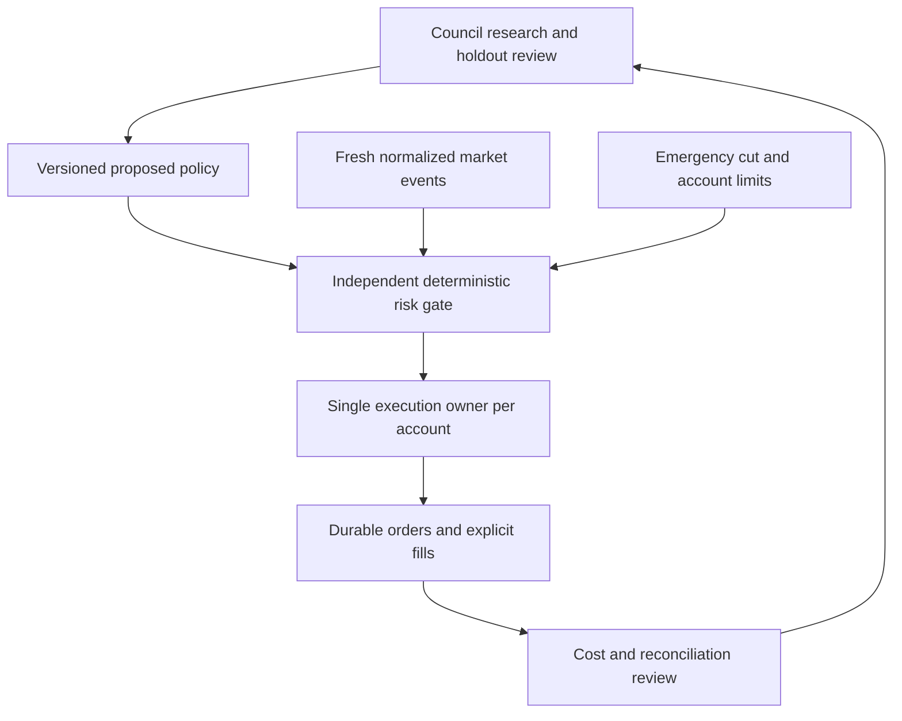

# Institutional mechanics for a personal Nexus Operative

Research date: 2026-10-18. Development strategy, not permission to connect an account, trade or release 1.0. Public product descriptions are vendor claims, not an independent performance audit or access to proprietary source. Proposed Nexus architecture below is our design inference.

The goal is a simple personal interface backed by rigorous execution mechanics: install, connect a supported account, choose risk, start Portal, then explicitly Engage. Institution-sized licensing and desk workflows are avoidable by building our own application around supported broker APIs. Account eligibility, market-data rights, broker limits, authentication and exchange access requirements still apply.

## Public mechanics worth adapting

| Reference | Documented mechanics | Nexus adaptation and current boundary |
| --- | --- | --- |
| [Bloomberg AIM](https://professional.bloomberg.com/products/trading/order-management-system/aim/) | Portfolio construction, order workflows, compliance and reconciliation. | One consistent path from proposed position to risk checks, original order identity, fills and accounting. Existing journals are a foundation; broker routing remains disconnected. |
| [Bloomberg PORT](https://professional.bloomberg.com/products/bloomberg-terminal/portfolio-analytics/) | Unified position/risk/performance views, attribution and scenario analysis. | Singularity for account movement, Fractal for individual positions; add defensible net performance, exposure and scenario attribution rather than decorative speed claims. |
| [EMSX programmer guide](https://emsx-api-doc.readthedocs.io/en/latest/programmable/index.html) | Request/response plus subscriptions; updates can precede responses; identifiers support matching and duplicate prevention. | An event-driven order state machine must reconcile out-of-order and duplicate updates. Reuse Nexus's immutable original IDs and uncertain-attempt recovery; never interpret a timeout as no order. Streaming integration is future work. |
| [FlexTRADER](https://flextrade.com/products/flextrader-execution-management-system/) | Execution automation, transaction-cost analysis and broker/algorithm selection. | Measure cost before optimizing routes. A future route selector must compare only eligible, fresh, funded paths and preserve unknown fees/liquidity. Multiple routes share account-wide limits. |
| [State Street Charles River OEMS](https://www.crd.com/solutions/charles-river-trader) | Connected portfolio/order/execution/compliance workflows, audit trails and post-trade handling. | One canonical inventory and consistent lifecycle across UI and execution, with independent risk checks and explicit reconciliation. A visually unified screen cannot replace reconciled state. |
| [Iress Order System](https://www.iress.com/software/trading-and-market-data/institutional-trading/order-system/) and [data interfaces](https://www.iress.com/software/trading-and-market-data/api-data-trading-solutions/hosting/) | Pre-trade checks, routing, FIX/API connectivity and normalized market data, including C++ interfaces. | Provider adapters feed a bounded common schema. Stream/book sequence gaps must pause affected decisions; more feeds do not establish provenance or eligibility automatically. |
| [Broadridge Tbricks, formerly Itiviti](https://www.broadridge.com/capability/front-office-solutions/principal-trading-market-making) | Modular server-side trading/quoting/hedging, risk controls and audit trails. | Keep the execution worker separate from the desktop, with explicit ownership and remote-stop acceptance before cloud operation. Quote-making/hedging are additional strategies needing their own evidence. |
| [AQR trading-cost research](https://www.aqr.com/insights/research/working-paper/trading-costs) | Empirical study of execution costs and price impact using actual institutional trading data. | Optimize measured implementation costs and capacity alongside forecasts. Its results are not Nexus performance evidence and its private trading data is not imported. |
| [IBKR TWS API](https://www.interactivebrokers.com/docs/tws-api/doc/introduction) and [error/pacing reference](https://www.interactivebrokers.com/docs/tws-api/doc/error-handling/error-codes) | Socket API with C++ and other language clients; documented message-rate restrictions. | A future approved adapter needs shared request budgets, subscriptions, pacing, stable order IDs and reconnect recovery. Message allowance is not a fill-rate promise; additional clients must not evade shared limits. |

## Speed and growth: the practical target

Nanosecond **timestamp precision** is useful for preserving event order. It does not mean nanosecond decisions, synchronized clocks, broker acknowledgments or fills. [Nasdaq's co-location description](https://www.nasdaq.com/products/north-american-markets/connectivity/co-location) describes a sub-50-microsecond order-to-ack network service in its own data center. That is neither an internet brokerage guarantee nor a Nexus measurement. IBKR's TWS error reference describes a 50-message/second limit; version/configuration-specific pacing still needs verification when integrating. Submissions, amendments, cancels and other requests can consume bandwidth without producing any fill.

Use distinct measurements for feed age, receive-to-decision, governor/queue delay, durable-commit time, send-to-ack and send-to-fill. Preserve p50/p95/p99 and failure rates on the complete accepted path. A C++ parser benchmark, nanosecond integer or internal matching engine does not establish exchange execution latency. Start with measured broker/feed budgets; do not promise a universal 30-fills/second target.

Compounding requires a repeatable positive net edge, controlled losses and available capacity. More frequent trading also repeats costs and mistakes. For illustration only: a forecast advantage of 2 basis points with 5 basis points of round-trip costs has a net expected disadvantage of 3 basis points per round trip. Council agreement alone cannot turn that into exponential growth. Abstention is an intentional outcome when evidence or cost coverage is missing.

## Target architecture: concurrent research, controlled execution

This is a target design. Current trained council output remains advisory and the fixed BTC virtual experiment remains separate. Use parallel learners and market readers to prepare bounded, expiring proposals; do not run conversational AI for each tick or give multiple agents independent spending authority. A reviewed policy should specify instruments, sizes, evidence horizon, expiry, allowed cost envelope and risk limits. Every execution still checks fresh state, stop fencing and account-wide reservations. Removing manual intervention does not remove those checks.

## First implemented component: original offline execution quality

`nexus/execution_quality.py` is an original bounded BTC/USD supplied-data diagnostic. It reports quantity-weighted price, signed decision-benchmark shortfall, a delay/spread/post-arrival decomposition, explicit supplied USD fees and separate unfilled opportunity cost. Positive shortfall means a worse price than the decision benchmark, negative means better. These are execution comparisons, not realized investment profit.

It deduplicates matching execution identities, rejects conflicts/overfills/crossed quotes and preserves integer nanoseconds. Missing fees stay unknown. An unfilled end mark is optional and never treated as an executable fill. No-fill cases cannot become zero-cost successful executions. The post-arrival residual cannot identify causal market impact, and caller-provided clocks, fills, fee links and source coverage remain unverified. It does not currently ingest journals or broker streams, select routes, train the council or alter order permission.

Run `python -m nexus.execution_quality` for a synthetic self-test containing only aggregate pass/fail checks. Real detailed review output contains private amounts and must stay outside Git; repository artifact checks reject its report mode. This fixture is also mandatory in the existing sixteen-profile release suite, separately from timed capacity treatments. No runtime dependency or copied institutional code was added.

The v0.159 companion `nexus/paper_execution_quality_review.py` now binds this arithmetic to exact-head locally accepted request/activity/pacing/acceptance histories. It derives all retained priced fills for one original request, checks original terms and repeats journal replay. `--paper-tool quality-review` makes the private review available in v0.159+ EXEs without desktop startup. Benchmark quotes and clock/event timing remain supplied/unverified; retained fees stay unlinked and all fee-inclusive results unknown. This is a local evidence bridge, not actual broker acceptance or automatic routing. Independently accepted quote capture and verified fee associations remain the next step.

The v0.160 internal quote-observation reader now offers a separately confirmed, mandatory-paced three-GET account/Alpaca-US-quote/account sequence with saved-key mutation/readback fences, source timestamp preservation and final freshness checks. It is a source-only acceptance primitive: no new UI/EXE command, automatic retention, original order-event binding, benchmark attestation or routing. It deliberately shares the existing60-second local read cooldown, so it is not a high-frequency feed. Bounded retained evidence and independently accepted event/time/fee bindings remain next.

## C++ and open-source candidates

| Candidate | Publicly reviewed license | Evaluation before adoption |
| --- | --- | --- |
| [QuickFIX C++](https://github.com/quickfix/quickfix), [license](https://github.com/quickfix/quickfix/blob/master/LICENSE) | QuickFIX Software License with redistribution/acknowledgment conditions; do not assume plain MIT. | Session sequence recovery, resend/gap behavior, dictionaries and disconnect fixtures. It is a protocol engine, not a strategy, broker entitlement or exchange membership. |
| [Simple Binary Encoding](https://github.com/aeron-io/simple-binary-encoding), [license](https://github.com/aeron-io/simple-binary-encoding/blob/master/LICENSE) | Apache-2.0; retain required notices and review bundled/generated components. The former real-logic repository redirects here. | Bounded schemas and low-allocation C++ codecs if measurements show serialization matters. It provides no exchange connectivity or risk engine. |
| [CppTrader](https://github.com/chronoxor/CppTrader), [license](https://github.com/chronoxor/CppTrader/blob/main/LICENSE) | MIT for the reviewed project; dependencies need separate review. | Order-book/ITCH replay experiments and local simulation. A matching-engine benchmark does not represent an external fill or broker performance. |

These are evaluated candidates, not installed dependencies or audited production components. Before copying any code, pin an exact upstream revision, review that revision and dependencies, retain license/copyright notices and add adversarial replay tests. Profile first; move a small isolated bottleneck into C++ only when an end-to-end benchmark justifies its additional build, memory-safety, ABI and installer burden. Keep desktop/research orchestration separate from an eventual native event-processing core. No private in-house hedge-fund source or proprietary algorithms are available from this review.

## Ordered development and acceptance

1. **Implemented foundation:** supplied execution-quality arithmetic and repeatable synthetic checks; verify exact-source Windows/security/browser workflows.
2. **Next:** accept the new exact-head journal/fill bridge on authorized paper-account data and native Windows profiles, then accept synchronized contemporaneous benchmark observations and fee associations. Bind the quality review to the exact account/order/data heads; do not substitute historical candles for executable quotes.
3. Add a bounded event-driven market/order adapter with sequence-gap detection, duplicates/out-of-order replay and reconnect/crash recovery. Respect shared provider budgets and preserve emergency-stop independence.
4. Add cost-aware, expiring policy proposals and portfolio-wide reservations; prove that multiple research paths cannot overspend, exceed exposure or duplicate an original order. Keep policies advisory until independent review and authorized paper integration.
5. Compare one eligible execution path with alternatives using net shortfall, completion, rejects and tail latency. Add smart routing and slicing only if measured costs/capacity justify them; aggressive activity must not bypass cancellation/stop headroom.
6. Measure sustained paper operation and net outcomes after verified fees, spread, slippage and downtime. Profile and selectively evaluate C++ only after locating a meaningful bottleneck.
7. Complete secure funding, separately governed live execution, encrypted durable cloud operation, independent security/risk review and owner acceptance under the existing full-1.0 gates. Personal deployment does not waive access or data requirements.

Research is date-bound. Recheck vendor/broker terms and current upstream licenses before any integration. Progress estimates do not increase merely because this document, a local test or a version number exists.
