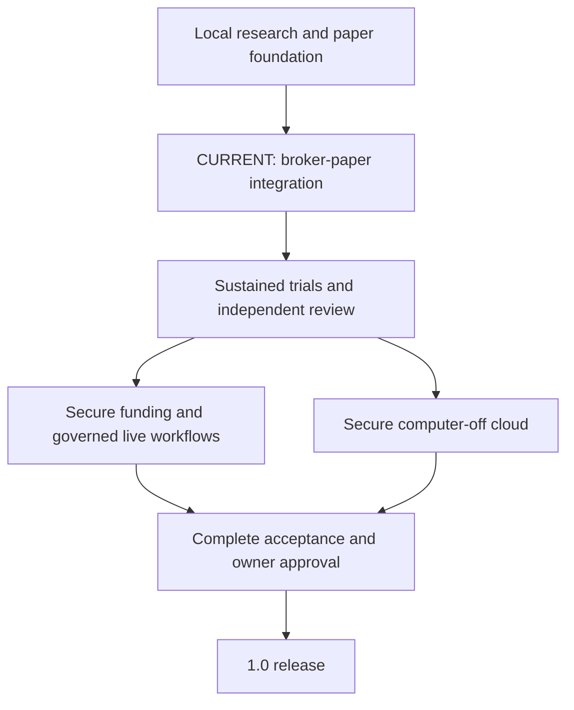

# Nexus Operative — read-only 1.0 roadmap

Revision: 0.292.0. Branch: `development/windows-portal-foundation`.

Generated from `nexus/release_roadmap.py`. View in PORTAL or `GET /api/roadmap`. Changes require source review; the application has no roadmap write endpoint.

Current position: local research and experimental local paper trading are implemented foundations; broker-paper integration and acceptance are the next major gate. Secure funding, governed live workflows, computer-off cloud and final independent/owner acceptance remain unfinished. Version numbers and passing test counts are not percent-complete estimates.

Current hardening: v0.292.0 freezes the pacing, activity-retention and acceptance-history paths exactly once at entry to the lower multi-account provider-POST/activity composition and the guarded provider-POST reconciliation composition. Mutable path-like inputs cannot redirect later accepted-activity, acceptance-status, account-evidence or final replay reads to byte-identical clones. The provider-POST budget and request journals remain independently pinned. No provider request, credential access, retry, continuation, journal write, ledger, order, funding, Portal or release authority is added. Injected cloned-path tests do not prove provider source, activity or fee coverage, reference semantics, posting time, actual holds, settlement, spendable funds, native power-loss durability or profitability. Actual-account acceptance and sustained trials remain unverified. Rough implementation stays about 40% (30–45%, low confidence), with 0/9 fully accepted major stages.

| Milestone | Status | Evidence | Remaining acceptance |
| --- | --- | --- | --- |
| M1: Windows packaging and recovery | PARTIAL | Windows test, EXE startup and installer workflows; passive portfolio and forward-history/session/capacity reads preserve absent storage; existing state uses read-only transactions, combined forward polling shares one evidence snapshot; recovery/order/session reads use read-only journal replay and read-only linked-portfolio attachment, with missing history distinguished from flat-account proof; installed smoke explicitly exercises dashboard/recovery reads; durable order recovery; installed-process/reinstall/uninstall smoke with explicit disposable fresh/saved setup profiles and settings-byte preservation assertions, plus distribution checksum tooling; verified offline backup/new-directory restore tooling and fresh-process linked-ledger/quote-evidence recovery drill and installed-API restored-data smoke tooling with pinned prior-version fixture support and default Windows data-layout checks; documented beginner help for all PORTAL controls and isolated headless-browser acceptance tooling; seven named workspaces, friendly To Do introduction and automatic read-only startup checks with a plain-language purpose and setup scope for every box; new unused settings receive an atomic $10,000 virtual budget and Terrestrial-only entry preset, preserved saved/OFF choices and on-Engage compatible virtual accounting remove redundant form setup. | Exact-SHA v0.130.0 installer/reinstall/uninstall and pinned v0.64 data recovery steps passed; record clean-machine native-window, ordinary-user profile/ACL and prior-installer upgrade acceptance. |
| M2: Market data and provenance | PARTIAL | Public observation, timestamp/gap checks, historical admission and source diagnostics; redirect-disabled public transport with exact response-URL checks; canonical compressed hub bars with cross-collector deduplication, conflict quarantine and hash-verified sealed datasets; bounded public candle collection selected by default on explicit Portal start, closed-boundary request coalescing, pre-network storage checks and receipt-time clock/stop fencing. | Independent provenance review; missing/revised/conflicting data and outage evidence. |
| M3: Decision speed and risk authority | PARTIAL | Bounded local research decision queue and retained-ID limits with invalid-clock rejection; disposable bounded linked-ledger burst timing, overflow/expiry and halt flushing; individual Terrestrial/Solar/Universal entry permissions with complete saved-setting validation, transactional enable admission and independent OFF under review; bounded per-product public quote request sharing with clock-fenced cache reuse and process-local transport/avoided-request diagnostics. | Measure full durable path under bursts; verify expiry, overload and permissions throughout autonomy. |
| M4: Order lifecycle and portfolio reconciliation | PARTIAL | Partial/full priced fills, fees, idempotency, cancellation, durable recovery; atomic opt-in paper-ledger linking, partial-position reconstruction, adverse quote-cost assumptions, post-lock runtime exchange/receipt freshness and expiry/stop checks, durable expiry, cleanup-failure pauses and forward process-death tests before/after fill commit. | Extend interruption/quote-path stress; independently review execution assumptions, existing-account migration and reconciliation. |
| M5: Durable latency and capacity | PARTIAL | Replay-validated checkpoints, two-snapshot retention, checkpoint interruption tests and isolated gateway and linked-ledger/tier-inclusive p50/p95/p99 benchmark; capacity admission diagnostics; opt-in atomic quote-order fixture treatment with retained commands and crash rollback tests; explicit logical archival with retained IDs and commands; read-only sustained-trial readiness reports quote/session headroom plus conservative every-cycle durable command and ID bounds; an explicit application-closed installed/source rotation tool verifies an offline archive, prepares a fresh halted candidate, retains a second exact source recovery copy, installs the candidate behind a persistent fail-closed marker and can explicitly recover an interrupted pair replacement or roll a completed install back. Archive/candidate/recovery publication, the marker and both live pair replacements use one durable move boundary: parent-directory fsync on POSIX and MoveFileExW WRITE_THROUGH on Windows, while file contents remain separately flushed. Each new v3 candidate retains replay-validated generation lineage plus a bounded private fingerprint set for all retired client-order IDs, rejecting cross-epoch reuse before journal mutation; v1/v2 candidate and legacy recovery/marker records remain readable. A legacy v2 source without fingerprints can proceed only through a private v1 baseline review bound to the exact closed source generation, epoch, replay digest and verified archive manifest. Known archived IDs must be included, raw IDs are never copied into the candidate, and the v4 lineage labels the result OPERATOR_REVIEWED_UNATTESTED. The mandatory operations fixture repeats four synthetic generations and 48 terminal orders, replays every retained archive/candidate/recovery set, verifies all 48 retired-ID fingerprints, exercises the legacy migration fence and requires each installed live journal to return to its four-command halted baseline. | Extended multi-epoch long-run scalability and pressure acceptance, sustained queue pressure, source-retirement policy and independent archive/private-volume/native Windows power-loss/profile/ACL acceptance remain open. The bounded synthetic fixture is not duration, market throughput or native interruption evidence. Write-through metadata publication reduces a known Windows durability gap but is not physical power-loss proof. The private fingerprint fence covers only a complete retained lineage; it does not establish caller identity, other-host coordination or broker-wide idempotency. A reviewed legacy baseline records an operator completeness assertion, not source attestation; independent review of the actual private scope remains required. Installation reclaims live journal capacity but preserves source history externally, never resumes operation and grants no broker, funds, live or release authority; the conservative trial bound is not expected trading volume or validated broker throughput. |
| M6: Scientific strategy evidence | PARTIAL | Chronological research, holdout, regime and cost-stress modules; persisted multi-horizon ridge momentum baselines with training-only scaling, purged chronological holdout, naive/momentum comparisons, generation invalidation and compact research signals; three built-in trained feature specialists with fixed three-block baseline checks, disagreement reporting and independent deterministic validation/provenance reviewers; versioned saved research packs and unchanged-data reuse; three expanding-window refits with purged training targets, delayed nonoverlapping modeled fills, fixed cost scenarios and fold-consistency checks; shared causal feature computation and serialized preparation; engine-started bounded learning with captured public/saved-only scope, bounded polls/fit attempts, generation skips, local OS ownership and stop-fenced publication. | Independent model calibration and walk-forward/forward evidence, licensed shared-source provenance, delisting/survivorship review and performance audit; trained baselines are not validated market edge. |
| M7: Unattended paper operation | PARTIAL | Explicitly started BTC public-quote paper runner; separate research-engine and explicit Engage Paper controls, independent emergency throttle cut preserving research, reset/start race fencing, dedicated coalesced emergency cleanup independent of feed/general workers, plus a separate installed emergency-stop process that publishes the durable latch before SQLite, starts no Portal/network/vault/reset path, is adopted by a running API and is consulted at paper start/quote/submit/fill boundaries; cancellation-shielded cut completion and pending/verified/unconfirmed status, queued-reset epoch checks, an immediate local runner cut signal and post-lock veto during real SQLite contention, independent bounded local cut-intent persistence and conservative restart recovery, native Windows read-only journal fault fencing with explicit post-recovery cleanup retry, process-death-before/after-cut-commit recovery fixtures, tier-gated entries, exits, halt/pause, feed-failure stop, durable session counters/heartbeats and fingerprinted fixed-policy admission; retained quote evidence, quote/fill price/quantity/fee/policy crosschecks, portable review summaries and exclusive local process ownership, clock-discontinuity pauses and exchange-regression warmup fencing and retained-storage preflight with operator runbook; bounded repeatable forward-runner fixture drill with fresh-process evidence comparison; operator recovery snapshot and pending-remainder inspect/cancel controls; Singularity account-equity and Fractal coordinated shared-time position constellation plus per-holding observed history with retained ranges and journal adjustment inspection and transactionally retained closed-day observation history with bounded active/total admission and range responses plus observation database byte/free-disk budgets and rollback-safe allocation failure handling. | Extend native Windows acceptance to ordinary-user ACL inheritance and whole-machine pressure; run sustained real-feed forward validation, independent policy evidence review and multi-market scheduling. Local subprocess/file-attribute outage tests are not broker or market performance evidence. |
| M8: Broker paper integration and operations | OPEN | Provider-neutral design plus disconnected Alpaca paper IOC-limit previews and bounded identity/status/cumulative-fill diagnostics and explicit execution/asset-fee balance projections plus chronological fee-reserved funding audits with equal-time ambiguity and nonterminal-reservation review using repeatable fixtures; a bounded account-scoped durable request/uncertain-attempt/observation journal with replay validation and crash/lost-ack fixtures, persisted lookup-attempt limits, shared cooldowns and conservative timeout/not-found/rate-limit/authentication outcome handling, read-only pending-ticket review and explicit current-head-fenced lookup-interruption records preserving attempts and order uncertainty; an opt-in fixed-host GET-only paper account inspection primitive with bounded reads, redirect rejection, clock/permission fencing, stable account identity and conservative observed cash/BTC checks, explicit Windows credential pair storage/removal with verified readback, local mutation fencing and bounded same-origin Portal controls for separately confirmed one-time inspection; an explicit original-client-ID recovery coordinator sharing the bounded reader, persisting attempts before IO and normalized outcomes under post-lock clock/permission checks, with saved-key mutation fencing and crash/uncertainty retention; a bounded supplied Trading REST BTC/USD activity adapter with explicit fill prices/quantities, semantic deduplication, nanosecond time preservation and cumulative-chain checks, keeping received-asset fee debits unlinked and date semantics/coverage unverified; an internal explicitly confirmed two-page paper activity collector with canonical creation-window paths, exact opaque cursors, account/key/time fencing and explicit partial/end-observed reports, retaining no verified coverage or automatic continuation; optional account-bound local activity retention with canonical record reuse, immutable order bindings, bounded full replay and atomic crash/lost-return recovery, read-only cross-batch fill-chain review with snapshot conflict/revision checks and declared-window gap diagnostics; an optional explicit local paper-read reservation journal shared across inspection, activity collection and recovery, retaining cooldown/rate/auth/interruption blocks across cooperating processes and holding local OS ownership through read cleanup, with explicit account/head/token-fenced interruption review preserving unknown outcomes and full-day cooldowns; a pure combined supplied balance review compares explicit linked fills/fees with total cash/BTC while separately checking availability/open IOC terms without inferring provider holds or spending permission; optional collection observations preserve bounded page identities, opaque cursor chains, read timing and normalized-content/query digests within atomic activity receipts, without attesting source or coverage; an exact-account/head-bound retained gross-fill and total-balance residual review preserves nanosecond groups, rejects stale/concurrently changed history and leaves all fee links/posting scope/funding unverified; the explicit paper inspector and Accounts display now separate reported cash, non-margin buying power, total/available BTC and unknown/unavailable differences with normalized fingerprints/sampled timing, fail-fast malformed/foreign collections and no non-USD cash projection; portable allowlisted JSON observations now support explicit local download and bounded offline content-consistency validation without source attestation; a read-only portable-observation pair review now binds account/manifests/history head, checks sequential read windows for retained boundary fills and conditionally compares total balances without rounding nanoseconds or promoting source/funds authority; the existing confirmed inspector and Accounts readout also summarize bounded simple IOC buy-limit principal and sell remainders, deduplicate matching terms, preserve nanosecond identities and leave unsupported/conflicting aggregates unknown without claiming holds; an internal explicitly confirmed single-attempt Alpaca paper POST boundary now checks fixed account/position/asset endpoints, requires an exact-head shared-local provider POST budget, commits both reservations before IO, rechecks permission/stop/credentials after the marker and never retries; a separate explicit reviewed recovery boundary clears only an ambiguous shared-budget latch after two exact-head replays prove the original client ID has a retained terminal observation, while preserving the full cooldown/history and permanently attempted request; a bounded read-only exact-head history composition now joins every completed POST attempt to the checked submission marker in up to seven account request journals, requires RESPONSE_OBSERVED to retain a request snapshot and NOT_SENT to retain none while preserving OUTCOME_UNKNOWN uncertainty, and refuses pending/interrupted, omitted, stale, changing, legacy, unbound, duplicate or related-path evidence; a second bounded read-only composition joins those exact POST attempts through the same request heads to complete accepted activity histories, requiring observed and recovered attempts to match retained order/fill evidence, NOT_SENT to retain no observation/fills and unresolved unknown outcomes to remain blocked; a single-account private exact-head composition now joins that POST/activity result to complete request/fill replay and four ordered stability-guarded balance observations, rechecking every journal and retaining gross-only residuals as non-authoritative diagnostics; a stricter fee-bearing composition additionally partitions every accepted receipt and requires every retained fee record to carry an explicit order/execution reference pair resolving to an accepted original fill while retaining reference semantics, date-only timing, fee coverage, posting allocation, holds and funds as unverified; a further known-fee reserve composition requires every accepted order to participate, reserves only retained explicitly referenced fee obligations at their accepted fill groups, rejects unfunded group debits and requires the local ending totals to match supplied closing inventory without promoting completeness, posting, holds or spendable-funds authority; validated with injected responses only, with no Portal, saved-write-credential or strategy route; an explicit source-only Windows saved-pair acceptance probe composes the account-ID-bound four-GET inspector with caller-selected durable local pacing, vault-silent pacing status and a content-bound allowlisted open-IOC aggregate from the same read, without granting provider/account/fee/hold/funding/live acceptance; Accounts now offers separately confirmed managed paced reads and vault-silent retained pacing review, with account-hashed private OS-profile storage and no automatic retry/reset; pacing, activity and request journals now preflight regular single-link files, bounded headers and DELETE-mode history, rejecting WAL layouts and sidecars before SQLite without conversion or evidence deletion; private cross-journal status replays every accepted receipt and exact successful pacing/activity head transition, separating latest-tail from historical-content disagreement without automatic repair; a read-only reconciliation composition requires no unverified legacy baseline and exactly one accepted record per retained pacing session, activity batch and collection observation, binds two portable observation manifests to that exact retained activity head and requires an exact nanosecond union of accepted declared creation windows to cover the full observation envelope before arithmetic, then rechecks all journals without promoting source, provider boundaries, received coverage, funds or routing authority.; a no-network supplied Activity SSE schema review now fail-closes to BTC/USD TRD fills and one-to-one USD fees, requires strict ULID cursor order and unique stable ref IDs, binds each admitted fee parent_id to a supplied fill, and rejects corrections, busts, bulk fees, FX and unsupported financial activities without claiming stream entitlement, delivery, replay coverage or provider source; a supplied two-segment reconnect review now requires the exact last processed ULID as since_id, idempotently deduplicates immutable ref_id redelivery, advances only on later event IDs and rechecks fee-parent links, while durable cursor storage, automatic backoff, real reconnect and complete replay remain explicitly unverified; a bounded supplied-wire Activity SSE session review now binds the exact v2beta1 since_id target, text/event-stream metadata, arbitrary byte chunks, strict UTF-8/SSE/JSON framing, heartbeats and the existing linked trade/fee envelope review, while slow-consumer drops and internal-error comments require reconnect review and remain ineligible for cursor checkpoint authority; an explicitly confirmed single-attempt paper Activity SSE transport now opens only the exact since_id target, disables proxies and redirects, validates streaming metadata before reading, fences every bounded read with permission, emergency-stop, credential and clock checks, and passes a complete two-event segment through the strict wire review without retry, reconnect, cursor mutation or authority; an explicitly confirmed one-attempt Activity SSE checkpoint coordinator now binds a caller-supplied private prior segment and the exact cursor-journal head to one fixed-target resumption GET, re-proves immutable duplicate redelivery plus forward advancement, rejects interruption comments and commits at most one crash-recoverable cursor transition while retaining no automatic retry/backoff, ledger, routing or funds authority; a private account-bound reconnect budget now reserves every explicitly confirmed SSE attempt before IO, enforces a fixed 1/2/4/8-second process-recoverable backoff with a four-attempt cap, blocks pending/lost-result episodes and composes one due attempt with the exact cursor checkpoint while never sleeping, looping or retrying automatically; a reservation-bound cursor-checkpoint receipt and separately confirmed no-network result reconciliation now close only the exact pending reconnect attempt after a checkpoint/result crash window, reject legacy/foreign/stale evidence and make lost recovery acknowledgment replay idempotent without another provider request; an exact-head, doubly confirmed no-network uncertainty close now permanently retires a reconnect reservation whose provider outcome could not be durably timestamped, retains the consumed attempt and review requirement, schedules no retry and makes exact lost-close acknowledgement replay byte-stable; after a failed reconnect attempt with no cursor transition, outcome-clock failure now durably closes from the last trusted admission time as terminal review state, recovering a lost result acknowledgement by inspection and never creating retry authority; successful or cursor-advanced attempts remain pending for exact checkpoint reconciliation; successful reconnect completion and explicit no-network checkpoint reconciliation now recover a lost result acknowledgement in the same call only when the current terminal result exactly binds the reservation token, requested and final success values, zero retry fields and checkpoint receipt; a new write also binds the supplied result time, while an uncommitted or mismatched result remains uncertain without another provider request; failed reconnect results now apply the same exact same-call acknowledgement recovery to retry, review, checkpoint-uncertain, provider-delay and emergency-stop-converted outcomes, requiring the current result head, reservation token, result time, requested/final values, zero checkpoint fields and exact delay state; uncommitted or mismatched results remain pending and the original provider failure is suppressed only by a fixed uncertainty diagnostic; automatic closure after a failed reconnect whose completion clock is unavailable, invalid or regressing now applies the same exact current-result proof, including result-head identity, reservation token, trusted admission time, requested/final review outcome, absent checkpoint fields and zero delay state; failed or malformed recovery inspection returns a fixed uncertainty diagnostic without exposing private faults or repeating provider IO; post-attempt cursor inspection is now a fixed fail-closed boundary: unreadable, malformed or invalid cursor state returns a sanitized cursor-uncertainty diagnostic, retains the exact pending reconnect reservation with no result or retry due, and performs no second provider request; only one valid digest head may decide unchanged versus advanced checkpoint state; explicit checkpoint reconciliation now treats every post-result reconnect-budget inspection as an untrusted crash-recovery boundary: lost acknowledgements, unreadable storage and malformed retained views produce only fixed recovery uncertainty, preserve any committed terminal result and never repeat provider IO; exact completion still requires stable result-head, reservation, timestamp and checkpoint receipt agreement; explicit checkpoint reconciliation now also sanitizes its initial reconnect-budget and cursor-binding preflight views before any recovery write: unreadable or malformed budget state returns fixed recovery-state uncertainty, unreadable or malformed cursor binding returns fixed binding-review failure, and neither path mutates the pending reservation or repeats provider IO; reconnect admission now treats its initial cursor inspection as the same fail-closed boundary used after an attempt: unreadable, malformed or invalid state returns fixed cursor-state uncertainty before reservation or provider IO, leaving both stores untouched and granting no retry authority; reconnect admission now also validates the initial reconnect-budget view before reservation: unreadable storage, missing fields, invalid digests, clocks, counters, flags or reasons return fixed admission-state uncertainty, expose no private fault, leave both stores untouched and perform no provider IO; reconnect reservation now treats any non-policy exception as a fail-closed acknowledgement boundary: failures before commit and lost acknowledgements after commit return fixed reservation-state uncertainty, never start provider IO, and preserve any durably pending reservation with no result or retry due for explicit review; reconnect reservation acknowledgements are now admitted only when their token/head, cursor binding, bounded attempt and exact boolean replay/authorization fields form one internally consistent result; missing, malformed or conflicting fields return fixed reservation-state uncertainty before provider IO and leave any committed reservation pending for explicit review; a structurally valid reconnect reservation acknowledgement now receives an independent exact durable-journal proof before provider IO: the pending token/current head, attempt, admitted cursor, prior budget head, evaluation time, reason and eligible prior retry state must agree; forged uncommitted returns, corrupted fields and unreadable post-commit state fail with fixed reservation uncertainty and leave any real reservation pending without request authority; the exact reconnect reservation is now re-proved at every downstream permission fence, including the transport checkpoint immediately before opening the provider request; a concurrent result, changed token or unreadable journal revokes stale request authority with fixed reservation uncertainty, preserves the current durable owner state and performs no provider IO; the explicit local emergency-stop abort, retry-wait close and outcome-uncertainty close now pin the exact reconnect-budget path/account binding across every callback, replay, transaction and result acknowledgement, returning fixed store-binding uncertainty before a retargeted store can be inspected or written; reconnect-budget admission and terminal-result persistence now pin their own exact path/account binding across initial replay, both emergency-stop samples, exact-head transactions and final acknowledgement inspection, rolling back a retargeted write and preserving a replayable schema-only fresh journal; the reconnect-budget public inspection boundary now pins its exact path/account identity across file preflight, database connection and full journal replay, returning fixed store-binding uncertainty rather than a mixed-scope view if any internal seam retargets the mutable store | Accept the internal paper POST boundary, shared-local provider budget and terminal original-ID recovery against an authorized account; add separately scoped saved write credentials, broker-wide/distributed POST coordination and explicit operator controls only after review; complete actual execution/fee/hold/funds reconciliation and sustained acceptance. IBKR paper then Coinbase Advanced expansion. |
| M9: Release acceptance and authorization | OPEN | 0.x numbering and release gates enforced; read-only retained forward coverage review revalidates recorded eligible quotes under the admitted policy before measuring a requested72-hour/95-percent target using clipped, unioned same-session public-labeled eligible intervals, excludes injection/gaps and leaves sustained-market/account acceptance unverified; repeatable source-fingerprinted offline trial suite covers 20 forward sessions, 24 operation rounds, backup/restore, durable capacity and real loopback HTTP startup/shutdown; fresh-install stop inspection avoids accounting initialization; bounded origin-first optional-AI credential controls use fixed errors, exact backend binding and verified save/remove readback. Public-repository hardening adds checksum-pinned full reachable-history secret/artifact scans, immutable Action references, nonpersistent checkout credentials, dependency updates/code ownership, a global loopback/Host/Origin boundary, no-store API responses and password-encrypted observation-copy tooling and explicit encrypted-input offline pair reviews without decrypted files; admin settings, historical logs/artifacts, default-branch policy adoption and native disk/ACL acceptance remain separate. Saved trial evidence is revalidated against every required profile and the exact current source; distribution checksums bind the bundled offline report as well as binaries, without attesting CI or approving release; real loopback HTTP trials now exercise paced paper reads with injected vault/transport seams, concurrent key removal, revoked-result suppression, retained cooldown/pending state and vault/network-silent fresh-process replay. Mandatory acceptance recovery observes a real pre-commit rollback sidecar, fingerprints all three main journals plus rollback/WAL/shared-memory sidecars and re-derives every accepted collection scope/account fields/observation/canonical activity input plus exact pacing/activity head transition from its retained receipt across fresh-process status. Release-run failures expose only allowlisted profile-specific child/timeout codes while suppressing child stderr, exception text, paths and environment data. See RELEASE_ACCEPTANCE.md for scope and unverified gates. | Independent security/risk review, operator runbook, complete acceptance evidence and explicit owner approval for 1.0. Live-money activation requires separate authorization. |

## Product milestones: funding, autonomy and final release

| Stage | Status | Built so far | Still required |
| --- | --- | --- | --- |
| D1: Usable research application | FOUNDATION_IMPLEMENTED | Windows packaging, seven workspaces, beginner help, Matrix views and engine/throttle controls exist. New unused installations receive recommended local paper defaults; To Do explains Start Portal, separate Engage, each check’s purpose and optional/future scope. | Clean-machine/native-window/profile and upgrade acceptance; keep startup and recovery dependable. |
| D2: Learning models with defensible strategy evidence | PARTIAL | Deduplicated local history, bounded public collection, trained numerical council, held-out and modeled cost checks exist. | Independent provenance, calibration and sustained forward evaluation; verify net results after costs and drawdowns before governed policy promotion. |
| D3: Autonomous paper trading | EXPERIMENTAL_IMPLEMENTED | Explicit Engage Paper runs the fixed BTC experiment with virtual funds, tier gates, durable accounting, recovery and an independent emergency cut. | Sustained real-feed reliability, incident evidence and reviewed strategy quality. Current council models do not direct orders. |
| D4: Connected broker paper trading | OPEN | Disconnected Alpaca paper request/status/fee fixtures, durable account-scoped request recovery and retained lookup pacing/outcome diagnostics and retrospective fee-reserved funding checks and a separately opt-in paper account inspector with Windows credential onboarding and explicit read-only Portal controls and an internal original-ID recovery coordinator bound to retained request terms and a supplied REST fill/fee-debit normalizer with an internal bounded two-page collector and optional account-bound replay-validated local activity retention with cross-batch snapshot/fill/window review and unverified fee links plus optional durable shared local read reservations and owned interruption review plus combined supplied balance/availability/open-term diagnostics and retained collection observations plus head-bound nanosecond gross-fill/residual diagnostics and beginner-facing separated inventory observations, private portable report download/offline validation, head-bound observation/activity comparison, reported open-IOC terms and a source-only paced private-activity acceptance record with replay-validated cross-journal bindings, explicit unbound/latest-content/historical-content disagreement recovery classification and mandatory before/after-commit process-death release evidence that fingerprints the complete cooperating SQLite file set and re-derives every accepted content record and exact pacing/activity transition from its retained receipt, plus an exact-head portable-observation reconciliation composition with before/after journal replay and a caller-driven durable four-attempt Activity SSE reconnect budget with fixed backoff, exist; an internal single-attempt paper POST boundary with an exact-head shared-local provider budget and bounded cross-journal marker/outcome/recovery history review now exists with injected tests only; terminal recovery events must bind back to the exact request prefix retaining the matching terminal original-ID observation, but it has no saved write credential, Portal or strategy route and does not attest an account or broker-wide quota. An explicit one-attempt Activity SSE coordinator now composes the fixed-target transport, private prior segment, strict reconnect review and exact-head cursor journal into one fail-closed local checkpoint; injected tests only. | Accept this exact-head reconnect/checkpoint path on an authorized paper account and native private volume; verify account entitlement, provider source/delivery and replay coverage, slow-consumer recovery and broker-wide/distributed coordination before any automatic reconnect loop. Authorized-account acceptance of the single-attempt boundary and shared-local budget, separately scoped saved write credentials, explicit operator integration, broker-wide/distributed POST coordination, authenticated recovery/collection, durable activity coverage, verified execution/fee associations and cash/position/hold/funds reconciliation. |
| D5: Secure deposits and available-funds verification | NOT_IMPLEMENTED | Funding is preview-only. No bank link, deposit, withdrawal or real balance access exists. | Use a selected provider-held account and reviewed hosted funding workflow; isolate credentials, never collect raw banking credentials, reconcile pending/settled transfers and spendable cash, verify failure/reversal and duplicate handling. No app custody or automatic transfers. |
| D6: Governed autonomous live trading | BLOCKED | Real-money execution remains disabled; research and simulated balances cannot authorize spending. | Validated and explicitly approved policy, live provider integration, reconciled spendable funds, hard exposure/loss/order caps, pacing, monitoring, emergency cut and independently reviewed limited rollout. Separate owner authorization is mandatory. |
| D7: Secure computer-off operation and shared Matrix hub | PLANNED | Local capped data/model stores and process ownership exist; cloud deployment and instance synchronization do not. | Select an eligible free-tier host without automatic billing; authenticated controls, encryption/key recovery, durable shared state, distributed fencing, quotas, remote stop and multi-day computer-off paper tests. |
| D8: Speed, resilience and independent acceptance | PARTIAL | Durable latency/queue fixtures, crash/recovery tests, Windows workflows, shared public-quote intake diagnostics, actual ASGI emergency-control tests under saturated general workers and repeatable bounded process/HTTP/restore/capacity trials with source fingerprints, reachable-history publication checks and opt-in authenticated encrypted observation copies and explicit in-memory encrypted pair reviews exist. | Measure full feed-to-decision-to-broker path, sustained load/outages, long-run storage, security/risk review and documented operations; fixture speed is not exchange fill speed. |
| D9: 1.0 production release | BLOCKED | The project remains a 0.x prerelease with source-controlled acceptance gates. | All agreed production workflows, including secure funding and governed autonomous execution, must be implemented and accepted; complete testing, reconciliation, security/risk review, recovery/runbooks, cloud acceptance for the agreed scope and explicit owner release approval. A release never activates live trading by itself. |

Secure provider-held funding, governed autonomous execution and computer-off operation are product goals. All agreed production workflows require acceptance before 1.0; live activation always requires separate authorization.

## Rough implementation progress — not release acceptance

As of 2026-10-18: about 40% of the full agreed implementation scope (rough range 30–45%; low confidence). 0/9 major stages fully accepted. No release date established.

Manual relative-scope weights multiplied by rough implementation estimates; overall rounded to the nearest5 percentage points. Estimates include foundations and partial work, not independently accepted operations. They are not measured task/hour completion or time remaining. Reusable foundations can contribute to unfinished integrations. The range is judgment, not a statistical confidence interval.

| Stage | Relative scope weight | Rough implementation | Acceptance |
| --- | --- | --- | --- |
| D1: Usable research application | 10% | 85% | OPEN |
| D2: Learning models with defensible strategy evidence | 15% | 55% | OPEN |
| D3: Autonomous paper trading | 15% | 70% | OPEN |
| D4: Connected broker paper trading | 20% | 35% | OPEN |
| D5: Secure deposits and available-funds verification | 10% | 0% | OPEN |
| D6: Governed autonomous live trading | 10% | 10% | OPEN |
| D7: Secure computer-off operation and shared Matrix hub | 10% | 10% | OPEN |
| D8: Speed, resilience and independent acceptance | 5% | 35% | OPEN |
| D9: 1.0 production release | 5% | 0% | OPEN |

Reassess after meaningful integration, acceptance or scope changes; no automatic increase for versions, patches or passing test counts. Estimates may decrease. Report occasionally in development updates.

Assessment basis: commit `b2a9bc6da241bb8c7f0e1dfe1b2ed6b251bf467c`; exact weighted index 38.0 before rounding. This is an assessment, not an independently measured completion percentage or permission.

## Standing target settings (verify actual runtime separately)

- broad_refresh_seconds: 5
- ranking_seconds: 15
- ai_candidate_count: 30
- adaptive_acceleration: True
- autonomous_paper_first: True

## Intended production experience

1. Install and open Nexus with included intelligence and practical defaults.
2. Securely authorize and fund an account through the financial provider; bank linking where required stays in the provider-hosted flow. Not implemented.
3. Choose a risk allowance that limits the engine; returns are not guaranteed.
4. Press Engage to run automatic readiness checks and start separately authorized autonomous execution. Live execution is not implemented.

Bank authorization, real funding and live execution are future work. Built-in numerical intelligence is included; external AI is optional. The current fixed BTC paper policy executes trades; learned council output remains advisory.

## Minimal first-run setup

Open the EXE, Start Portal, then separately confirm Engage Paper; no settings editing on a new unused installation.

Defaults: $10,000 virtual budget; Terrestrial entry allowance; BTC hourly research with1,000 bars; bounded public-history collection and included numerical models. Solar/Universal, paid AI and provider accounts are optional. Existing settings, explicit OFF selections and retained accounting/stop history are preserved. Compatible unused virtual accounting is created only on confirmed Engage; sessions never restart automatically.

Every To Do checkbox explains what it checks, why it matters and whether it is included, required for saving/paper configuration, created on Engage, optional or future work. Optional and future boxes may stay unticked.

Validate the fresh native EXE, ordinary profile, saved-choice upgrade, outage and recovery paths. Recommended defaults are not proven optimal returns.

## Next sequence

1. Accept the explicit one-attempt Activity SSE reconnect/checkpoint coordinator on an authorized paper account and native private Windows volume. Keep the prior segment, cursor journal and resulting report private; exercise exact-head races, revoked permission, the independent emergency stop, credential changes, disconnects, slow-consumer/internal-error frames, lost acknowledgments and process restart. Do not add an automatic reconnect loop until provider source/delivery/replay coverage, bounded backoff, broker-wide coordination and native durability are independently accepted.
2. Use the private exact-response bundle review on an authorized adjacent ACCOUNT_INVENTORY and current-tail ACTIVITY_COLLECTION pair: preserve every exact response body plus the portable account observation outside Git, pin the shared current pacing/activity heads and both session heads, and independently review the composed normalization result. Local byte/hash agreement is not provider identity, source or received-activity coverage, account ownership, fee/hold/funds acceptance or routing permission.
3. Use the private account-response review on an authorized retained ACCOUNT_INVENTORY session: preserve the exact four response bodies and portable observation outside Git, pin the current pacing head and session head, and independently review the normalization result. Exact local byte/hash agreement is not provider identity, source coverage, account ownership, fee/hold/funds acceptance or routing permission.
4. Use the private activity-response review on an authorized retained ACTIVITY_COLLECTION session: preserve the exact account and one/two page response bodies outside Git, pin the current pacing/activity heads and session head, and independently replay the retained normalized receipt. Exact local byte/hash agreement does not prove source or creation/execution/fee coverage, posting times, fee links, holds, funds or routing permission.
5. Accept retained checked-admission samples on authorized native paper histories, including full prefix replay and later cross-request clock regression. Keep older markers untimed. Independently review actual send/arrival event capture, clock domains and contemporaneous quotes before creating execution benchmarks; admission is not proof of transport or broker arrival.
6. Accept the separately confirmed EXE quote-capture, offline status and encrypted full-chain evidence review on authorized paper-account/native-profile history. Preserve one quote per successful retained pacing transition, original-request prefixes and interruption blocks; accept the new declared-operation history, review central budget coordination and a complete mixed-operation receipt model, and add exact original-event-time bindings before deriving decision/arrival benchmarks; do not treat a latest quote, local clock or reported size as verified order arrival, executable liquidity or latency.
7. Accept the exact-head paper execution-quality review on authorized retained account history and native Windows builds. Accept the exact local original-request event binding, then add independently reviewed contemporaneous benchmark/arrival quote capture, transport-event evidence, clock-domain evidence and verified fee links before net-cost or broker-latency claims; preserve unknown fees and include every retained fill.
8. Verify all fourteen EXE paper tools on standalone and installed Windows builds, including exact-byte account/activity response normalization, the application-closed order-offload copy, private exact-head quality review, unchanged inputs, unknown fees and unverified benchmark authority; preserve current-head/public account review, crypto, no default-data/UI startup and actual account/profile acceptance. Response reviews require private bodies outside Git and grant no source, coverage or funds authority; quality review requires v0.159+; quote-capture requires v0.162+ and explicit confirmation for a read; encrypted full-chain quote evidence requires v0.163+ and a hidden password, with actual native/private-volume/ACL recovery acceptance still required.
9. Accept durable request-origin replay on authorized paper data: verify stored v3 request heads against historical prefixes and exact retained order inputs across restarts and later appends; retain mixed v2 history without inventing origin bindings or authorizing routing.
10. Accept request-journal-derived activity collection on authorized Windows paper data, including changed heads during reads/retention/acceptance and lost returns; original observations and local hashes remain unverified, and no fee, funds or routing authority follows.
11. Use the private combined account-evidence review on authorized retained paper data: bind original requests, accepted fills and opening/closing inventory to common heads, investigate term violations and gross-only differences, and obtain separate source/fee/hold/funds acceptance before any routing.
12. Accept bounded next-request recovery on an authorized Windows paper account with real retained request history, exact-head races, shared pacing, interruptions and original-ID outcomes. Use the explicit exact-head account-recovery tool only after reviewing a blocked pacing tail; it preserves cooldown, history, capacity and uncertainty and grants no read authority. A local candidate is not permission; never auto-loop, clear uncertainty, resubmit or promote account/funds acceptance from read success.
13. Accept the new confirmed paced paper BTC asset-field read on an authorized Windows paper account; independently review current minimum/increment semantics, stale metadata and account restrictions before any plan/routing integration. Reported asset fields do not prove entitlement or spending permission.
14. Accept the minimal first-run path on a fresh Windows profile: no settings edits, clear checkbox purposes, optional connections excluded, preserved saved/OFF choices, separate Engage consent and independent emergency cut.
15. Collect and explicitly review retained public-feed paper observations using To Do Paper Trial Readiness; satisfy the72-hour/95% declared coverage diagnostic and obtain separate source, strategy, account, incident/recovery and independent acceptance. Passing local regression is not a launch-date estimate.
16. Measure shared quote intake and the full feed-to-decision path under concurrent readers, failures and sustained real feeds.
17. Extend emergency-control acceptance to sustained feeds and CPU/event-loop pressure; exercise the repaired failed-reset durability boundary under native Windows storage faults and continue interrupted-acknowledgment recovery while preserving durable fencing.
18. Validate linked-ledger recovery, risk vetoes and reconciliation under repeated interruption.
19. Extend linked quote-model stress and independently review cost, liquidity and expiry assumptions.
20. Accept the explicit halted replacement install/recovery/rollback flow on private native Windows volumes and ordinary-user profiles, including power-loss interruption at each replacement boundary; then run multi-epoch long-run capacity and cost tests. Live capacity can now be reclaimed only after an exact source archive, candidate and separate recovery copy are verified, while source history remains preserved externally.
21. Validate the opt-in BTC paper runner across sustained public feeds, outages and restart; integrate broader research-backed admission.
22. Validate sustained local candidate refresh and independent walk-forward/cost evidence and reviewed optional local-weight runtime upgrades; never promote learned output automatically.
23. Accept the internal single-attempt paper submission boundary, shared-local provider POST budget and exact terminal original-ID recovery against an authorized account; add separately scoped saved write credentials, broker-wide/distributed POST coordination and explicit operator controls only after review, then reconcile real fills, fees, holds and funds before any strategy route or policy promotion.
24. Validate the explicit Windows paper credential/read controls in a real authorized paper account and review scoped-secret lifecycle; accept the journal-bound original-ID recovery coordinator against authorized paper data, then accept the bounded activity collector against authorized paper data, validate bounded local retention and implement authenticated source coverage and verified fee associations/timing, broker-wide pacing and cash/position/hold reconciliation before provider-paper routing; finish forward, packaging and independent release acceptance.
25. Validate Found Markets on sustained real public feeds, missing data, outages and shared-IP budgets; add licensed/authorized asset connectors, leakage-free walk-forward cost evidence, calibrated forecasts, portfolio diversification and governed policy integration before any discovery-to-order route.
26. Expand markets incrementally through verified data, legal eligibility, cost and paper-evidence gates.
27. Evaluate free-tier computer-off hosting and secure headless operation without assuming anonymous hosting, free unlimited compute or automatic paid upgrades.

## Institutional design strategy

See [INSTITUTIONAL_DESIGN.md](INSTITUTIONAL_DESIGN.md) for the dated public-source comparison of AIM/PORT/EMSX, FlexTRADER, Charles River, Iress, Tbricks, quantitative execution research, IBKR and licensed C++ candidates.

Implemented: original bounded offline BTC/USD execution-quality arithmetic plus private exact-head locally accepted request/fill derivation and repeat journal replay. Quotes/clocks remain supplied and unverified; fees stay unlinked and all-cost totals unknown. Planned: independently accepted quote/fee/event-time bindings, event-driven adapters, cost-aware proposals, shared reservations, measured routing and selective native acceleration.

Council research remains advisory. Independent deterministic risk/stop checks and one execution owner per account are the target execution design. No proprietary code import, native C++ execution core, nanosecond broker-fill claim, broker routing, guaranteed growth or automatic policy promotion is implemented.

## Explicit expansion and cloud goals

- G1: Global opportunity expansion — PLANNED. Broaden assets, markets and providers through the existing 12-avenue expansion initiative; validate source rights, eligibility, liquidity, costs and reproducible paper evidence before enabling each route.
- G2: Computer-off cloud operation — PLANNED_NOT_DEPLOYED. Run the headless paper engine independently of the desktop, with authenticated remote observation, durable reconciliation, one execution owner, encrypted transport/storage/backups, credential isolation and tested shutdown/recovery.
  Cost preference: Free-tier only; avoid a separate dedicated account where a supported existing account can be reused. No verified anonymous always-on option selected; never silently enable billing. Acceptance: Prove durable storage, quota/outage behavior, remote halt, desktop/cloud fencing, key recovery and multi-day computer-off paper operation. See CLOUD_OPERATION.md.
- G3: Collective Matrix data and prediction hub — LOCAL_FOUNDATION_CLOUD_NOT_DEPLOYED. One authenticated central public-data unit with canonical venue/product/interval/time identities, deduplicated ingestion, conflict quarantine, compact read-only snapshots and versioned model evidence. Local bounded hub and trained momentum baselines are implemented; global instance synchronization, source rights/attestation, cloud encryption, stronger model acceptance and governed paper execution remain open. See MATRIX_HUB.md.

Aim for roughly 30+ market moves/second in the long term; internal throughput is not broker acknowledgments or fills.

## Resume after a conversation cutoff

Read AGENTS.md, ROADMAP.md, LAUNCH_DRIVE.md and VERSIONING.md; verify remote branch head, CI and current source before editing.

Run `python -m pytest -q`, Python compilation and PORTAL JavaScript validation. Record exact commits and CI outcomes. Keep 0.x until release gates pass and owner approval is explicit. Never describe an unverified gate as complete.
