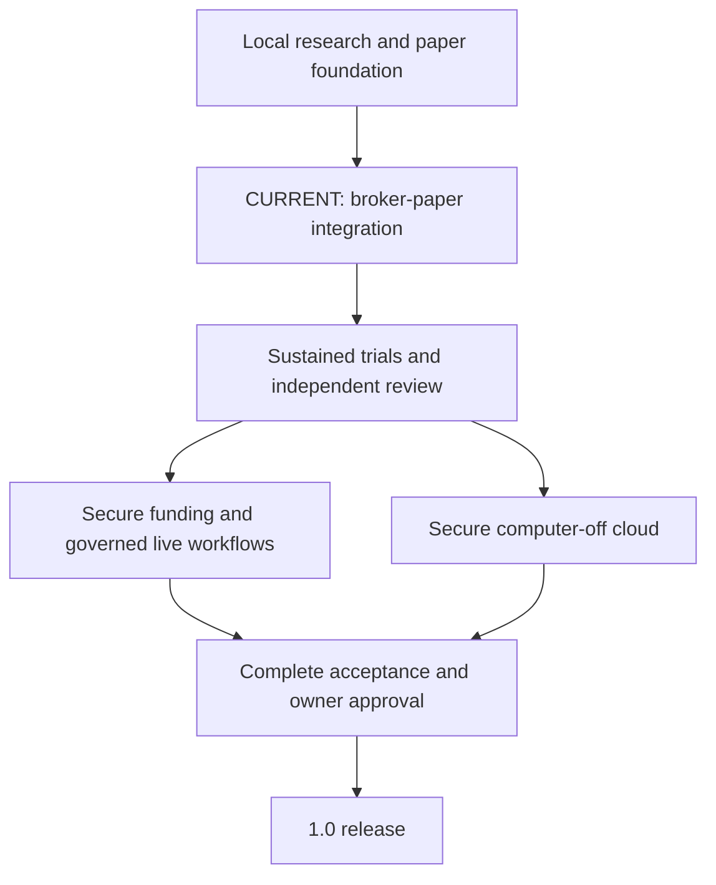

# Nexus Operative — read-only 1.0 roadmap

Revision: 0.340.305. Branch: `development/windows-portal-foundation`.

Generated from `nexus/release_roadmap.py`. View in PORTAL or `GET /api/roadmap`. Changes require source review; the application has no roadmap write endpoint.

Current position: local research and experimental local paper trading are implemented foundations; broker-paper integration and acceptance are the next major gate. Secure funding, governed live workflows, computer-off cloud and final independent/owner acceptance remain unfinished. Version numbers and passing test counts are not percent-complete estimates.

Current hardening: v0.340.305 freezes the resolved parent of both the private observation source and exclusive output path before any hidden passphrase prompt. The final selected filename remains separately visible to O_NOFOLLOW and O_EXCL, so a direct leaf symlink or existing destination still fails closed while a mutable parent alias cannot redirect the later read or encrypted/plaintext copy creation. Existing bounded input, authenticated encryption, strict observation validation, private terminal prompt, no-overwrite behavior and authority denials remain mandatory. This is sampled local private-evidence path-scope hardening, not an ACL/administrator boundary, secure deletion, broker/account or source acceptance, genuine-feed realism, a sustained 72-hour trial, profitability, native ordinary-profile acceptance, funding/live/cloud readiness or release approval. No button or editable parameter was added; seven tabs and existing black/bright-purple bottom-right hover help remain unchanged. Rough implementation remains about 40% (weighted 38%; 30–45%, low confidence), with 0/9 major stages fully accepted.

| Milestone | Status | Evidence | Remaining acceptance |
| --- | --- | --- | --- |
| M1: Windows packaging and recovery | PARTIAL | Windows test, EXE startup and installer workflows; passive portfolio and forward-history/session/capacity reads preserve absent storage; existing state uses read-only transactions, combined forward polling shares one evidence snapshot; recovery/order/session reads use read-only journal replay and read-only linked-portfolio attachment, with missing history distinguished from flat-account proof; installed smoke explicitly exercises dashboard/recovery reads; operator-created paper snapshots reject source/destination link indirection, require regular single-link files, use bounded SQLite backup contention, enforce fixed source/count/aggregate/directory/free-space admission, flush completed content, sync the directory entry where supported and require a stable read-only SQLite quick-check plus complete local hash-chain/accounting reconstruction before issuing a receipt, then remove failed candidate files without replacing or pruning retained snapshots; durable order recovery; installed-process/reinstall/uninstall smoke with explicit disposable fresh/saved setup profiles and settings-byte preservation assertions, plus distribution checksum tooling; verified offline backup/new-directory restore tooling and fresh-process linked-ledger/quote-evidence recovery drill and installed-API restored-data smoke tooling with pinned prior-version fixture support and default Windows data-layout checks; the Windows distribution includes a manifest-bound owner-operated non-elevated LocalAppData profile/effective-ACL probe and strict privacy-safe offline reviewer that retain no username, SID or path and keep all external authority false; documented beginner help for all PORTAL controls and isolated headless-browser acceptance tooling; seven named workspaces, friendly To Do introduction and automatic read-only startup checks with a plain-language purpose and setup scope for every box; new unused settings receive an atomic $10,000 virtual budget and Terrestrial-only entry preset, preserved saved/OFF choices and on-Engage compatible virtual accounting remove redundant form setup. | Exact-SHA automated installer/reinstall/uninstall and pinned prior-data recovery steps passed; execute and independently review the new probe on a clean ordinary-user owner profile, record native-window behavior, and complete prior-installer upgrade acceptance. Tool availability alone is not owner/profile/ACL acceptance. |
| M2: Market data and provenance | PARTIAL | Public observation, timestamp/gap checks, historical admission and source diagnostics; redirect-disabled public transport with exact response-URL checks; canonical compressed hub bars with cross-collector deduplication, conflict quarantine and hash-verified sealed datasets; bounded public candle collection selected by default on explicit Portal start, closed-boundary request coalescing, pre-network storage checks and receipt-time clock/stop fencing. | Independent provenance review; missing/revised/conflicting data and outage evidence. |
| M3: Decision speed and risk authority | PARTIAL | Bounded local research decision queue and retained-ID limits with invalid-clock rejection; disposable bounded linked-ledger burst timing, overflow/expiry and halt flushing; individual Terrestrial/Solar/Universal entry permissions with complete saved-setting validation, transactional enable admission and independent OFF under review; bounded per-product public quote request sharing with clock-fenced cache reuse and process-local transport/avoided-request diagnostics. | Measure full durable path under bursts; verify expiry, overload and permissions throughout autonomy. |
| M4: Order lifecycle and portfolio reconciliation | PARTIAL | Partial/full priced fills, fees, idempotency, cancellation, durable recovery; atomic opt-in paper-ledger linking, partial-position reconstruction, adverse quote-cost assumptions, post-lock runtime exchange/receipt freshness and expiry/stop checks, durable expiry, cleanup-failure pauses and forward process-death tests before/after fill commit.; forward evidence snapshots now enforce their linked-ledger row cap before semantic reconciliation readers run, bind the read-only SQLite attachment to the exact preflighted regular-file identity throughout fingerprint and audit reads, bind each direct start-preflight SQLite read to one regular-file identity, content-metadata sample and SQLite-reported path, require all order/portfolio/forward/settings roles and SQLite companions to remain relationship-distinct, and hold storage-directory plus complete expected-file-set presence/metadata fences across the multi-file diagnostic before allowing its local result | Extend interruption/quote-path stress; independently review execution assumptions, existing-account migration and reconciliation. |
| M5: Durable latency and capacity | PARTIAL | Replay-validated checkpoints, two-snapshot retention, checkpoint interruption tests and isolated gateway and linked-ledger/tier-inclusive p50/p95/p99 benchmark; capacity admission diagnostics; opt-in atomic quote-order fixture treatment with retained commands and crash rollback tests; explicit logical archival with retained IDs and commands; read-only sustained-trial readiness reports quote/session headroom plus conservative every-cycle durable command and ID bounds; an explicit application-closed installed/source rotation tool verifies an offline archive, prepares a fresh halted candidate, retains a second exact source recovery copy, installs the candidate behind a persistent fail-closed marker and can explicitly recover an interrupted pair replacement or roll a completed install back. Archive/candidate/recovery publication, the marker and both live pair replacements use one durable move boundary: parent-directory fsync on POSIX and MoveFileExW WRITE_THROUGH on Windows, while file contents remain separately flushed. Each new v3 candidate retains replay-validated generation lineage plus a bounded private fingerprint set for all retired client-order IDs, rejecting cross-epoch reuse before journal mutation; v1/v2 candidate and legacy recovery/marker records remain readable. A legacy v2 source without fingerprints can proceed only through a private v1 baseline review bound to the exact closed source generation, epoch, replay digest and verified archive manifest. Known archived IDs must be included, raw IDs are never copied into the candidate, and the v4 lineage labels the result OPERATOR_REVIEWED_UNATTESTED. The mandatory operations fixture repeats four synthetic generations and 48 terminal orders, replays every retained archive/candidate/recovery set, verifies all 48 retired-ID fingerprints, exercises the legacy migration fence and requires each installed live journal to return to its four-command halted baseline.; Trial Readiness now consumes an exact durable-capacity report that separates ordinary commands from the fixed halt/cancel/expiry reserve, fails closed on malformed values and refuses next-cycle or conservative full-window readiness when that emergency/control reserve is depleted | Extended multi-epoch long-run scalability and pressure acceptance, sustained queue pressure, source-retirement policy and independent archive/private-volume/native Windows power-loss/profile/ACL acceptance remain open. The bounded synthetic fixture is not duration, market throughput or native interruption evidence. Write-through metadata publication reduces a known Windows durability gap but is not physical power-loss proof. The private fingerprint fence covers only a complete retained lineage; it does not establish caller identity, other-host coordination or broker-wide idempotency. A reviewed legacy baseline records an operator completeness assertion, not source attestation; independent review of the actual private scope remains required. Installation reclaims live journal capacity but preserves source history externally, never resumes operation and grants no broker, funds, live or release authority; the conservative trial bound is not expected trading volume or validated broker throughput. |
| M6: Scientific strategy evidence | PARTIAL | Chronological research, holdout, regime and cost-stress modules; persisted multi-horizon ridge momentum baselines with training-only scaling, purged chronological holdout, naive/momentum comparisons, generation invalidation and compact research signals; three built-in trained feature specialists with fixed three-block baseline checks, disagreement reporting and independent deterministic validation/provenance reviewers; versioned saved research packs and unchanged-data reuse; three expanding-window refits with purged training targets, delayed nonoverlapping modeled fills, fixed cost scenarios and fold-consistency checks; shared causal feature computation and serialized preparation; engine-started bounded learning with captured public/saved-only scope, bounded polls/fit attempts, generation skips, local OS ownership and stop-fenced publication. | Independent model calibration and walk-forward/forward evidence, licensed shared-source provenance, delisting/survivorship review and performance audit; trained baselines are not validated market edge. |
| M7: Unattended paper operation | PARTIAL | Explicitly started BTC public-quote paper runner; separate research-engine and explicit Engage Paper controls, independent emergency throttle cut preserving research, reset/start race fencing, dedicated coalesced emergency cleanup independent of feed/general workers, plus a separate installed emergency-stop process that publishes the durable latch before SQLite, starts no Portal/network/vault/reset path, is adopted by a running API and is consulted at paper start/quote/submit/fill boundaries; cancellation-shielded cut completion and pending/verified/unconfirmed status, queued-reset epoch checks, an immediate local runner cut signal and post-lock veto during real SQLite contention, independent bounded local cut-intent persistence and conservative restart recovery, native Windows read-only journal fault fencing with explicit post-recovery cleanup retry, process-death-before/after-cut-commit recovery fixtures, tier-gated entries, exits, halt/pause, feed-failure stop, durable session counters/heartbeats and fingerprinted fixed-policy admission; retained quote evidence, quote/fill price/quantity/fee/policy crosschecks, portable review summaries and exclusive local process ownership, clock-discontinuity pauses and exchange-regression warmup fencing and retained-storage preflight with operator runbook; bounded repeatable forward-runner fixture drill with fresh-process evidence comparison; operator recovery snapshot and pending-remainder inspect/cancel controls; Singularity account-equity and Fractal coordinated shared-time position constellation plus per-holding observed history with retained ranges and journal adjustment inspection and transactionally retained closed-day observation history with bounded active/total admission and range responses plus observation database byte/free-disk budgets and rollback-safe allocation failure handling.; read-only start preflight now samples the actual cross-process forward-owner lock before replay, while lock acquisition and sampling reject symlink, hardlink, malformed and pathname-replaced lock stores without treating the sample as a reservation; the forward worker now revalidates its exact opened regular single-link owner path through preparation, quote intake, submit/fill boundaries, diagnostic commits and release, while cancellation and the independent emergency cut remain available after ownership uncertainty; forward and research-refresh owners now also bind the physical directory that scopes their lock, reject a symlinked owner directory and fail closed if that directory is replaced even when the same single-link lock inode is moved back under the public path; every active owner validation now brackets the public lock-path identity sample with the acquired directory identity, so replacement between those samples cannot acknowledge even when the same locked inode is moved into the replacement directory; research refresh now revalidates its acquired owner lease before collection requests, retained-data intake, training and model-reference publication, discarding work and pausing for review when the public owner path changes; paper-forward ownership now requires the fixed one-byte marker before and after every OS lock acquisition and during active lease validation, rejecting malformed existing state without repair and invalidating an in-place marker change before further acknowledged work; on POSIX, paper-forward ownership also requires the lock file and containing directory to remain owned by the current effective user, and the lock file to remain owner-readable/writable without group/other write access, rejecting unsafe inherited state without repair and detecting mode drift during an active lease; the POSIX owner directory is now created private and must remain free of group/other write permission before acquisition and throughout an active lease, rejecting unsafe inherited state without repair; the standalone emergency-stop process now samples an existing resolved data-root identity before priority elevation, exclusively initializes a root observed absent only afterward, and rechecks the identity throughout intent/SQLite work, refusing a concurrently replaced public root instead of reporting VERIFIED for a cut applied only to replacement storage; the standalone emergency-stop process contains unexpected best-effort priority-helper failures and malformed reports as STANDARD/unconfirmed diagnostics, then continues the authoritative intent-latch and durable-halt path; the standalone emergency-stop process contains unforeseen ordinary latch, durable-halt and status-helper faults after completing its nested fallback attempts, and accepts only an ordinary explicit boolean halt acknowledgement; the standalone emergency-stop process accepts only the exact boolean True from final intent inspection, so malformed truthy helper returns remain unconfirmed and every public cut-state field retains its boolean schema; the standalone emergency-stop process samples the exact latch entry after its first confirmed observation and rechecks the same entry immediately before durable-halt handoff, so a concurrent clear or replacement loses ordering confirmation without suppressing the independent halt or final-latch attempts | Extend native Windows acceptance to ordinary-user ACL inheritance and whole-machine pressure; run sustained real-feed forward validation, independent policy evidence review and multi-market scheduling. Local subprocess/file-attribute outage tests are not broker or market performance evidence. |
| M8: Broker paper integration and operations | OPEN | Provider-neutral design plus disconnected Alpaca paper IOC-limit previews and bounded identity/status/cumulative-fill diagnostics and explicit execution/asset-fee balance projections plus chronological fee-reserved funding audits with equal-time ambiguity and nonterminal-reservation review using repeatable fixtures; a bounded account-scoped durable request/uncertain-attempt/observation journal with replay validation and crash/lost-ack fixtures, persisted lookup-attempt limits, shared cooldowns and conservative timeout/not-found/rate-limit/authentication outcome handling, read-only pending-ticket review and explicit current-head-fenced lookup-interruption records preserving attempts and order uncertainty; an opt-in fixed-host GET-only paper account inspection primitive with bounded reads, redirect rejection, clock/permission fencing, stable account identity and conservative observed cash/BTC checks, explicit Windows credential pair storage/removal with verified readback, local mutation fencing and bounded same-origin Portal controls for separately confirmed one-time inspection; an explicit original-client-ID recovery coordinator sharing the bounded reader, persisting attempts before IO and normalized outcomes under post-lock clock/permission checks, with saved-key mutation fencing and crash/uncertainty retention; a bounded supplied Trading REST BTC/USD activity adapter with explicit fill prices/quantities, semantic deduplication, nanosecond time preservation and cumulative-chain checks, keeping received-asset fee debits unlinked and date semantics/coverage unverified; an internal explicitly confirmed two-page paper activity collector with canonical creation-window paths, exact opaque cursors, account/key/time fencing and explicit partial/end-observed reports, retaining no verified coverage or automatic continuation; optional account-bound local activity retention with canonical record reuse, immutable order bindings, bounded full replay and atomic crash/lost-return recovery, read-only cross-batch fill-chain review with snapshot conflict/revision checks and declared-window gap diagnostics; an optional explicit local paper-read reservation journal shared across inspection, activity collection and recovery, retaining cooldown/rate/auth/interruption blocks across cooperating processes and holding local OS ownership through read cleanup, with explicit account/head/token-fenced interruption review preserving unknown outcomes and full-day cooldowns; a pure combined supplied balance review compares explicit linked fills/fees with total cash/BTC while separately checking availability/open IOC terms without inferring provider holds or spending permission; optional collection observations preserve bounded page identities, opaque cursor chains, read timing and normalized-content/query digests within atomic activity receipts, without attesting source or coverage; an exact-account/head-bound retained gross-fill and total-balance residual review preserves nanosecond groups, rejects stale/concurrently changed history and leaves all fee links/posting scope/funding unverified; the explicit paper inspector and Accounts display now separate reported cash, non-margin buying power, total/available BTC and unknown/unavailable differences with normalized fingerprints/sampled timing, fail-fast malformed/foreign collections and no non-USD cash projection; portable allowlisted JSON observations now support explicit local download and bounded offline content-consistency validation without source attestation; a read-only portable-observation pair review now binds account/manifests/history head, checks sequential read windows for retained boundary fills and conditionally compares total balances without rounding nanoseconds or promoting source/funds authority; the existing confirmed inspector and Accounts readout also summarize bounded simple IOC buy-limit principal and sell remainders, deduplicate matching terms, preserve nanosecond identities and leave unsupported/conflicting aggregates unknown without claiming holds; an internal explicitly confirmed single-attempt Alpaca paper POST boundary now checks fixed account/position/asset endpoints, requires an exact-head shared-local provider POST budget, commits both reservations before IO, rechecks permission/stop/credentials after the marker and never retries; a separate explicit reviewed recovery boundary clears only an ambiguous shared-budget latch after two exact-head replays prove the original client ID has a retained terminal observation, while preserving the full cooldown/history and permanently attempted request; a bounded read-only exact-head history composition now joins every completed POST attempt to the checked submission marker in up to seven account request journals, requires RESPONSE_OBSERVED to retain a request snapshot and NOT_SENT to retain none while preserving OUTCOME_UNKNOWN uncertainty, and refuses pending/interrupted, omitted, stale, changing, legacy, unbound, duplicate or related-path evidence; a second bounded read-only composition joins those exact POST attempts through the same request heads to complete accepted activity histories, requiring observed and recovered attempts to match retained order/fill evidence, NOT_SENT to retain no observation/fills and unresolved unknown outcomes to remain blocked; a single-account private exact-head composition now joins that POST/activity result to complete request/fill replay and four ordered stability-guarded balance observations, rechecking every journal and retaining gross-only residuals as non-authoritative diagnostics; a stricter fee-bearing composition additionally partitions every accepted receipt and requires every retained fee record to carry an explicit order/execution reference pair resolving to an accepted original fill while retaining reference semantics, date-only timing, fee coverage, posting allocation, holds and funds as unverified; a further known-fee reserve composition requires every accepted order to participate, reserves only retained explicitly referenced fee obligations at their accepted fill groups, rejects unfunded group debits and requires the local ending totals to match supplied closing inventory without promoting completeness, posting, holds or spendable-funds authority; validated with injected responses only, with no Portal, saved-write-credential or strategy route; an explicit source-only Windows saved-pair acceptance probe composes the account-ID-bound four-GET inspector with caller-selected durable local pacing, vault-silent pacing status and a content-bound allowlisted open-IOC aggregate from the same read, without granting provider/account/fee/hold/funding/live acceptance; Accounts now offers separately confirmed managed paced reads and vault-silent retained pacing review, with account-hashed private OS-profile storage and no automatic retry/reset; pacing, activity and request journals now preflight regular single-link files, bounded headers and DELETE-mode history, rejecting WAL layouts and sidecars before SQLite without conversion or evidence deletion; private cross-journal status replays every accepted receipt and exact successful pacing/activity head transition, separating latest-tail from historical-content disagreement without automatic repair; a read-only reconciliation composition requires no unverified legacy baseline and exactly one accepted record per retained pacing session, activity batch and collection observation, binds two portable observation manifests to that exact retained activity head and requires an exact nanosecond union of accepted declared creation windows to cover the full observation envelope before arithmetic, then rechecks all journals without promoting source, provider boundaries, received coverage, funds or routing authority.; a no-network supplied Activity SSE schema review now fail-closes to BTC/USD TRD fills and one-to-one USD fees, requires strict ULID cursor order and unique stable ref IDs, binds each admitted fee parent_id to a supplied fill, and rejects corrections, busts, bulk fees, FX and unsupported financial activities without claiming stream entitlement, delivery, replay coverage or provider source; a supplied two-segment reconnect review now requires the exact last processed ULID as since_id, idempotently deduplicates immutable ref_id redelivery, advances only on later event IDs and rechecks fee-parent links, while durable cursor storage, automatic backoff, real reconnect and complete replay remain explicitly unverified; a bounded supplied-wire Activity SSE session review now binds the exact v2beta1 since_id target, text/event-stream metadata, arbitrary byte chunks, strict UTF-8/SSE/JSON framing, heartbeats and the existing linked trade/fee envelope review, while slow-consumer drops and internal-error comments require reconnect review and remain ineligible for cursor checkpoint authority; an explicitly confirmed single-attempt paper Activity SSE transport now opens only the exact since_id target, disables proxies and redirects, validates streaming metadata before reading, fences every bounded read with permission, emergency-stop, credential and clock checks, and passes a complete two-event segment through the strict wire review without retry, reconnect, cursor mutation or authority; an explicitly confirmed one-attempt Activity SSE checkpoint coordinator now binds a caller-supplied private prior segment and the exact cursor-journal head to one fixed-target resumption GET, re-proves immutable duplicate redelivery plus forward advancement, rejects interruption comments and commits at most one crash-recoverable cursor transition while retaining no automatic retry/backoff, ledger, routing or funds authority; a private account-bound reconnect budget now reserves every explicitly confirmed SSE attempt before IO, enforces a fixed 1/2/4/8-second process-recoverable backoff with a four-attempt cap, blocks pending/lost-result episodes and composes one due attempt with the exact cursor checkpoint while never sleeping, looping or retrying automatically; a reservation-bound cursor-checkpoint receipt and separately confirmed no-network result reconciliation now close only the exact pending reconnect attempt after a checkpoint/result crash window, reject legacy/foreign/stale evidence and make lost recovery acknowledgment replay idempotent without another provider request; an exact-head, doubly confirmed no-network uncertainty close now permanently retires a reconnect reservation whose provider outcome could not be durably timestamped, retains the consumed attempt and review requirement, schedules no retry and makes exact lost-close acknowledgement replay byte-stable; after a failed reconnect attempt with no cursor transition, outcome-clock failure now durably closes from the last trusted admission time as terminal review state, recovering a lost result acknowledgement by inspection and never creating retry authority; successful or cursor-advanced attempts remain pending for exact checkpoint reconciliation; successful reconnect completion and explicit no-network checkpoint reconciliation now recover a lost result acknowledgement in the same call only when the current terminal result exactly binds the reservation token, requested and final success values, zero retry fields and checkpoint receipt; a new write also binds the supplied result time, while an uncommitted or mismatched result remains uncertain without another provider request; failed reconnect results now apply the same exact same-call acknowledgement recovery to retry, review, checkpoint-uncertain, provider-delay and emergency-stop-converted outcomes, requiring the current result head, reservation token, result time, requested/final values, zero checkpoint fields and exact delay state; uncommitted or mismatched results remain pending and the original provider failure is suppressed only by a fixed uncertainty diagnostic; automatic closure after a failed reconnect whose completion clock is unavailable, invalid or regressing now applies the same exact current-result proof, including result-head identity, reservation token, trusted admission time, requested/final review outcome, absent checkpoint fields and zero delay state; failed or malformed recovery inspection returns a fixed uncertainty diagnostic without exposing private faults or repeating provider IO; post-attempt cursor inspection is now a fixed fail-closed boundary: unreadable, malformed or invalid cursor state returns a sanitized cursor-uncertainty diagnostic, retains the exact pending reconnect reservation with no result or retry due, and performs no second provider request; only one valid digest head may decide unchanged versus advanced checkpoint state; explicit checkpoint reconciliation now treats every post-result reconnect-budget inspection as an untrusted crash-recovery boundary: lost acknowledgements, unreadable storage and malformed retained views produce only fixed recovery uncertainty, preserve any committed terminal result and never repeat provider IO; exact completion still requires stable result-head, reservation, timestamp and checkpoint receipt agreement; explicit checkpoint reconciliation now also sanitizes its initial reconnect-budget and cursor-binding preflight views before any recovery write: unreadable or malformed budget state returns fixed recovery-state uncertainty, unreadable or malformed cursor binding returns fixed binding-review failure, and neither path mutates the pending reservation or repeats provider IO; reconnect admission now treats its initial cursor inspection as the same fail-closed boundary used after an attempt: unreadable, malformed or invalid state returns fixed cursor-state uncertainty before reservation or provider IO, leaving both stores untouched and granting no retry authority; reconnect admission now also validates the initial reconnect-budget view before reservation: unreadable storage, missing fields, invalid digests, clocks, counters, flags or reasons return fixed admission-state uncertainty, expose no private fault, leave both stores untouched and perform no provider IO; reconnect reservation now treats any non-policy exception as a fail-closed acknowledgement boundary: failures before commit and lost acknowledgements after commit return fixed reservation-state uncertainty, never start provider IO, and preserve any durably pending reservation with no result or retry due for explicit review; reconnect reservation acknowledgements are now admitted only when their token/head, cursor binding, bounded attempt and exact boolean replay/authorization fields form one internally consistent result; missing, malformed or conflicting fields return fixed reservation-state uncertainty before provider IO and leave any committed reservation pending for explicit review; a structurally valid reconnect reservation acknowledgement now receives an independent exact durable-journal proof before provider IO: the pending token/current head, attempt, admitted cursor, prior budget head, evaluation time, reason and eligible prior retry state must agree; forged uncommitted returns, corrupted fields and unreadable post-commit state fail with fixed reservation uncertainty and leave any real reservation pending without request authority; the exact reconnect reservation is now re-proved at every downstream permission fence, including the transport checkpoint immediately before opening the provider request; a concurrent result, changed token or unreadable journal revokes stale request authority with fixed reservation uncertainty, preserves the current durable owner state and performs no provider IO; the explicit local emergency-stop abort, retry-wait close and outcome-uncertainty close now pin the exact reconnect-budget path/account binding across every callback, replay, transaction and result acknowledgement, returning fixed store-binding uncertainty before a retargeted store can be inspected or written; reconnect-budget admission and terminal-result persistence now pin their own exact path/account binding across initial replay, both emergency-stop samples, exact-head transactions and final acknowledgement inspection, rolling back a retargeted write and preserving a replayable schema-only fresh journal; the reconnect-budget public inspection boundary now pins its exact path/account identity across file preflight, database connection and full journal replay, returning fixed store-binding uncertainty rather than a mixed-scope view if any internal seam retargets the mutable store; terminal reconnect-budget acknowledgements are now treated symmetrically whether lost by exception or returned malformed: success, failed-attempt scheduling, trusted-time uncertainty closure and explicit no-network checkpoint reconciliation cold-replay the exact durable result before continuing, while uncommitted or mismatched state remains fixed uncertainty and no additional provider request is granted; no-network outcome-uncertainty and emergency-stop closures now also discard structurally returned acknowledgements and accept only an exact cold-replayed terminal journal record, while an uncommitted return or changed file remains fixed uncertainty; those no-network closures now recognize their production-prefixed fixed acknowledgement-uncertainty diagnostics before exact recovery, while unrelated typed denials remain authoritative; the private three-journal observation reconciliation now samples bounded no-follow SHA-256 fingerprints for the exact pacing, activity and acceptance SQLite files before and after semantic replay, rejecting same-head byte rewrites, identity/metadata changes and rollback/WAL/shared-memory sidecars without exposing paths or private digests; the higher account-evidence composition extends that stability guard to its request journal and spans pinned, explicitly sampled current-head and four-observation reviews, so all four exact local files must remain byte, identity and metadata stable around the composed result; the internal single-attempt paper POST boundary now requires two identical normalized account and BTC-position admission samples around the asset read, so any late permission, pending-funds/fee, cash/buying-capacity or BTC quantity/availability change fails before its durable reservations and only allowed POST; every exceptional single-attempt POST-budget closure now ignores its write-side return and requires two stable read-only replays of the exact terminal token, account/client, request/payload heads, outcome and actual-POST count before preserving the original failure; lost acknowledgements recover locally, while missing, malformed or unstable closure state remains pending or review-blocked under a fixed uncertainty diagnostic without another provider request; the single-attempt POST boundary also discards the provider-budget BEGIN acknowledgement and cold-replays the exact pending token, account/client hashes, request/payload heads and owner identity twice before creating the request marker; only the original in-process ownership lease may continue, while missing, malformed, unstable or replacement-owner state stops before provider IO under fixed reservation uncertainty; provider-budget and request-marker cold replay now also binds each durable admission timestamp to the caller-observed permission, emergency-stop and monotonic-clock window, retains the provider reservation admission in its replay receipt/history, and requires the marker admission to follow that reservation before any POST; out-of-window durable state remains pending or closes as NOT_SENT with no provider IO; terminal provider-budget cold replay now also binds RESPONSE_OBSERVED and the zero/one-POST NOT_SENT/OUTCOME_UNKNOWN safety closures to caller-witnessed completion windows; a safety closure uses the exact last trusted admission sample so revoked permission or an active emergency stop never needs to be relaxed merely to retire local state, while an out-of-window terminal row remains fixed uncertainty without another provider request; zero/one-POST safety closure now brackets its provider-budget terminal write with stable full-chain request-journal receipts, requiring the identical exact request head/account/payload afterward so a concurrent original-ID lookup advance yields only fixed uncertainty and never another provider request; successful response completion now also brackets the provider-budget terminal write with exact cold replay of the immutable OBSERVE prefix, so an invalidated response event or post-write semantic-reader failure yields fixed completion uncertainty without another provider request, while a later valid original-ID lookup remains permitted; resolved-unknown POST-budget recovery now ignores its write acknowledgement and requires two identical read-only receipts for the exact recovery head, blocked attempt, terminal request-resolution head and unchanged cooldown, so a lost acknowledgement is recovered without re-arming the original request while absent or fabricated durable state remains blocked; the provider-POST reconciliation boundary now validates the retained observation's shared gross-balance and activity subreviews, binds both account/activity heads to the outer observation, replays the gross-balance scope hash and rejects nested authority promotion or removed replay/arithmetic assurances; the bounded Activity SSE response scope now preserves the original fixed safety failure even when a hostile response context attempts to suppress it or raises an ordinary cleanup exception, while process-control signals remain independently visible; the durable reconnect budget records the one GET as non-retryable review with no cursor advance, retry or sleep; failed fresh activity-acceptance connection, pragma, transaction, schema and baseline writes now remove only their exact newly created empty sidecar-free pathname so one explicit bind retry can initialize cleanly, while replacement or close uncertainty remains retained and blocked; activity-acceptance baseline and append writers now reject a substituted SQLite main connection before mutation, explicitly fsync the exact committed writable descriptor, recheck its bounded bytes and flush a new POSIX directory entry before cold acknowledgement replay; activity-acceptance append now pins its store binding and main-file content around every untrusted admission/input callback, derives the expected chain head independently and requires two exact cold reads before acknowledging a commit; private activity-acceptance inspection and ordered replay now pin one resolved store path, regular-file identity, bounded main-file fingerprint and exact serialized SQLite connection content while retaining pre-commit rollback-journal evidence for read-only recovery review; retained provider/read receipt inspection now hashes the bounded serialized main-database image before and after replay and rejects a path-spoofed foreign SQLite connection whose bytes differ from the captured store fingerprint; retained provider/read receipt inspection now also proves that the opened SQLite connection has exactly one main database bound to the captured resolved store path, rejecting a valid foreign connection before replay; provider/read receipt inspection now pins one exact resolved store path, regular-file identity and bounded fingerprint across connection, complete replay, close and exceptional unwind, rejecting mutable-store retargeting and same-path mutation before returning any public receipt history; both reviewed provider POST and provider-read recovery commands now repeat their exact budget SQLite identity and committed fingerprint proof during return-expression and exception finalization while outer ownership remains held; reviewed account-read pacing recovery now accepts a lost local write acknowledgement only after two exact cold receipts, while the account journal identity and committed fingerprint remain stable through return finalization; the exact-head provider/account read-history composition now treats retained pending or review-blocked account pacing state as a first-class reconciliation blocker, so clearing only the shared provider budget can never promote a split recovery to consistent history; the exact-head provider/account split-recovery fixture now requires both explicit recovery orders, proving that whichever journal recovers first remains blocked by the untouched side until the second recovery completes; mandatory exact-head release evidence now proves provider-only, account-only and aligned dual-pending read histories all remain read-only review blockers and can never be promoted to matched completed sessions; the exact-head release fixture now composes two account journals and proves that one pending account cannot hide behind a fully matched peer or yield partial matched-session credit; mandatory multi-account reader-failure evidence now proves that one account semantic reader cannot mutate a peer journal and hide that change behind its own exception; multi-account read reconciliation now requires every selected account independently to retain all five read purposes, so a complete peer cannot mask another account with only a completed subset or earn partial matched-session credit; durable provider/read review retention now pins the provider budget and every selected account journal to one identity and bounded fingerprint set across all semantic replays, callbacks, commit acknowledgement, exception unwind and final return; durable provider/read review receipt retention now ignores its write-side acknowledgement, accepts an exact lost acknowledgement only after two stable cold receipts and pins the committed receipt-store identity and bounded fingerprint through postcommit callbacks and final return; resolved-unknown POST recovery now samples and rechecks the exact provider-budget SQLite file identity across source replay, the guarded recovery write and both post-commit cold receipts, rejecting pathname replacement as fixed uncertainty; the same recovery now fingerprints the bounded provider-budget bytes before mutation and pins the newly committed fingerprint across both cold receipts, rejecting same-file content or metadata change as fixed uncertainty; after both recovery receipts the command replays the exact locked request proof again, so post-commit request content, metadata or head change remains fixed uncertainty rather than a successful cross-journal acknowledgement; the reusable locked request-snapshot guard now rechecks exact identity and bounded content during context exit, including return-expression and exception unwind, so mutation after a caller's final replay cannot become a successful cross-journal result; provider POST ownership now rechecks that its lock pathname still names the opened regular single-link file before releasing the descriptor, so a late replacement cannot become a successful recovery return; account-read and provider-read ownership now recheck their exact opened regular single-link lock file during context exit, while all three read/POST guards normalize an unavailable lock path to fixed ownership uncertainty; explicit reviewed provider-read budget recovery now ignores its append acknowledgement and requires two identical read-only receipts binding the exact recovery head, account digest, blocked session/outcome, recovery count, unchanged cooldown and unreclaimed capacity while ownership remains held; provider-read budget recovery now pins the existing SQLite pathname identity and bounded fingerprint through source replay and mutation, then requires the committed fingerprint around both cold recovery receipts; a failed first provider/read receipt transaction now removes only its exact newly created empty SQLite pathname after rollback, rejects replacement or sidecar ambiguity and restores absent state for one explicit exact retry; active provider/read receipt-store fingerprint sampling now uses the same Windows-portable pathname/open-handle boundary as the quiescent guard, excluding nonportable Windows ctime while retaining identity, size, mtime, link and bounded-byte checks; fresh provider/read receipt initialization now captures the exclusively created pathname identity before SQLite opens and restores absence after connection, pragma, transaction-begin or schema-creation failure only when the exact empty file has no sidecars; committed provider/read receipt stores now cross an explicit writable main-file fsync boundary on every accepted commit, plus parent-directory fsync for a newly created POSIX pathname; flush uncertainty retains the exact committed receipt for inspection and explicit duplicate replay; the committed provider/read receipt fingerprint is now fixed before its explicit main-file flush and rechecked before and after that flush plus any new POSIX parent-directory flush, so same-identity content or metadata change cannot become an accepted durability baseline; the exact writable provider/read receipt descriptor is now bounded-byte hashed before and after its explicit file sync and must match the already committed pathname fingerprint, so descriptor/path divergence cannot pass as a durable acknowledgement; new POSIX provider/read receipt stores now pin the resolved parent-directory identity before opening it, require the fsync descriptor and post-flush pathname to retain that exact device/inode, and reject wrong-directory substitution before directory sync; the mixed account-read review receipt now independently matches the provider-read receipt durability boundary: every committed exact writable descriptor is bounded-byte matched and fsynced, each new POSIX pathname flushes its exact pinned parent directory, and uncertainty retains exactly one receipt for explicit duplicate recovery; fresh mixed account-read receipt initialization now pins the exact exclusively created descriptor identity, removes only that unchanged empty file after an uncommitted setup failure, and retains any substituted path under fixed cleanup uncertainty; an installed OFF-by-default Activity SSE operator now combines the saved read-only Windows credential pair, private retained initial segment, exact cursor/reconnect heads, bounded one-attempt budget and independent emergency-cut latch; status is vault/network/storage silent, every attempt needs three explicit confirmations, and aggregate output omits credentials and event/order identities; mandatory installed recovery evidence now carries one failed GET through durable backoff into one explicitly invoked due-time retry, a single completed checkpoint and vault/network-silent cold replay that denies a third attempt; mandatory installed secret-lifecycle evidence removes the saved pair after a failed GET, proves a due retry fails before network access without consuming its durable attempt, and requires explicit non-authoritative credential restoration before one confirmed completion; mandatory installed in-flight credential-rotation evidence now proves one bounded GET is withheld from checkpoint authority, commits durable manual review and denies any second GET even after a valid replacement pair exists; the independent emergency-stop process now durably latches after an in-flight credential rotation has already forced manual review, preserving the exact cursor/reconnect heads and denying another GET with replacement credentials; on POSIX, shared provider POST, provider-read, account-read pacing and Activity SSE cursor ownership now require the lock file and exact containing directory to remain owned by the current effective user, require owner read/write on the lock file and reject group/other write access before mutation and throughout the active lease; provider POST, provider-read, account-read pacing and Activity SSE cursor ownership now also require the complete fixed marker before OS lock acquisition and throughout the active lease, rejecting malformed inherited markers without repair and detecting same-inode marker corruption before further acknowledged work; provider POST, provider-read, account-read pacing and Activity SSE cursor ownership now pin the exact containing directory device/inode before opening and bracket every public lock-path/marker validation with that identity, so replacing the directory cannot preserve lease authority even when the same locked inode is moved back into the public pathname; provider POST, provider-read, account-read pacing and Activity SSE cursor ownership now initialize the fixed marker only after exclusive lock-file creation, while every inherited lock must already be an exact regular single-link marker file; empty, multiply linked or malformed inherited state is rejected byte-for-byte without repair; every valid provider POST, provider-read, account-read pacing and Activity SSE cursor owner marker now crosses an exact file-fsync barrier before lock authority, then flushes its identity-bound parent directory on POSIX; inherited retries repeat the same barrier, while sync uncertainty or a substituted directory descriptor fails closed; every broker-paper owner lease now pins the no-follow immediate-parent directory identity before opening its marker and brackets all active marker/directory checks with that identity, so moving the same owner directory under a replacement parent fails closed before acknowledged work and during exit; Activity SSE cursor checkpoint ownership now combines the OS-backed lock with a PID-and-normalized-path process claim so a second cooperating Windows handle cannot checkpoint during provider open; fresh native cross-process and provider-paper acceptance remain required | Accept the internal paper POST boundary, shared-local provider budget and terminal original-ID recovery against an authorized account; add separately scoped saved write credentials, broker-wide/distributed POST coordination and explicit operator controls only after review; complete actual execution/fee/hold/funds reconciliation and sustained acceptance. IBKR paper then Coinbase Advanced expansion. |
| M9: Release acceptance and authorization | OPEN | 0.x numbering and release gates enforced; read-only retained forward coverage review revalidates recorded eligible quotes under the admitted policy before measuring a requested72-hour/95-percent target using clipped, unioned same-session public-labeled eligible intervals, excludes injection/gaps and leaves sustained-market/account acceptance unverified; repeatable source-fingerprinted offline trial suite covers 20 forward sessions, 24 operation rounds, backup/restore, durable capacity and real loopback HTTP startup/shutdown; fresh-install stop inspection avoids accounting initialization; bounded origin-first optional-AI credential controls use fixed errors, exact backend binding and verified save/remove readback. Public-repository hardening adds checksum-pinned full reachable-history secret/artifact scans, immutable Action references, nonpersistent checkout credentials, dependency updates/code ownership, a global loopback/Host/Origin boundary, no-store API responses and password-encrypted observation-copy tooling and explicit encrypted-input offline pair reviews without decrypted files; admin settings, historical logs/artifacts, default-branch policy adoption and native disk/ACL acceptance remain separate. Saved trial evidence is revalidated against every required profile and the exact current source; distribution checksums bind the bundled offline report as well as binaries, without attesting CI or approving release; real loopback HTTP trials now exercise paced paper reads with injected vault/transport seams, concurrent key removal, revoked-result suppression, retained cooldown/pending state and vault/network-silent fresh-process replay. Mandatory acceptance recovery observes a real pre-commit rollback sidecar, fingerprints all three main journals plus rollback/WAL/shared-memory sidecars and re-derives every accepted collection scope/account fields/observation/canonical activity input plus exact pacing/activity head transition from its retained receipt across fresh-process status. Release-run failures expose only allowlisted profile-specific child/timeout codes while suppressing child stderr, exception text, paths and environment data. See RELEASE_ACCEPTANCE.md for scope and unverified gates.; provider-ownership exit negative controls now use actual lock-path replacement where the operating system permits it and deterministic late identity failure on Windows, whose mandatory-share lock correctly rejects renaming an open file | Independent security/risk review, operator runbook, complete acceptance evidence and explicit owner approval for 1.0. Live-money activation requires separate authorization. |

## Product milestones: funding, autonomy and final release

| Stage | Status | Built so far | Still required |
| --- | --- | --- | --- |
| D1: Usable research application | FOUNDATION_IMPLEMENTED | Windows packaging, seven workspaces, beginner help, Matrix views and engine/throttle controls exist. New unused installations receive recommended local paper defaults; To Do explains Start Portal, separate Engage, each check’s purpose and optional/future scope. | Clean-machine/native-window/profile and upgrade acceptance; keep startup and recovery dependable. |
| D2: Learning models with defensible strategy evidence | PARTIAL | Deduplicated local history, bounded public collection, trained numerical council, held-out and modeled cost checks exist. | Independent provenance, calibration and sustained forward evaluation; verify net results after costs and drawdowns before governed policy promotion. |
| D3: Autonomous paper trading | EXPERIMENTAL_IMPLEMENTED | Explicit Engage Paper runs the fixed BTC experiment with virtual funds, tier gates, durable accounting, recovery and an independent emergency cut. Forward evidence review brackets its separate quote/session snapshot with two exact order-and-linked-ledger reconciliation snapshots. Linked-ledger fingerprint/audit reads and direct settings/unused-portfolio start-preflight reads remain bound to their preflighted regular-file identities; direct reads also bind content metadata and SQLite-reported paths. All order, portfolio, forward and settings roles plus their SQLite companions must be relationship-distinct before recovery reads. Storage-directory identity and the complete expected SQLite file-set presence/identity/metadata span the entire multi-file diagnostic and recheck on success, early return and ordinary failure. Read-only preflight additionally samples whether a separate process owns the forward-worker lock, without creating or reserving it; unsafe lock-store identity fails closed. This is local supplied-history and cooperating-process integrity, not an atomic multi-file snapshot, broker/account source attestation, genuine-feed acceptance, sustained-trial evidence, native durability, funds authority or routing permission. The active forward worker now binds its OS lock descriptor to the same regular single-link public pathname throughout preparation, quote intake, order submit/fill checkpoints, forward diagnostic commits and final release. A late replacement stops the worker and prevents successful acknowledgement while safety cancellation and the process-independent emergency cut remain available. This is sampled cooperating-process local fencing, not distributed ownership, an ACL/administrator boundary, physical durability, broker acceptance or sustained-market evidence. Forward and research-refresh ownership now binds both the opened lock file and its physical containing directory. Symlinked owner directories are refused, and replacement of the lock scope fails closed even if the original single-link lock inode is moved into the replacement directory. This is cooperating-process local fencing, not distributed ownership, ACL/administrator isolation, physical durability, provider identity, broker acceptance or sustained-market evidence. Active owner validation now samples the acquired directory both before and after validating the public lock path. A directory swap in that interval fails closed even if the same opened single-link lock inode remains at the public path. This narrows a local cooperating-process race; it is not an atomic filesystem transaction, distributed ownership, ACL/administrator isolation, broker acceptance or sustained-market evidence. The opt-in research-refresh worker now actively revalidates its OS owner lease across collection, import, training and model-reference publication boundaries. A replaced public owner path pauses the worker for explicit review and cannot acknowledge a later publication. This is sampled local cooperating-process fencing, not distributed ownership, source attestation, model acceptance or sustained-market evidence. Paper-forward ownership now validates its fixed one-byte marker before and after OS lock acquisition and during every active lease check. Corrupt existing state is not repaired, and a same-inode marker change invalidates the lease before further acknowledged work. This is local cooperating-process integrity, not distributed ownership, ACL isolation, broker acceptance or sustained-market evidence. POSIX paper-forward ownership now rejects a lock file or containing directory not owned by the current effective user, and requires the lock file to stay owner-readable/writable without group/other write access throughout an active lease. Unsafe inherited state is never repaired. This is mode-bit/current-user local hardening, not directory ACL, extended-ACL, Windows ACL, administrator, broker or sustained-market acceptance. The exact POSIX owner directory is now created private and must remain non-group/world-writable across availability, acquisition and every active lease check. Unsafe inherited mode and later drift fail closed without repair. This remains an exact-directory mode-bit fence, not ancestor-path, extended-ACL, Windows ACL, administrator, broker or sustained-market acceptance. | Sustained real-feed reliability, incident evidence and reviewed strategy quality. Current council models do not direct orders. |
| D4: Connected broker paper trading | OPEN | Disconnected Alpaca paper request/status/fee fixtures, durable account-scoped request recovery and retained lookup pacing/outcome diagnostics and retrospective fee-reserved funding checks and a separately opt-in paper account inspector with Windows credential onboarding and explicit read-only Portal controls and an internal original-ID recovery coordinator bound to retained request terms and a supplied REST fill/fee-debit normalizer with an internal bounded two-page collector and optional account-bound replay-validated local activity retention with cross-batch snapshot/fill/window review and unverified fee links plus optional durable shared local read reservations and owned interruption review plus combined supplied balance/availability/open-term diagnostics and retained collection observations plus head-bound nanosecond gross-fill/residual diagnostics and beginner-facing separated inventory observations, private portable report download/offline validation, head-bound observation/activity comparison, reported open-IOC terms and a source-only paced private-activity acceptance record with replay-validated cross-journal bindings, explicit unbound/latest-content/historical-content disagreement recovery classification and mandatory before/after-commit process-death release evidence that fingerprints the complete cooperating SQLite file set and re-derives every accepted content record and exact pacing/activity transition from its retained receipt, plus an exact-head portable-observation reconciliation composition with before/after journal replay and a caller-driven durable four-attempt Activity SSE reconnect budget with fixed backoff, exist. An internal explicitly confirmed paper-only single-attempt POST boundary now requires two stable account/BTC-position admission samples and durable local reservations, but has no Portal, saved-write-credential or strategy route; injected tests do not attest an account. Fresh private activity-acceptance initialization now captures the exclusive main-file identity before SQLite opens and restores absence after failed connection, pragma, transaction, schema or baseline writes only when the exact file is empty, regular, single-link and sidecar-free. Replacement, content, sidecar or close uncertainty retains the path and fails closed; retry is explicit, never automatic. This is sampled local initialization recovery, not provider identity, broker acceptance, sustained-market evidence, physical durability or release approval. Private activity-acceptance baseline and append writes now prove the writable SQLite main path before mutation, explicitly flush the exact committed main-file descriptor, require unchanged bounded descriptor/path content across that barrier and flush a newly created POSIX directory entry. Flush uncertainty retains the committed baseline or record and recovers only through explicit cold replay; no retry is automatic. This is sampled local durability evidence, not physical power-loss, portable Windows directory persistence, provider identity, authorized broker acceptance, sustained-market evidence or release approval. Private activity-acceptance append now brackets every admission/input callback with exact store-path and bounded main-file proofs, derives rather than trusts the write return, and requires two stable cold reads of the committed record before acknowledgement. A post-commit retarget loses the acknowledgement, retains the exact record and recovers only through explicit duplicate replay. This is sampled local reconciliation integrity, not provider identity, authorized broker acceptance, native durability, sustained-market evidence or release approval. Private cross-journal activity-acceptance inspection and replay now require one immutable resolved store binding plus exact bounded main-file and serialized-connection content before and after replay. Valid foreign, path-spoofed and retargeted stores fail closed, while an existing pre-commit rollback journal remains untouched and reviewable. Mandatory process-death evidence covers all three seams and replays the exact original two-transition history. This is sampled local reconciliation integrity, not provider identity, authorized broker acceptance, native durability, sustained-market evidence or release approval. Retained provider/read receipt inspection now compares the bounded serialized SQLite main image with the exact pre-connect store size and SHA-256 on both sides of complete replay. A foreign valid database cannot pass by spoofing the expected connection-local pathname; it receives a fixed content-binding refusal, both files remain unchanged, and the original receipt later replays exactly. This is sampled local read-only integrity evidence, not provider identity, authorized broker acceptance, native durability, sustained-market evidence or release approval. Retained provider/read receipt inspection now binds the SQLite connection itself to exactly one main database at the captured resolved store path before and after complete replay. A substituted valid foreign connection is rejected with a fixed diagnostic while both stores remain unchanged. Disposable release evidence covers the connection seam. This is local read-only integrity evidence, not provider identity, authorized broker acceptance, native durability, sustained-market evidence or release approval. Public provider/read receipt inspection now fixes one resolved store binding plus bounded identity/content sample before opening SQLite and rechecks it around connection, full replay, close and exceptional unwind. Retargeting or same-path mutation returns a fixed refusal without accepting a mixed-scope view. Disposable release evidence covers both faults. This is local read-only integrity evidence, not provider identity, authorized broker acceptance, native durability, sustained-market evidence or release approval. Both reviewed provider POST and provider-read recovery paths now recheck the exact budget SQLite identity and committed fingerprint as return finalization exits, before outer ownership releases. A late replacement or rollback overrides a lower-priority result and cannot become successful recovery, retry or reclaimed capacity. This remains sampled local storage evidence, not atomic descriptor binding, ACL/administrator protection, physical durability or provider/account acceptance. Account-read pacing recovery now cold-replays the exact committed recovery twice and retains its journal identity/fingerprint proof through return finalization. Lost acknowledgement cannot duplicate recovery; replacement or rollback remains fixed uncertainty without reclaiming session capacity. This is local injected durability evidence, not broker/account acceptance, provider quota coordination or sustained market evidence. Cross-journal provider/account read review now symmetrically refuses retained account pacing pending/review state as well as provider-budget blocks. A provider-only recovery remains inconsistent until the exact account-side block is also explicitly recovered; the complete histories and cooldown/session uncertainty stay retained. This is local injected reconciliation evidence, not broker/account acceptance, automatic recovery or routing authority. Provider/account read reconciliation now carries mandatory order-invariance evidence: provider-first and account-first recovery each remain inconsistent after one side clears, and only the second explicit exact-head recovery restores local consistency. This is injected local recovery-order evidence, not automatic recovery, broker-wide coordination, provider acceptance or routing authority. Provider/account read reconciliation now carries mandatory three-way pending-history evidence: provider-only, account-only and aligned dual-pending tails each remain inconsistent, report zero matched sessions and leave every journal byte unchanged. This is disposable local fail-closed evidence, not automatic recovery, provider IO, broker acceptance or routing authority. Multi-account provider/read reconciliation now carries mandatory non-masking evidence: one pending account alongside a fully matched peer keeps the whole exact-head review inconsistent, retains both complete six-session histories for diagnosis, reports zero promoted matched sessions and changes no journal bytes. This is disposable local fail-closed evidence, not partial account acceptance, provider IO or routing authority. Exact-head multi-account provider/read review now carries a mandatory cross-account exceptional-exit proof: if one account reader changes a selected peer journal and then raises, the outer composition reports the fixed file-set refusal and never returns partial consistency. Journal bytes remain unchanged. This is disposable local integrity evidence, not provider identity, broker acceptance or routing authority. Multi-account provider/read reconciliation now evaluates five-purpose completeness per selected account instead of across the aggregate. A fully covered peer cannot mask another account with only a completed subset; the whole review remains inconsistent, reports zero matched sessions and changes no journal bytes. This is disposable local fail-closed evidence, not partial account acceptance, provider IO or routing authority. Durable provider/read receipt retention now carries one end-to-end source-file proof across repeated semantic review, caller revocation callbacks, receipt commit acknowledgement, exception unwind and final return. A same-head source mutation receives the fixed outer file-set refusal and cannot create a successful receipt result. This remains sampled local integrity evidence, not atomic writer exclusion, provider identity, broker acceptance or routing authority. Durable provider/read receipt retention now derives its result from two stable exact store replays instead of trusting the write return. A lost acknowledgement recovers one committed receipt; a fabricated return remains fixed durable-state uncertainty. The committed store identity and bounded fingerprint are rechecked through callbacks, exception unwind and return finalization. This is sampled local durability evidence, not physical durability, provider identity, broker acceptance or routing authority. An explicit one-attempt Activity SSE coordinator now composes the fixed-target transport, private prior segment, strict reconnect review and exact-head cursor journal into one fail-closed local checkpoint; injected tests only. The paper POST preflight requires stable pre/post-reservation risk samples and now retains exact-path/account/provider-bound request and POST-budget store instances across all admission callbacks; a caller-object retarget fails closed, sends nothing and cannot write a decoy store. This remains local injected evidence, not broker-wide coordination or accepted provider state. After both paper POST reservations, every remaining admission and transport checkpoint now replays the exact request and provider-budget tails twice and requires the checked marker head, pending budget token and immutable request state to remain unchanged until the sole POST begins. A same-file head advance fails closed before provider write. This is sampled local replay, not multi-file atomicity or provider acceptance. A returned paper POST response is appended only by an atomic exact-marker-head and payload check, and provider-budget completion binds the exact committed observation head. Concurrent original-ID lookup cannot be silently composed with the response or substituted as its budget reference. This remains local injected evidence, not broker idempotency, provider acceptance or market evidence. Provider-budget response completion is now accepted only after stable exact cold replay of the committed token, account, client order, request/payload/observation heads, outcome and one-POST count. A lost local completion acknowledgement never repeats provider IO; an uncommitted or malformed completion remains pending and review-blocked. This is local injected durability evidence, not provider acceptance or broker-wide coordination. Request response observation now has a read-only exact-event receipt that validates the complete current chain and replays the prefix through the OBSERVE event immediately following the submission marker. Stable cold replay recovers a lost local observation acknowledgement without another provider POST; missing, different or uncommitted events retain OUTCOME_UNKNOWN review. This is local injected durability evidence, not provider acceptance or broker-wide coordination. Failure-path provider-budget closure now receives the same exact cold-replay treatment as successful response completion: the intended NOT_SENT or OUTCOME_UNKNOWN terminal row must bind the precise reservation and actual POST count before the original failure is preserved. Lost acknowledgements do not repeat provider IO; unproved closure returns fixed uncertainty. This remains local injected durability evidence, not broker or account acceptance. The paper request-marker write acknowledgement is now ignored. Two stable full-chain reads must prove the marker is the current exact child of the prepared request head, with the expected payload and canonical admission record, before provider IO can continue. A lost committed acknowledgement proceeds once; fabricated, uncommitted, unstable or later-advanced state sends nothing and closes the provider budget conservatively. This remains local injected durability evidence, not broker or account acceptance. Successful response completion and both zero/one-POST safety closures now retain and cold-replay completion times inside the exact caller-witnessed window. Safety closure uses the last trusted sample independently of current permission or emergency-stop state; a forged or out-of-window terminal row grants no recovery, resend or routing authority. This remains injected local evidence, not provider/account acceptance or market reconciliation. Every zero/one-POST safety closure now requires stable request-journal receipts before its provider-budget terminal write and the identical receipt afterward. A concurrent original-ID lookup advance makes the cross-journal closure uncertain without retrying provider IO. This remains injected local evidence, not provider/account acceptance or market reconciliation. Successful response completion now replays the exact immutable OBSERVE prefix both before and after the provider-budget terminal write. An invalidated response event or failed post-write semantic replay yields fixed completion uncertainty without retry; later valid original-ID lookup history remains allowed. This remains injected local evidence, not provider/account acceptance or market reconciliation. Resolved-unknown provider POST recovery now cold-replays the exact committed recovery receipt after the write while request-writer and budget ownership remain held. Lost acknowledgements recover without a second recovery append; missing, fabricated or unreadable durable state remains fixed uncertainty. This remains injected local evidence, not provider/account acceptance or completed fee/hold/funds reconciliation. The reviewed recovery command now pins the exact provider-budget file identity before reading source history and rechecks it before and after the recovery transaction and each cold receipt. A same-path replacement is rejected even if its retained bytes are otherwise valid. This is sampled local identity evidence, not an ACL, administrator-exclusion, physical durability or provider/account acceptance proof. The reviewed recovery command now requires a stable bounded provider-budget file fingerprint throughout source replay and immediately before its guarded write, then captures the committed fingerprint and requires it to remain unchanged across both cold receipts. Same-inode content or metadata mutation is fixed uncertainty. This remains sampled local evidence, not an atomic descriptor transaction, ACL/administrator protection, physical durability or provider/account acceptance. Resolved-unknown recovery now extends request-writer exclusion through both provider-budget cold receipts and then requires the original exact request proof once more. A post-commit request mutation returns fixed uncertainty after the conservative recovery commit; it never re-arms or resubmits the request. This remains sampled local evidence, not multi-file atomicity, ACL/administrator protection, physical durability or provider/account acceptance. The reusable locked request-snapshot guard now verifies the exact request file again before releasing writer exclusion, covering caller return and exception-unwind seams. A late same-inode or pathname mutation receives fixed locked-snapshot uncertainty even when lower code failed, while rollback remains local and no request is re-armed. This remains sampled local evidence, not multi-file atomicity, ACL/administrator protection, physical durability or provider/account acceptance. Provider POST ownership now validates the exact opened lock-file identity during context exit, including normal return and exception unwind. A late pathname replacement produces fixed ownership uncertainty after any conservative recovery commit and cannot grant retry or request authority. This remains a cooperating-process local fence, not broker-wide/distributed ownership, ACL/administrator protection, physical durability or provider/account acceptance. Account-read and shared provider-read ownership now retain their local lock proof through context finalization, matching the POST guard. Late replacement, disappearance or inaccessible-path sampling yields fixed ownership uncertainty on normal return and exception unwind; all descriptors are still closed. This is cooperating-process local hardening, not broker-wide/distributed ownership, native ACL acceptance or provider/account acceptance. Reviewed provider-read budget recovery now accepts a lost local append acknowledgement only after two identical cold receipts prove the exact committed recovery and conservative state while provider ownership remains held. Uncommitted, fabricated, changed or unreadable state stays blocked; history, cooldown, uncertainty and consumed session capacity are preserved. This is injected local durability evidence, not provider/account acceptance, broker-wide coordination, fee/hold/funds reconciliation or market evidence. Provider-read budget recovery now rejects same-path replacement and same-inode byte or metadata mutation across source replay, its guarded recovery write and both cold receipts. The committed recovery may remain conservative, but mutated or rolled-back state cannot become success or reclaim capacity. This is sampled local storage evidence, not atomic descriptor binding, ACL/administrator protection, physical durability or provider/account acceptance. A failed first durable provider/read receipt transaction no longer leaves a schema-less SQLite pathname that poisons an exact operator retry. Cleanup is limited to the captured new identity after rollback and only when the main file is regular, single-link and empty with no SQLite sidecars; any replacement or uncertain state remains retained and blocked. This is sampled local cleanup and retry evidence, not physical durability, broker/account acceptance or automatic retry authority. Active receipt-store transaction sampling now compares the portable Windows intersection of pathname and open-handle metadata rather than treating their different ctime precision as mutation. Identity, size, mtime, link count and bounded bytes remain checked. This repairs a five-test native Windows regression; fresh exact-source packaging is still required and not inferred from the fix. Fresh receipt-store initialization now applies the same narrow rollback cleanup to failures before append receives a database connection. The exclusive file identity is captured from its open descriptor; connection, pragma, transaction-begin and schema failures close SQLite first and remove only that exact empty sidecar-free pathname. Ambiguity remains retained and blocked. This is sampled local initialization recovery, not physical durability, automatic retry or broker/account acceptance. Every committed provider/read receipt now receives an explicit writable main-file flush before its cold acknowledgement proof. A newly created POSIX pathname also receives parent-directory fsync; Python exposes no portable Windows directory fsync, so Windows retains the main-file barrier and native acceptance gate. Flush uncertainty preserves the committed receipt, fails closed and permits only an exact duplicate replay after inspection. This narrows local durability uncertainty but is not physical power-loss, broker/account or native-owner acceptance. The exact bounded committed receipt-store fingerprint is now captured before explicit file sync and required before and after the main-file barrier and after any new POSIX directory barrier. Same-inode byte or metadata change returns fixed durability uncertainty, retains the committed receipt and permits only explicit exact-head duplicate replay after inspection. This is sampled local integrity evidence, not physical power-loss, provider/account, native-owner or broker acceptance. The exact O_RDWR receipt-store descriptor is now independently bounded-byte hashed before and after fsync and required to match the committed pathname fingerprint. Descriptor tampering is rejected before sync, the committed receipt remains retained and only explicit exact-head duplicate replay can recover after inspection. This is sampled local descriptor/path integrity evidence, not physical durability, broker acceptance or native-owner acceptance. New POSIX receipt-store directory persistence now opens the resolved parent with no-follow semantics and requires the descriptor and post-flush pathname to match the captured directory identity. A substituted directory descriptor is rejected before directory fsync, the committed receipt remains retained and explicit exact-head duplicate replay remains the only recovery. Windows has no portable Python directory-fsync API and keeps its independent native gate. This is sampled local identity evidence, not physical durability or broker acceptance. The mixed account-read review receipt now has explicit file-sync parity with the provider-read receipt. Its exact O_RDWR descriptor must match the committed pathname fingerprint before and after fsync; a new POSIX entry also flushes only its pinned parent-directory descriptor. Flush, descriptor or directory uncertainty fails closed while preserving one committed receipt for inspection and explicit exact-head duplicate recovery. Mandatory pacing evidence now includes this account receipt boundary. This is sampled local durability handling, not physical power-loss, native-owner or broker acceptance. Fresh mixed account-read receipt initialization now captures the device/inode identity from the exclusive create descriptor. An uncommitted connection or setup failure removes only that exact unchanged empty regular single-link file; a substituted empty pathname, sidecar, close uncertainty or any bytes are retained under fixed `UNCOMMITTED_CLEANUP_UNCERTAIN`. Explicit clean retry is proven after safe cleanup, and mandatory pacing evidence covers both recovery and replacement refusal. This is local initialization integrity, not broker, native-owner or physical-durability acceptance. The installed Activity SSE operator now exposes a local-only status and one explicitly confirmed saved-pair acceptance attempt. It binds a private retained segment and exact cursor/reconnect heads, samples the independent emergency-cut latch at every downstream safety checkpoint, makes at most one GET and one cursor checkpoint, and emits aggregate hashes/counts only. It remains OFF by default and grants no trading, funding, routing, source, delivery, reconciliation or release authority. The installed Activity SSE attempt now validates its first wall-clock sample as an exact finite bounded number before credential, provider or journal access. Ordinary clock failures collapse to one fixed refusal without private detail; process-control signals remain independently observable. This is local fail-closed operator hardening, not provider/account acceptance, source or clock attestation, sustained-market evidence, reconciliation or release approval. The saved-pair Activity SSE seam now samples exact permission and independent emergency-stop admission before opening the Windows credential vault. Revoked, indeterminate or ordinarily failing callbacks collapse to one fixed refusal with no credential read; process-control signals remain observable. This is local fail-closed secret/admission hardening, not provider/account acceptance, sustained-market evidence, reconciliation or release approval. The installed Activity SSE attempt now requires a stable, repeated cursor/reconnect snapshot whose bounded file identities, fingerprints and exact heads match operator input before opening saved credentials. Invalid, stale or incoherent heads fail locally; the coordinator still rechecks after vault admission. This is sampled local preflight integrity, not an atomic multi-journal snapshot, provider/account acceptance, sustained-market evidence, reconciliation or release approval. The installed Activity SSE operator now retains the validated resolved cursor, reconnect-budget and order-journal targets instead of caller-controlled path aliases. A mutable parent symlink can no longer redirect status or attempt storage after scope validation, hide an existing independent emergency latch or move later writes to another directory. This is sampled local path-scope hardening, not an ACL/administrator boundary, provider/account acceptance, sustained-market evidence, reconciliation or release approval. The installed Activity SSE attempt now pins the validated regular retained-input target before identity/fingerprint capture and rejects a parent-alias change observed during pinning. A later parent-symlink redirect cannot silently substitute a different stable private event file, while leaf symlinks remain refused. This is sampled local input-scope hardening, not provider/source attestation, broker acceptance, sustained-market evidence, reconciliation or release approval. Mandatory installed Activity SSE recovery evidence now executes the full local failure-to-success lifecycle: one failed injected GET is retained, pre-deadline restart is denied, due-time status remains read-only, one separately explicit retry creates the only checkpoint, and a fresh process replays attempt two as completed without vault/network access or third-attempt eligibility. This is disposable local injected recovery evidence, not provider identity, delivery coverage, broker acceptance, native durability, reconciliation or routing authority. Mandatory installed Activity SSE secret-lifecycle evidence now removes the saved credential pair after a failed GET and retained backoff. The due retry fails before any network request and leaves the exact cursor/reconnect snapshot eligible and unchanged; only explicit credential restoration plus a fresh confirmation can complete attempt two. Removal, restoration and completion grant no routing, funds, live or release authority. This is disposable local injected evidence, not provider identity, broker acceptance, native-vault durability, sustained-market coverage or reconciliation acceptance. Mandatory installed Activity SSE in-flight rotation evidence now replaces the saved pair during response consumption. The old generation is revoked, exactly one bounded GET fails without a cursor checkpoint, the reconnect budget enters durable manual review, and a subsequent attempt is denied before network access despite the valid replacement pair. Cold review is vault/network/storage-write silent. This is disposable local injected evidence, not cross-process/native-vault proof, provider identity, broker acceptance, sustained-market coverage, reconciliation or routing authority. Mandatory installed concurrency evidence now advances the durable Activity SSE cursor from an untrusted final control callback while leaving the reconnect reservation untouched. The dedicated pre-open fence detects the stale cursor, performs zero GETs and retains the pending reservation for explicit review. This is disposable local injected evidence, not native power-loss proof, provider identity, broker acceptance, sustained-market coverage, reconciliation or routing authority. POSIX broker-paper coordination locks for provider POST, provider-read, account-read pacing and Activity SSE cursor checkpoints now require current-user lock/directory ownership, owner read/write lock access and no group/other write permission before mutation and throughout the active lease. Unsafe inherited locks and exact directories are not repaired; active mode drift fails closed. This is local mode-bit coordination hardening, not ancestor-path or extended-ACL review, Windows ACL acceptance, distributed ownership, provider identity, broker acceptance or sustained-market evidence. Shared broker-paper owner locks now validate the complete fixed marker before OS locking and during every active lease check. Malformed inherited markers are not repaired, and same-inode mutation invalidates the lease before further acknowledged work. This is cooperating-process local marker integrity, not distributed ownership, provider identity, broker acceptance, sustained-market evidence or routing authority. Shared broker-paper owner locks now bind the exact containing directory identity before opening and bracket active lock-path/marker checks with that identity. A replacement directory cannot inherit the lease by receiving the same still-locked inode. This is local exact-directory identity hardening, not distributed ownership, extended-ACL review, Windows owner-profile acceptance, provider identity, broker acceptance or sustained-market evidence. Shared broker-paper owner locks now distinguish exclusive creation from inheritance before marker initialization. Only a freshly and exclusively created regular single-link file may receive the fixed marker; inherited empty, multiply linked or malformed files are rejected unchanged. This is local cooperating-process state-integrity hardening, not distributed ownership, extended-ACL review, Windows owner-profile acceptance, provider identity, broker acceptance or sustained-market evidence. Every valid shared broker-paper owner marker now requires exact file fsync before lock authority and identity-bound parent-directory fsync on POSIX. Inherited retries repeat the same barrier, so a prior graceful sync failure cannot be promoted by reopening the retained marker. File-sync uncertainty, directory-sync uncertainty or a substituted directory descriptor fails closed. Python exposes no portable Windows directory-fsync API, so Windows retains the file barrier and independent native acceptance gate. This is graceful local durability handling, not physical power-loss, distributed ownership, native-owner, provider/account or broker acceptance. Every valid shared broker-paper owner lease now captures the no-follow identity of the directory that publishes its exact owner-directory entry before opening the marker. That identity is required during marker preparation, every active validation and context exit, so a replacement immediate parent cannot inherit authority by moving the same owner directory back under the public pathname. This is one additional local ancestry level, not full ancestor-chain, extended-ACL, distributed-owner, native-profile, provider/account or broker acceptance. | Accept this exact-head reconnect/checkpoint path on an authorized paper account and native private volume; verify account entitlement, provider source/delivery and replay coverage, slow-consumer recovery and broker-wide/distributed coordination before any automatic reconnect loop. Authorized-account acceptance of the single-attempt boundary and shared-local budget, separately scoped saved write credentials, explicit operator integration, broker-wide/distributed POST coordination, authenticated recovery/collection, durable activity coverage, verified execution/fee associations and cash/position/hold/funds reconciliation. |
| D5: Secure deposits and available-funds verification | NOT_IMPLEMENTED | Funding is preview-only. No bank link, deposit, withdrawal or real balance access exists. | Use a selected provider-held account and reviewed hosted funding workflow; isolate credentials, never collect raw banking credentials, reconcile pending/settled transfers and spendable cash, verify failure/reversal and duplicate handling. No app custody or automatic transfers. |
| D6: Governed autonomous live trading | BLOCKED | Real-money execution remains disabled; research and simulated balances cannot authorize spending. | Validated and explicitly approved policy, live provider integration, reconciled spendable funds, hard exposure/loss/order caps, pacing, monitoring, emergency cut and independently reviewed limited rollout. Separate owner authorization is mandatory. |
| D7: Secure computer-off operation and shared Matrix hub | PLANNED | Local capped data/model stores and process ownership exist; cloud deployment and instance synchronization do not. | Select an eligible free-tier host without automatic billing; authenticated controls, encryption/key recovery, durable shared state, distributed fencing, quotas, remote stop and multi-day computer-off paper tests. |
| D8: Speed, resilience and independent acceptance | PARTIAL | Durable latency/queue fixtures, crash/recovery tests, Windows workflows, shared public-quote intake diagnostics, actual ASGI emergency-control tests under saturated general workers and repeatable bounded process/HTTP/restore/capacity trials with source fingerprints, reachable-history publication checks and opt-in authenticated encrypted observation copies and explicit in-memory encrypted pair reviews exist. | Measure full feed-to-decision-to-broker path, sustained load/outages, long-run storage, security/risk review and documented operations; fixture speed is not exchange fill speed. |
| D9: 1.0 production release | BLOCKED | The project remains a 0.x prerelease with source-controlled acceptance gates. Provider-ownership exit negative controls now preserve the same error-priority assertions across POSIX and Windows: POSIX exercises real pathname replacement, while Windows injects the equivalent late identity failure because the kernel denies renaming the open locked file. This is test portability for the local guard, not native owner-profile, broker or independent acceptance. | All agreed production workflows, including secure funding and governed autonomous execution, must be implemented and accepted; complete testing, reconciliation, security/risk review, recovery/runbooks, cloud acceptance for the agreed scope and explicit owner release approval. A release never activates live trading by itself. |

Secure provider-held funding, governed autonomous execution and computer-off operation are product goals. All agreed production workflows require acceptance before 1.0; live activation always requires separate authorization.

## Rough implementation progress — not release acceptance

As of 2026-10-18: about 40% of the full agreed implementation scope (rough range 30–45%; low confidence). 0/9 major stages fully accepted. No release date established.

Manual relative-scope weights multiplied by rough implementation estimates; overall rounded to the nearest5 percentage points. Estimates include foundations and partial work, not independently accepted operations. They are not measured task/hour completion or time remaining. Reusable foundations can contribute to unfinished integrations. The range is judgment, not a statistical confidence interval.

| Stage | Relative scope weight | Rough implementation | Acceptance |
| --- | --- | --- | --- |
| D1: Usable research application | 10% | 85% | OPEN |
| D2: Learning models with defensible strategy evidence | 15% | 55% | OPEN |
| D3: Autonomous paper trading | 15% | 70% | OPEN |
| D4: Connected broker paper trading | 20% | 35% | OPEN |
| D5: Secure deposits and available-funds verification | 10% | 0% | OPEN |
| D6: Governed autonomous live trading | 10% | 10% | OPEN |
| D7: Secure computer-off operation and shared Matrix hub | 10% | 10% | OPEN |
| D8: Speed, resilience and independent acceptance | 5% | 35% | OPEN |
| D9: 1.0 production release | 5% | 0% | OPEN |

Reassess after meaningful integration, acceptance or scope changes; no automatic increase for versions, patches or passing test counts. Estimates may decrease. Report occasionally in development updates.

Assessment basis: commit `b2a9bc6da241bb8c7f0e1dfe1b2ed6b251bf467c`; exact weighted index 38.0 before rounding. This is an assessment, not an independently measured completion percentage or permission.

## Remaining milestone acceptance checklist

This is a read-only work plan, not an executable workflow or trading permission. Steps remain REVIEW_REQUIRED until separately evidenced and reviewed. Dependencies describe acceptance sequencing; development can proceed in parallel. The next major operational gate is D4, alongside sustained D3 trials.

### D1: Usable research application

Unaccepted prerequisite stages: None.

- [ ] D1.1 — Native setup: Test a fresh ordinary-user Windows profile, install/upgrade/uninstall and preserved saved/OFF choices.
- [ ] D1.2 — Beginner controls: Verify startup defaults, seven tabs, hover help, observed Matrix history and separate Portal/Engage controls on the installed build.
- [ ] D1.3 — Owner recovery: Record restart, outage, emergency-cut and backup/restore results using OWNER_PAPER_ACCEPTANCE.md; retained private data stays outside Git.

### D2: Learning models with defensible strategy evidence

Unaccepted prerequisite stages: D1.

- [ ] D2.1 — Data quality: Independently review history provenance, deduplication, conflicts and leakage-free training/test splits.
- [ ] D2.2 — Strategy evaluation: Measure held-out and forward results after fees, spread, slippage, liquidity limits and drawdowns against simple baselines.
- [ ] D2.3 — Policy governance: Review calibration, drift and model updates; explicitly approve each candidate before any execution integration. Council output remains advisory.

### D3: Autonomous paper trading

Unaccepted prerequisite stages: D1, D2.

- [ ] D3.1 — Sustained observations: Retain genuine public-feed paper observations for at least 72 hours and review the 95% declared-coverage diagnostic; coverage alone does not accept the strategy.
- [ ] D3.2 — Failure trials: Exercise disconnects, stale data, restarts, risk vetoes and independent emergency stop with durable accounting and no automatic re-engagement.
- [ ] D3.3 — Independent review: Review actual incidents, costs, reconciliation and strategy quality before accepting autonomous paper operation.

### D4: Connected broker paper trading

Unaccepted prerequisite stages: D3.

- [ ] D4.1 — Authorized environment: Use an owner-authorized paper account and native private Windows volume; accept scoped credential onboarding and authenticated read-only inventory first.
- [ ] D4.2 — Recovery and coverage: Verify original-ID recovery, activity collection/replay, reconnect budgets, lost acknowledgements and stop behavior against that account; retain exact evidence privately.
- [ ] D4.3 — Paper submission integration: Accept the internal single-attempt boundary, then review separately scoped saved write credentials, explicit operator controls and broker-wide pacing before connecting any strategy route.
- [ ] D4.4 — Broker reconciliation: Match actual fills, fee associations, pending orders, holds, cash and positions; resolve discrepancies and obtain independent connected-paper acceptance.

### D5: Secure deposits and available-funds verification

Unaccepted prerequisite stages: D4.

- [ ] D5.1 — Provider funding design: Select a provider-held account and reviewed provider-hosted authorization/funding flow; Nexus must not collect raw banking credentials or take custody.
- [ ] D5.2 — Funds reconciliation: Implement pending versus settled transfers and spendable cash with scoped secrets, duplicate handling, failures and reversals.
- [ ] D5.3 — Funding acceptance: Test provider sandbox flows, then obtain separately authorized end-to-end funding/security acceptance before treating balances as spendable.

### D6: Governed autonomous live trading

Unaccepted prerequisite stages: D2, D3, D4, D5.

- [ ] D6.1 — Live risk boundary: Implement a separate live adapter with accepted policy, reconciled spendable funds and hard exposure, loss, order and pacing caps.
- [ ] D6.2 — Controlled rollout: Independently review monitoring, reconciliation, emergency cut and recovery; obtain separate explicit owner authorization before any limited real-money trial.
- [ ] D6.3 — Live acceptance: Review supervised limited-rollout evidence before expanding any autonomous live scope; release approval never activates trading.

### D7: Secure computer-off operation and shared Matrix hub

Unaccepted prerequisite stages: D3, D4.

- [ ] D7.1 — Hosting choice: Verify an eligible free-tier host and quotas using a supported account; do not assume anonymous always-on compute or enable billing automatically.
- [ ] D7.2 — Secure headless engine: Implement authenticated controls, encrypted transport/storage/backups, credential isolation, key recovery, shared Matrix deduplication and one execution owner across desktop/cloud.
- [ ] D7.3 — Computer-off trial: Prove remote halt, quota/outage recovery, distributed fencing and durable reconciliation during multi-day paper operation with the desktop off.

### D8: Speed, resilience and independent acceptance

Unaccepted prerequisite stages: D2, D3, D4.

- [ ] D8.1 — End-to-end measurements: Measure feed-to-decision-to-provider timings, costs and bounded queues on real accepted paths; fixture throughput is not broker fill speed.
- [ ] D8.2 — Resilience trials: Run sustained load, long-run storage, outage, power-loss, restore and rollback trials on native profiles.
- [ ] D8.3 — Independent assurance: Complete security/risk review and operational runbooks against the exact release candidate and retained evidence.

### D9: 1.0 production release

Unaccepted prerequisite stages: D1, D2, D3, D4, D5, D6, D7, D8.

- [ ] D9.1 — Scope acceptance: Accept all D1–D8 production workflows in the agreed scope and resolve remaining defects; percentages cannot substitute for evidence.
- [ ] D9.2 — Release candidate: Bind source, full regression, browser checks, security/history scans, Windows installer/upgrade/recovery and signed or checksum-verified distribution evidence to one exact candidate.
- [ ] D9.3 — Owner release decision: Obtain independent final review and explicit owner approval to label 1.0. Keep live activation as a separate authorization.

## Standing target settings (verify actual runtime separately)

- broad_refresh_seconds: 5
- ranking_seconds: 15
- ai_candidate_count: 30
- adaptive_acceleration: True
- autonomous_paper_first: True

## Intended production experience

1. Install and open Nexus with included intelligence and practical defaults.
2. Securely authorize and fund an account through the financial provider; bank linking where required stays in the provider-hosted flow. Not implemented.
3. Choose a risk allowance that limits the engine; returns are not guaranteed.
4. Press Engage to run automatic readiness checks and start separately authorized autonomous execution. Live execution is not implemented.

Bank authorization, real funding and live execution are future work. Built-in numerical intelligence is included; external AI is optional. The current fixed BTC paper policy executes trades; learned council output remains advisory.

## Minimal first-run setup

Open the EXE, Start Portal, then separately confirm Engage Paper; no settings editing on a new unused installation.

Defaults: $10,000 virtual budget; Terrestrial entry allowance; BTC hourly research with1,000 bars; bounded public-history collection and included numerical models. Solar/Universal, paid AI and provider accounts are optional. Existing settings, explicit OFF selections and retained accounting/stop history are preserved. Compatible unused virtual accounting is created only on confirmed Engage; sessions never restart automatically.

Every To Do checkbox explains what it checks, why it matters and whether it is included, required for saving/paper configuration, created on Engage, optional or future work. Optional and future boxes may stay unticked.

Validate the fresh native EXE, ordinary profile, saved-choice upgrade, outage and recovery paths. Recommended defaults are not proven optimal returns.

## Next sequence

1. Accept the explicit one-attempt Activity SSE reconnect/checkpoint coordinator on an authorized paper account and native private Windows volume. Keep the prior segment, cursor journal and resulting report private; exercise exact-head races, revoked permission, the independent emergency stop, credential changes, disconnects, slow-consumer/internal-error frames, lost acknowledgments and process restart. Do not add an automatic reconnect loop until provider source/delivery/replay coverage, bounded backoff, broker-wide coordination and native durability are independently accepted.
2. Use the private exact-response bundle review on an authorized adjacent ACCOUNT_INVENTORY and current-tail ACTIVITY_COLLECTION pair: preserve every exact response body plus the portable account observation outside Git, pin the shared current pacing/activity heads and both session heads, and independently review the composed normalization result. Local byte/hash agreement is not provider identity, source or received-activity coverage, account ownership, fee/hold/funds acceptance or routing permission.
3. Use the private account-response review on an authorized retained ACCOUNT_INVENTORY session: preserve the exact four response bodies and portable observation outside Git, pin the current pacing head and session head, and independently review the normalization result. Exact local byte/hash agreement is not provider identity, source coverage, account ownership, fee/hold/funds acceptance or routing permission.
4. Use the private activity-response review on an authorized retained ACTIVITY_COLLECTION session: preserve the exact account and one/two page response bodies outside Git, pin the current pacing/activity heads and session head, and independently replay the retained normalized receipt. Exact local byte/hash agreement does not prove source or creation/execution/fee coverage, posting times, fee links, holds, funds or routing permission.
5. Accept retained checked-admission samples on authorized native paper histories, including full prefix replay and later cross-request clock regression. Keep older markers untimed. Independently review actual send/arrival event capture, clock domains and contemporaneous quotes before creating execution benchmarks; admission is not proof of transport or broker arrival.
6. Accept the separately confirmed EXE quote-capture, offline status and encrypted full-chain evidence review on authorized paper-account/native-profile history. Preserve one quote per successful retained pacing transition, original-request prefixes and interruption blocks; accept the new declared-operation history, review central budget coordination and a complete mixed-operation receipt model, and add exact original-event-time bindings before deriving decision/arrival benchmarks; do not treat a latest quote, local clock or reported size as verified order arrival, executable liquidity or latency.
7. Accept the exact-head paper execution-quality review on authorized retained account history and native Windows builds. Accept the exact local original-request event binding, then add independently reviewed contemporaneous benchmark/arrival quote capture, transport-event evidence, clock-domain evidence and verified fee links before net-cost or broker-latency claims; preserve unknown fees and include every retained fill.
8. Verify all fourteen EXE paper tools on standalone and installed Windows builds, including exact-byte account/activity response normalization, the application-closed order-offload copy, private exact-head quality review, unchanged inputs, unknown fees and unverified benchmark authority; preserve current-head/public account review, crypto, no default-data/UI startup and actual account/profile acceptance. Response reviews require private bodies outside Git and grant no source, coverage or funds authority; quality review requires v0.159+; quote-capture requires v0.162+ and explicit confirmation for a read; encrypted full-chain quote evidence requires v0.163+ and a hidden password, with actual native/private-volume/ACL recovery acceptance still required.
9. Accept durable request-origin replay on authorized paper data: verify stored v3 request heads against historical prefixes and exact retained order inputs across restarts and later appends; retain mixed v2 history without inventing origin bindings or authorizing routing.
10. Accept request-journal-derived activity collection on authorized Windows paper data, including changed heads during reads/retention/acceptance and lost returns; original observations and local hashes remain unverified, and no fee, funds or routing authority follows.
11. Use the private combined account-evidence review on authorized retained paper data: bind original requests, accepted fills and opening/closing inventory to common heads, investigate term violations and gross-only differences, and obtain separate source/fee/hold/funds acceptance before any routing.
12. Accept bounded next-request recovery on an authorized Windows paper account with real retained request history, exact-head races, shared pacing, interruptions and original-ID outcomes. Use the explicit exact-head account-recovery tool only after reviewing a blocked pacing tail; it preserves cooldown, history, capacity and uncertainty and grants no read authority. A local candidate is not permission; never auto-loop, clear uncertainty, resubmit or promote account/funds acceptance from read success.
13. Accept the new confirmed paced paper BTC asset-field read on an authorized Windows paper account; independently review current minimum/increment semantics, stale metadata and account restrictions before any plan/routing integration. Reported asset fields do not prove entitlement or spending permission.
14. Accept the minimal first-run path on a fresh Windows profile: no settings edits, clear checkbox purposes, optional connections excluded, preserved saved/OFF choices, separate Engage consent and independent emergency cut.
15. Collect and explicitly review retained public-feed paper observations using To Do Paper Trial Readiness; satisfy the72-hour/95% declared coverage diagnostic and obtain separate source, strategy, account, incident/recovery and independent acceptance. Passing local regression is not a launch-date estimate.
16. Measure shared quote intake and the full feed-to-decision path under concurrent readers, failures and sustained real feeds.
17. Extend emergency-control acceptance to sustained feeds and CPU/event-loop pressure; exercise the repaired failed-reset durability boundary under native Windows storage faults and continue interrupted-acknowledgment recovery while preserving durable fencing.
18. Validate linked-ledger recovery, risk vetoes and reconciliation under repeated interruption.
19. Extend linked quote-model stress and independently review cost, liquidity and expiry assumptions.
20. Accept the explicit halted replacement install/recovery/rollback flow on private native Windows volumes and ordinary-user profiles, including power-loss interruption at each replacement boundary; then run multi-epoch long-run capacity and cost tests. Live capacity can now be reclaimed only after an exact source archive, candidate and separate recovery copy are verified, while source history remains preserved externally.
21. Validate the opt-in BTC paper runner across sustained public feeds, outages and restart; integrate broader research-backed admission.
22. Validate sustained local candidate refresh and independent walk-forward/cost evidence and reviewed optional local-weight runtime upgrades; never promote learned output automatically.
23. Accept the internal single-attempt paper submission boundary, shared-local provider POST budget and exact terminal original-ID recovery against an authorized account; add separately scoped saved write credentials, broker-wide/distributed POST coordination and explicit operator controls only after review, then reconcile real fills, fees, holds and funds before any strategy route or policy promotion.
24. Validate the explicit Windows paper credential/read controls in a real authorized paper account and review scoped-secret lifecycle; accept the journal-bound original-ID recovery coordinator against authorized paper data, then accept the bounded activity collector against authorized paper data, validate bounded local retention and implement authenticated source coverage and verified fee associations/timing, broker-wide pacing and cash/position/hold reconciliation before provider-paper routing; finish forward, packaging and independent release acceptance.
25. Validate Found Markets on sustained real public feeds, missing data, outages and shared-IP budgets; add licensed/authorized asset connectors, leakage-free walk-forward cost evidence, calibrated forecasts, portfolio diversification and governed policy integration before any discovery-to-order route.
26. Expand markets incrementally through verified data, legal eligibility, cost and paper-evidence gates.
27. Evaluate free-tier computer-off hosting and secure headless operation without assuming anonymous hosting, free unlimited compute or automatic paid upgrades.

## Institutional design strategy

See [INSTITUTIONAL_DESIGN.md](INSTITUTIONAL_DESIGN.md) for the dated public-source comparison of AIM/PORT/EMSX, FlexTRADER, Charles River, Iress, Tbricks, quantitative execution research, IBKR and licensed C++ candidates.

Implemented: original bounded offline BTC/USD execution-quality arithmetic plus private exact-head locally accepted request/fill derivation and repeat journal replay. Quotes/clocks remain supplied and unverified; fees stay unlinked and all-cost totals unknown. Planned: independently accepted quote/fee/event-time bindings, event-driven adapters, cost-aware proposals, shared reservations, measured routing and selective native acceleration.

Council research remains advisory. Independent deterministic risk/stop checks and one execution owner per account are the target execution design. No proprietary code import, native C++ execution core, nanosecond broker-fill claim, broker routing, guaranteed growth or automatic policy promotion is implemented.

## Explicit expansion and cloud goals

- G1: Global opportunity expansion — PLANNED. Broaden assets, markets and providers through the existing 12-avenue expansion initiative; validate source rights, eligibility, liquidity, costs and reproducible paper evidence before enabling each route.
- G2: Computer-off cloud operation — PLANNED_NOT_DEPLOYED. Run the headless paper engine independently of the desktop, with authenticated remote observation, durable reconciliation, one execution owner, encrypted transport/storage/backups, credential isolation and tested shutdown/recovery.
  Cost preference: Free-tier only; avoid a separate dedicated account where a supported existing account can be reused. No verified anonymous always-on option selected; never silently enable billing. Acceptance: Prove durable storage, quota/outage behavior, remote halt, desktop/cloud fencing, key recovery and multi-day computer-off paper operation. See CLOUD_OPERATION.md.
- G3: Collective Matrix data and prediction hub — LOCAL_FOUNDATION_CLOUD_NOT_DEPLOYED. One authenticated central public-data unit with canonical venue/product/interval/time identities, deduplicated ingestion, conflict quarantine, compact read-only snapshots and versioned model evidence. Local bounded hub and trained momentum baselines are implemented; global instance synchronization, source rights/attestation, cloud encryption, stronger model acceptance and governed paper execution remain open. See MATRIX_HUB.md.

Aim for roughly 30+ market moves/second in the long term; internal throughput is not broker acknowledgments or fills.

## Resume after a conversation cutoff

Read AGENTS.md, ROADMAP.md, LAUNCH_DRIVE.md and VERSIONING.md; verify remote branch head, CI and current source before editing.

Run `python -m pytest -q`, Python compilation and PORTAL JavaScript validation. Record exact commits and CI outcomes. Keep 0.x until release gates pass and owner approval is explicit. Never describe an unverified gate as complete.
