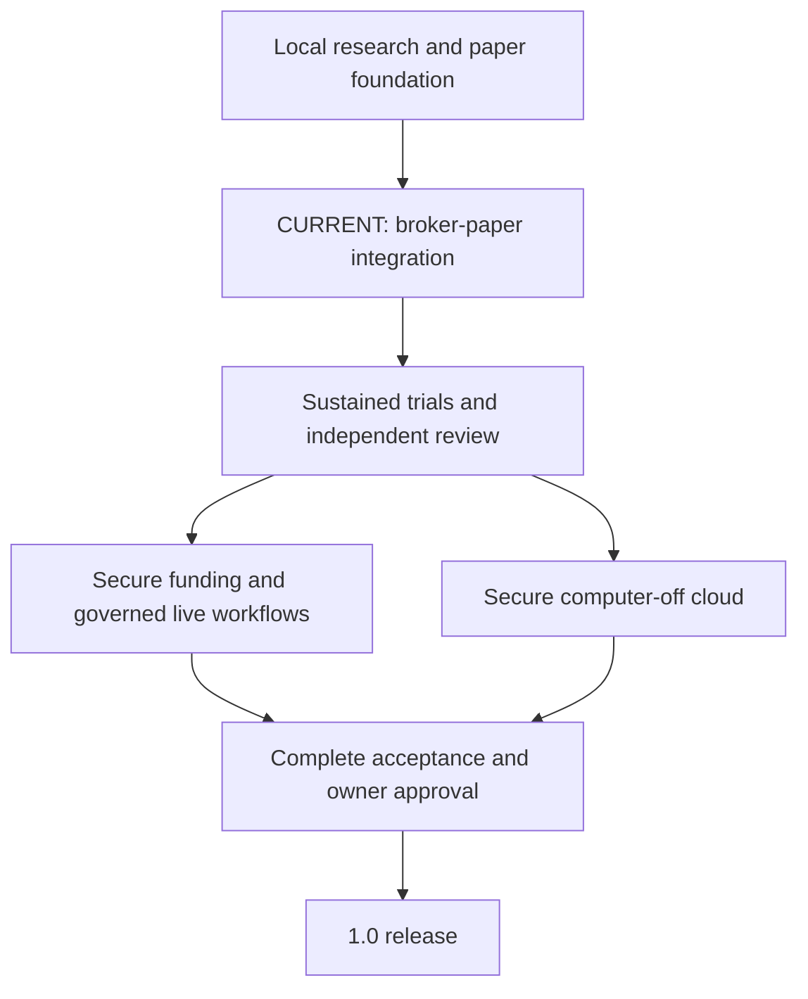

# Nexus Operative — read-only 1.0 roadmap

Revision: 0.340.275. Branch: `development/windows-portal-foundation`.

Generated from `nexus/release_roadmap.py`. View in PORTAL or `GET /api/roadmap`. Changes require source review; the application has no roadmap write endpoint.

Current position: local research and experimental local paper trading are implemented foundations; broker-paper integration and acceptance are the next major gate. Secure funding, governed live workflows, computer-off cloud and final independent/owner acceptance remain unfinished. Version numbers and passing test counts are not percent-complete estimates.

Current hardening: v0.340.275 extends the POSIX current-user/mode-bit fence to the shared provider POST, provider-read, account-read pacing and Activity SSE cursor owner locks. Unsafe inherited locks and exact directories are rejected before mutation without chmod repair, and active lock/directory mode drift fails closed. This strengthens local broker-paper coordination, but it is not ancestor-path or extended-ACL acceptance, Windows ACL acceptance, an administrator boundary, distributed ownership, genuine-feed or broker acceptance, profitability, funding/live/cloud readiness or release approval. No engagement control or editable parameter changed; the existing trial-readiness button retains black/bright-purple bottom-right hover help. Rough implementation remains about 40% (30–45%, low confidence), with 0/9 major stages fully accepted.

| Milestone | Status | Evidence | Remaining acceptance |
| --- | --- | --- | --- |
| M1: Windows packaging and recovery | PARTIAL | Windows test, EXE startup and installer workflows; passive portfolio and forward-history/session/capacity reads preserve absent storage; existing state uses read-only transactions, combined forward polling shares one evidence snapshot; recovery/order/session reads use read-only journal replay and read-only linked-portfolio attachment, with missing history distinguished from flat-account proof; installed smoke explicitly exercises dashboard/recovery reads; operator-created paper snapshots reject source/destination link indirection, require regular single-link files, use bounded SQLite backup contention, enforce fixed source/count/aggregate/directory/free-space admission, flush completed content, sync the directory entry where supported and require a stable read-only SQLite quick-check plus complete local hash-chain/accounting reconstruction before issuing a receipt, then remove failed candidate files without replacing or pruning retained snapshots; durable order recovery; installed-process/reinstall/uninstall smoke with explicit disposable fresh/saved setup profiles and settings-byte preservation assertions, plus distribution checksum tooling; verified offline backup/new-directory restore tooling and fresh-process linked-ledger/quote-evidence recovery drill and installed-API restored-data smoke tooling with pinned prior-version fixture support and default Windows data-layout checks; the Windows distribution includes a manifest-bound owner-operated non-elevated LocalAppData profile/effective-ACL probe and strict privacy-safe offline reviewer that retain no username, SID or path and keep all external authority false; documented beginner help for all PORTAL controls and isolated headless-browser acceptance tooling; seven named workspaces, friendly To Do introduction and automatic read-only startup checks with a plain-language purpose and setup scope for every box; new unused settings receive an atomic $10,000 virtual budget and Terrestrial-only entry preset, preserved saved/OFF choices and on-Engage compatible virtual accounting remove redundant form setup. | Exact-SHA automated installer/reinstall/uninstall and pinned prior-data recovery steps passed; execute and independently review the new probe on a clean ordinary-user owner profile, record native-window behavior, and complete prior-installer upgrade acceptance. Tool availability alone is not owner/profile/ACL acceptance. |
| M2: Market data and provenance | PARTIAL | Public observation, timestamp/gap checks, historical admission and source diagnostics; redirect-disabled public transport with exact response-URL checks; canonical compressed hub bars with cross-collector deduplication, conflict quarantine and hash-verified sealed datasets; bounded public candle collection selected by default on explicit Portal start, closed-boundary request coalescing, pre-network storage checks and receipt-time clock/stop fencing. | Independent provenance review; missing/revised/conflicting data and outage evidence. |
| M3: Decision speed and risk authority | PARTIAL | Bounded local research decision queue and retained-ID limits with invalid-clock rejection; disposable bounded linked-ledger burst timing, overflow/expiry and halt flushing; individual Terrestrial/Solar/Universal entry permissions with complete saved-setting validation, transactional enable admission and independent OFF under review; bounded per-product public quote request sharing with clock-fenced cache reuse and process-local transport/avoided-request diagnostics. | Measure full durable path under bursts; verify expiry, overload and permissions throughout autonomy. |
| M4: Order lifecycle and portfolio reconciliation | PARTIAL | Partial/full priced fills, fees, idempotency, cancellation, durable recovery; atomic opt-in paper-ledger linking, partial-position reconstruction, adverse quote-cost assumptions, post-lock runtime exchange/receipt freshness and expiry/stop checks, durable expiry, cleanup-failure pauses and forward process-death tests before/after fill commit.; forward evidence snapshots now enforce their linked-ledger row cap before semantic reconciliation readers run, bind the read-only SQLite attachment to the exact preflighted regular-file identity throughout fingerprint and audit reads, bind each direct start-preflight SQLite read to one regular-file identity, content-metadata sample and SQLite-reported path, require all order/portfolio/forward/settings roles and SQLite companions to remain relationship-distinct, and hold storage-directory plus complete expected-file-set presence/metadata fences across the multi-file diagnostic before allowing its local result | Extend interruption/quote-path stress; independently review execution assumptions, existing-account migration and reconciliation. |
| M5: Durable latency and capacity | PARTIAL | Replay-validated checkpoints, two-snapshot retention, checkpoint interruption tests and isolated gateway and linked-ledger/tier-inclusive p50/p95/p99 benchmark; capacity admission diagnostics; opt-in atomic quote-order fixture treatment with retained commands and crash rollback tests; explicit logical archival with retained IDs and commands; read-only sustained-trial readiness reports quote/session headroom plus conservative every-cycle durable command and ID bounds; an explicit application-closed installed/source rotation tool verifies an offline archive, prepares a fresh halted candidate, retains a second exact source recovery copy, installs the candidate behind a persistent fail-closed marker and can explicitly recover an interrupted pair replacement or roll a completed install back. Archive/candidate/recovery publication, the marker and both live pair replacements use one durable move boundary: parent-directory fsync on POSIX and MoveFileExW WRITE_THROUGH on Windows, while file contents remain separately flushed. Each new v3 candidate retains replay-validated generation lineage plus a bounded private fingerprint set for all retired client-order IDs, rejecting cross-epoch reuse before journal mutation; v1/v2 candidate and legacy recovery/marker records remain readable. A legacy v2 source without fingerprints can proceed only through a private v1 baseline review bound to the exact closed source generation, epoch, replay digest and verified archive manifest. Known archived IDs must be included, raw IDs are never copied into the candidate, and the v4 lineage labels the result OPERATOR_REVIEWED_UNATTESTED. The mandatory operations fixture repeats four synthetic generations and 48 terminal orders, replays every retained archive/candidate/recovery set, verifies all 48 retired-ID fingerprints, exercises the legacy migration fence and requires each installed live journal to return to its four-command halted baseline. | Extended multi-epoch long-run scalability and pressure acceptance, sustained queue pressure, source-retirement policy and independent archive/private-volume/native Windows power-loss/profile/ACL acceptance remain open. The bounded synthetic fixture is not duration, market throughput or native interruption evidence. Write-through metadata publication reduces a known Windows durability gap but is not physical power-loss proof. The private fingerprint fence covers only a complete retained lineage; it does not establish caller identity, other-host coordination or broker-wide idempotency. A reviewed legacy baseline records an operator completeness assertion, not source attestation; independent review of the actual private scope remains required. Installation reclaims live journal capacity but preserves source history externally, never resumes operation and grants no broker, funds, live or release authority; the conservative trial bound is not expected trading volume or validated broker throughput. |
| M6: Scientific strategy evidence | PARTIAL | Chronological research, holdout, regime and cost-stress modules; persisted multi-horizon ridge momentum baselines with training-only scaling, purged chronological holdout, naive/momentum comparisons, generation invalidation and compact research signals; three built-in trained feature specialists with fixed three-block baseline checks, disagreement reporting and independent deterministic validation/provenance reviewers; versioned saved research packs and unchanged-data reuse; three expanding-window refits with purged training targets, delayed nonoverlapping modeled fills, fixed cost scenarios and fold-consistency checks; shared causal feature computation and serialized preparation; engine-started bounded learning with captured public/saved-only scope, bounded polls/fit attempts, generation skips, local OS ownership and stop-fenced publication. | Independent model calibration and walk-forward/forward evidence, licensed shared-source provenance, delisting/survivorship review and performance audit; trained baselines are not validated market edge. |
| M7: Unattended paper operation | PARTIAL | Explicitly started BTC public-quote paper runner; separate research-engine and explicit Engage Paper controls, independent emergency throttle cut preserving research, reset/start race fencing, dedicated coalesced emergency cleanup independent of feed/general workers, plus a separate installed emergency-stop process that publishes the durable latch before SQLite, starts no Portal/network/vault/reset path, is adopted by a running API and is consulted at paper start/quote/submit/fill boundaries; cancellation-shielded cut completion and pending/verified/unconfirmed status, queued-reset epoch checks, an immediate local runner cut signal and post-lock veto during real SQLite contention, independent bounded local cut-intent persistence and conservative restart recovery, native Windows read-only journal fault fencing with explicit post-recovery cleanup retry, process-death-before/after-cut-commit recovery fixtures, tier-gated entries, exits, halt/pause, feed-failure stop, durable session counters/heartbeats and fingerprinted fixed-policy admission; retained quote evidence, quote/fill price/quantity/fee/policy crosschecks, portable review summaries and exclusive local process ownership, clock-discontinuity pauses and exchange-regression warmup fencing and retained-storage preflight with operator runbook; bounded repeatable forward-runner fixture drill with fresh-process evidence comparison; operator recovery snapshot and pending-remainder inspect/cancel controls; Singularity account-equity and Fractal coordinated shared-time position constellation plus per-holding observed history with retained ranges and journal adjustment inspection and transactionally retained closed-day observation history with bounded active/total admission and range responses plus observation database byte/free-disk budgets and rollback-safe allocation failure handling.; read-only start preflight now samples the actual cross-process forward-owner lock before replay, while lock acquisition and sampling reject symlink, hardlink, malformed and pathname-replaced lock stores without treating the sample as a reservation; the forward worker now revalidates its exact opened regular single-link owner path through preparation, quote intake, submit/fill boundaries, diagnostic commits and release, while cancellation and the independent emergency cut remain available after ownership uncertainty; forward and research-refresh owners now also bind the physical directory that scopes their lock, reject a symlinked owner directory and fail closed if that directory is replaced even when the same single-link lock inode is moved back under the public path; every active owner validation now brackets the public lock-path identity sample with the acquired directory identity, so replacement between those samples cannot acknowledge even when the same locked inode is moved into the replacement directory; research refresh now revalidates its acquired owner lease before collection requests, retained-data intake, training and model-reference publication, discarding work and pausing for review when the public owner path changes; paper-forward ownership now requires the fixed one-byte marker before and after every OS lock acquisition and during active lease validation, rejecting malformed existing state without repair and invalidating an in-place marker change before further acknowledged work; on POSIX, paper-forward ownership also requires the lock file and containing directory to remain owned by the current effective user, and the lock file to remain owner-readable/writable without group/other write access, rejecting unsafe inherited state without repair and detecting mode drift during an active lease; the POSIX owner directory is now created private and must remain free of group/other write permission before acquisition and throughout an active lease, rejecting unsafe inherited state without repair | Extend native Windows acceptance to ordinary-user ACL inheritance and whole-machine pressure; run sustained real-feed forward validation, independent policy evidence review and multi-market scheduling. Local subprocess/file-attribute outage tests are not broker or market performance evidence. |
| M8: Broker paper integration and operations | OPEN | Provider-neutral design plus disconnected Alpaca paper IOC-limit previews and bounded identity/status/cumulative-fill diagnostics and explicit execution/asset-fee balance projections plus chronological fee-reserved funding audits with equal-time ambiguity and nonterminal-reservation review using repeatable fixtures; a bounded account-scoped durable request/uncertain-attempt/observation journal with replay validation and crash/lost-ack fixtures, persisted lookup-attempt limits, shared cooldowns and conservative timeout/not-found/rate-limit/authentication outcome handling, read-only pending-ticket review and explicit current-head-fenced lookup-interruption records preserving attempts and order uncertainty; an opt-in fixed-host GET-only paper account inspection primitive with bounded reads, redirect rejection, clock/permission fencing, stable account identity and conservative observed cash/BTC checks, explicit Windows credential pair storage/removal with verified readback, local mutation fencing and bounded same-origin Portal controls for separately confirmed one-time inspection; an explicit original-client-ID recovery coordinator sharing the bounded reader, persisting attempts before IO and normalized outcomes under post-lock clock/permission checks, with saved-key mutation fencing and crash/uncertainty retention; a bounded supplied Trading REST BTC/USD activity adapter with explicit fill prices/quantities, semantic deduplication, nanosecond time preservation and cumulative-chain checks, keeping received-asset fee debits unlinked and date semantics/coverage unverified; an internal explicitly confirmed two-page paper activity collector with canonical creation-window paths, exact opaque cursors, account/key/time fencing and explicit partial/end-observed reports, retaining no verified coverage or automatic continuation; optional account-bound local activity retention with canonical record reuse, immutable order bindings, bounded full replay and atomic crash/lost-return recovery, read-only cross-batch fill-chain review with snapshot conflict/revision checks and declared-window gap diagnostics; an optional explicit local paper-read reservation journal shared across inspection, activity collection and recovery, retaining cooldown/rate/auth/interruption blocks across cooperating processes and holding local OS ownership through read cleanup, with explicit account/head/token-fenced interruption review preserving unknown outcomes and full-day cooldowns; a pure combined supplied balance review compares explicit linked fills/fees with total cash/BTC while separately checking availability/open IOC terms without inferring provider holds or spending permission; optional collection observations preserve bounded page identities, opaque cursor chains, read timing and normalized-content/query digests within atomic activity receipts, without attesting source or coverage; an exact-account/head-bound retained gross-fill and total-balance residual review preserves nanosecond groups, rejects stale/concurrently changed history and leaves all fee links/posting scope/funding unverified; the explicit paper inspector and Accounts display now separate reported cash, non-margin buying power, total/available BTC and unknown/unavailable differences with normalized fingerprints/sampled timing, fail-fast malformed/foreign collections and no non-USD cash projection; portable allowlisted JSON observations now support explicit local download and bounded offline content-consistency validation without source attestation; a read-only portable-observation pair review now binds account/manifests/history head, checks sequential read windows for retained boundary fills and conditionally compares total balances without rounding nanoseconds or promoting source/funds authority; the existing confirmed inspector and Accounts readout also summarize bounded simple IOC buy-limit principal and sell remainders, deduplicate matching terms, preserve nanosecond identities and leave unsupported/conflicting aggregates unknown without claiming holds; an internal explicitly confirmed single-attempt Alpaca paper POST boundary now checks fixed account/position/asset endpoints, requires an exact-head shared-local provider POST budget, commits both reservations before IO, rechecks permission/stop/credentials after the marker and never retries; a separate explicit reviewed recovery boundary clears only an ambiguous shared-budget latch after two exact-head replays prove the original client ID has a retained terminal observation, while preserving the full cooldown/history and permanently attempted request; a bounded read-only exact-head history composition now joins every completed POST attempt to the checked submission marker in up to seven account request journals, requires RESPONSE_OBSERVED to retain a request snapshot and NOT_SENT to retain none while preserving OUTCOME_UNKNOWN uncertainty, and refuses pending/interrupted, omitted, stale, changing, legacy, unbound, duplicate or related-path evidence; a second bounded read-only composition joins those exact POST attempts through the same request heads to complete accepted activity histories, requiring observed and recovered attempts to match retained order/fill evidence, NOT_SENT to retain no observation/fills and unresolved unknown outcomes to remain blocked; a single-account private exact-head composition now joins that POST/activity result to complete request/fill replay and four ordered stability-guarded balance observations, rechecking every journal and retaining gross-only residuals as non-authoritative diagnostics; a stricter fee-bearing composition additionally partitions every accepted receipt and requires every retained fee record to carry an explicit order/execution reference pair resolving to an accepted original fill while retaining reference semantics, date-only timing, fee coverage, posting allocation, holds and funds as unverified; a further known-fee reserve composition requires every accepted order to participate, reserves only retained explicitly referenced fee obligations at their accepted fill groups, rejects unfunded group debits and requires the local ending totals to match supplied closing inventory without promoting completeness, posting, holds or spendable-funds authority; validated with injected responses only, with no Portal, saved-write-credential or strategy route; an explicit source-only Windows saved-pair acceptance probe composes the account-ID-bound four-GET inspector with caller-selected durable local pacing, vault-silent pacing status and a content-bound allowlisted open-IOC aggregate from the same read, without granting provider/account/fee/hold/funding/live acceptance; Accounts now offers separately confirmed managed paced reads and vault-silent retained pacing review, with account-hashed private OS-profile storage and no automatic retry/reset; pacing, activity and request journals now preflight regular single-link files, bounded headers and DELETE-mode history, rejecting WAL layouts and sidecars before SQLite without conversion or evidence deletion; private cross-journal status replays every accepted receipt and exact successful pacing/activity head transition, separating latest-tail from historical-content disagreement without automatic repair; a read-only reconciliation composition requires no unverified legacy baseline and exactly one accepted record per retained pacing session, activity batch and collection observation, binds two portable observation manifests to that exact retained activity head and requires an exact nanosecond union of accepted declared creation windows to cover the full observation envelope before arithmetic, then rechecks all journals without promoting source, provider boundaries, received coverage, funds or routing authority.; a no-network supplied Activity SSE schema review now fail-closes to BTC/USD TRD fills and one-to-one USD fees, requires strict ULID cursor order and unique stable ref IDs, binds each admitted fee parent_id to a supplied fill, and rejects corrections, busts, bulk fees, FX and unsupported financial activities without claiming stream entitlement, delivery, replay coverage or provider source; a supplied two-segment reconnect review now requires the exact last processed ULID as since_id, idempotently deduplicates immutable ref_id redelivery, advances only on later event IDs and rechecks fee-parent links, while durable cursor storage, automatic backoff, real reconnect and complete replay remain explicitly unverified; a bounded supplied-wire Activity SSE session review now binds the exact v2beta1 since_id target, text/event-stream metadata, arbitrary byte chunks, strict UTF-8/SSE/JSON framing, heartbeats and the existing linked trade/fee envelope review, while slow-consumer drops and internal-error comments require reconnect review and remain ineligible for cursor checkpoint authority; an explicitly confirmed single-attempt paper Activity SSE transport now opens only the exact since_id target, disables proxies and redirects, validates streaming metadata before reading, fences every bounded read with permission, emergency-stop, credential and clock checks, and passes a complete two-event segment through the strict wire review without retry, reconnect, cursor mutation or authority; an explicitly confirmed one-attempt Activity SSE checkpoint coordinator now binds a caller-supplied private prior segment and the exact cursor-journal head to one fixed-target resumption GET, re-proves immutable duplicate redelivery plus forward advancement, rejects interruption comments and commits at most one crash-recoverable cursor transition while retaining no automatic retry/backoff, ledger, routing or funds authority; a private account-bound reconnect budget now reserves every explicitly confirmed SSE attempt before IO, enforces a fixed 1/2/4/8-second process-recoverable backoff with a four-attempt cap, blocks pending/lost-result episodes and composes one due attempt with the exact cursor checkpoint while never sleeping, looping or retrying automatically; a reservation-bound cursor-checkpoint receipt and separately confirmed no-network result reconciliation now close only the exact pending reconnect attempt after a checkpoint/result crash window, reject legacy/foreign/stale evidence and make lost recovery acknowledgment replay idempotent without another provider request; an exact-head, doubly confirmed no-network uncertainty close now permanently retires a reconnect reservation whose provider outcome could not be durably timestamped, retains the consumed attempt and review requirement, schedules no retry and makes exact lost-close acknowledgement replay byte-stable; after a failed reconnect attempt with no cursor transition, outcome-clock failure now durably closes from the last trusted admission time as terminal review state, recovering a lost result acknowledgement by inspection and never creating retry authority; successful or cursor-advanced attempts remain pending for exact checkpoint reconciliation; successful reconnect completion and explicit no-network checkpoint reconciliation now recover a lost result acknowledgement in the same call only when the current terminal result exactly binds the reservation token, requested and final success values, zero retry fields and checkpoint receipt; a new write also binds the supplied result time, while an uncommitted or mismatched result remains uncertain without another provider request; failed reconnect results now apply the same exact same-call acknowledgement recovery to retry, review, checkpoint-uncertain, provider-delay and emergency-stop-converted outcomes, requiring the current result head, reservation token, result time, requested/final values, zero checkpoint fields and exact delay state; uncommitted or mismatched results remain pending and the original provider failure is suppressed only by a fixed uncertainty diagnostic; automatic closure after a failed reconnect whose completion clock is unavailable, invalid or regressing now applies the same exact current-result proof, including result-head identity, reservation token, trusted admission time, requested/final review outcome, absent checkpoint fields and zero delay state; failed or malformed recovery inspection returns a fixed uncertainty diagnostic without exposing private faults or repeating provider IO; post-attempt cursor inspection is now a fixed fail-closed boundary: unreadable, malformed or invalid cursor state returns a sanitized cursor-uncertainty diagnostic, retains the exact pending reconnect reservation with no result or retry due, and performs no second provider request; only one valid digest head may decide unchanged versus advanced checkpoint state; explicit checkpoint reconciliation now treats every post-result reconnect-budget inspection as an untrusted crash-recovery boundary: lost acknowledgements, unreadable storage and malformed retained views produce only fixed recovery uncertainty, preserve any committed terminal result and never repeat provider IO; exact completion still requires stable result-head, reservation, timestamp and checkpoint receipt agreement; explicit checkpoint reconciliation now also sanitizes its initial reconnect-budget and cursor-binding preflight views before any recovery write: unreadable or malformed budget state returns fixed recovery-state uncertainty, unreadable or malformed cursor binding returns fixed binding-review failure, and neither path mutates the pending reservation or repeats provider IO; reconnect admission now treats its initial cursor inspection as the same fail-closed boundary used after an attempt: unreadable, malformed or invalid state returns fixed cursor-state uncertainty before reservation or provider IO, leaving both stores untouched and granting no retry authority; reconnect admission now also validates the initial reconnect-budget view before reservation: unreadable storage, missing fields, invalid digests, clocks, counters, flags or reasons return fixed admission-state uncertainty, expose no private fault, leave both stores untouched and perform no provider IO; reconnect reservation now treats any non-policy exception as a fail-closed acknowledgement boundary: failures before commit and lost acknowledgements after commit return fixed reservation-state uncertainty, never start provider IO, and preserve any durably pending reservation with no result or retry due for explicit review; reconnect reservation acknowledgements are now admitted only when their token/head, cursor binding, bounded attempt and exact boolean replay/authorization fields form one internally consistent result; missing, malformed or conflicting fields return fixed reservation-state uncertainty before provider IO and leave any committedm«ëŒ+Š×�®º+º$zzb¥â&W6W'fF–öâVæF–ærf÷"W‡Æ–6—B&Wf–Ws²7G'V7GW&ÆÇ’fÆ–B&V6öææV7B&W6W'fF–öâ6¶æ÷vÆVFvVÖVçBæ÷r&V6V—fW2â–æFWVæFVçBW†7BGW&&ÆRÖ¦÷W&æÂ&ööb&Vf÷&R&÷f–FW"”ó¢F†RVæF–ærFö¶Vâö7W'&VçB†VBÂGFV×BÂFÖ—GFVB7W'6÷"Â&–÷"'VFvWB†VBÂWfÇVF–öâF–ÖRÂ&V6öâæBVÆ–v–&ÆR&–÷"&WG'’7FFR×W7Bw&VS²f÷&vVBVæ6öÖÖ—GFVB&WGW&ç2Â6÷''WFVBf–VÆG2æBVç&VF&ÆR÷7BÖ6öÖÖ—B7FFRf–Âv—F‚f—†VB&W6W'fF–öâVæ6W'F–çG’æBÆVfRç’&VÂ&W6W'fF–öâVæF–ærv—F†÷WB&WVW7BWF†÷&—G“²F†RW†7B&V6öææV7B&W6W'fF–öâ—2æ÷r&R×&÷fVBBWfW'’F÷vç7G&VÒW&Ö—76–öâfVæ6R–æ6ÇVF–ærF†RG&ç7÷'B6†V6·ö–çB–ÖÖVF–FVÇ’&Vf÷&R÷Væ–ærF†R&÷f–FW"&WVW7C²6öæ7W'&VçB&W7VÇBÂ6†ævVBFö¶Vâ÷"Vç&VF&ÆR¦÷W&æÂ&Wfö¶W27FÆR&WVW7BWF†÷&—G’v—F‚f—†VB&W6W'fF–öâVæ6W'F–çG’Â&W6W'fW2F†R7W'&VçBGW&&ÆR÷væW"7FFRæBW&f÷&×2æò&÷f–FW"”ó²F†RW‡Æ–6—BÆö6ÂVÖW&vVæ7’×7F÷&÷'BÂ&WG'’×v—B6Æ÷6RæB÷WF6öÖR×Væ6W'F–çG’6Æ÷6Ræ÷r–âF†RW†7B&V6öææV7BÖ'VFvWBF‚ö66÷VçB&–æF–ær7&÷72WfW'’6ÆÆ&6²Â&WÆ’ÂG&ç67F–öâæB&W7VÇB6¶æ÷vÆVFvVÖVçBÂ&WGW&æ–ærf—†VB7F÷&RÖ&–æF–ærVæ6W'F–çG’&Vf÷&R&WF&vWFVB7F÷&R6â&R–ç7V7FVB÷"w&—GFVã²&V6öææV7BÖ'VFvWBFÖ—76–öâæBFW&Ö–æÂ×&W7VÇBW'6—7FVæ6Ræ÷r–âF†V—"÷vâW†7BF‚ö66÷VçB&–æF–ær7&÷72–æ—F–Â&WÆ’Â&÷F‚VÖW&vVæ7’×7F÷6×ÆW2ÂW†7BÖ†VBG&ç67F–öç2æBf–æÂ6¶æ÷vÆVFvVÖVçB–ç7V7F–öâÂ&öÆÆ–ær&6²&WF&vWFVBw&—FRæB&W6W'f–ær&WÆ–&ÆR66†VÖÖöæÇ’g&W6‚¦÷W&æòF†R&V6öææV7BÖ'VFvWBV&Æ–2–ç7V7F–öâ&÷VæF'’æ÷r–ç2—G2W†7BF‚ö66÷VçB–FVçF—G’7&÷72f–ÆR&VfÆ–v‡BÂFF&6R6öææV7F–öâæBgVƦ÷W&æÂ&WÆ’Â&WGW&æ–ærf—†VB7F÷&RÖ&–æF–ærVæ6W'F–çG’&F†W"F†âÖ—†VB×66÷Rf–Wr–bç’–çFW&æÂ6VÒ&WF&vWG2F†R×WF&ÆR7F÷&S²FW&Ö–æÂ&V6öææV7BÖ'VFvWB6¶æ÷vÆVFvVÖVçG2&Ræ÷rG&VFVB7–ÖÖWG&–6ÆÇ’v†WF†W"Æ÷7B'’W†6WF–öâ÷"&WGW&æVBÖÆf÷&ÖVC¢7V66W72Âf–ÆVBÖGFV×B66†VGVÆ–ærÂG'W7FVB×F–ÖRVæ6W'F–çG’6Æ÷7W&RæBW‡Æ–6—BæòÖæWGv÷&²6†V6·ö–çB&V6öæ6–Æ–F–öâ6öÆB×&WÆ’F†RW†7BGW&&ÆR&W7VÇB&Vf÷&R6öçF–çV–ærÂv†–ÆRVæ6öÖÖ—GFVB÷"Ö—6ÖF6†VB7FFR&VÖ–ç2f—†VBVæ6W'F–çG’æBæòFF—F–öæÂ&÷f–FW"&WVW7B—2w&çFVC²æòÖæWGv÷&²÷WF6öÖR×Væ6W'F–çG’æBVÖW&vVæ7’×7F÷6Æ÷7W&W2æ÷rÇ6òF—66&B7G'V7GW&ÆÇ’&WGW&æVB6¶æ÷vÆVFvVÖVçG2æB66WBöæÇ’âW†7B6öÆB×&WÆ–VBFW&Ö–æ¦÷W&æÂ&V6÷&BÂv†–ÆRâVæ6öÖÖ—GFVB&WGW&â÷"6†ævVBf–ÆR&VÖ–ç2f—†VBVæ6W'F–çG“²F†÷6RæòÖæWGv÷&²6Æ÷7W&W2æ÷r&V6övæ—¦RF†V—"&öGV7F–öâ×&Vf—†VBf—†VB6¶æ÷vÆVFvVÖVçB×Væ6W'F–çG’F–væ÷7F–72&Vf÷&RW†7B&V6÷fW'’Âv†–ÆRVç&VÆFVBG—VBFVæ–Ç2&VÖ–âWF†÷&—FF—fS²F†R&—fFRF‡&VRÖ¦÷W&æÂö'6W'fF–öâ&V6öæ6–Æ–F–öâæ÷r6×ÆW2&÷VæFVBæòÖföÆÆ÷r4„Ó#Sbf–ævW'&–çG2f÷"F†RW†7B6–ærÂ7F—f—G’æB66WFæ6R5Æ—FRf–ÆW2&Vf÷&RæBgFW"6VÖçF–2&WÆ’Â&V¦V7F–ær6ÖRÖ†VB'—FR&Ww&—FW2–FVçF—G’öÖWFFF6†ævW2æB&öÆÆ&6²õtÂ÷6†&VBÖÖVÖ÷'’6–FV6'2v—F†÷WBW‡÷6–ærF‡2÷"&—fFRF–vW7G3²F†R†–v†W"66÷VçBÖWf–FVæ6R6ö×÷6—F–öâW‡FVæG2F†B7F&–Æ—G’wV&BFò—G2&WVW7B¦÷W&æÂæB7ç2–ææVBÂW‡Æ–6—FÇ’6×ÆVB7W'&VçBÖ†VBæBf÷W"Öö'6W'fF–öâ&Wf–Ww2Â6òÆÂf÷W"W†7BÆö6Âf–ÆW2×W7B&VÖ–â'—FR–FVçF—G’æBÖWFFF7F&ÆR&÷VæBF†R6ö×÷6VB&W7VÇC²F†R–çFW&æÂ6–ævÆRÖGFV×BW"õ5B&÷VæF'’æ÷r&WV—&W2Gvò–FVçF–6Âæ÷&ÖÆ—¦VB66÷VçBæB%D2×÷6—F–öâFÖ—76–öâ6×ÆW2&÷VæBF†R76WB&VBÂ6òç’ÆFRW&Ö—76–öâÂVæF–ærÖgVæG2öfVRÂ66‚ö'W––ærÖ66—G’÷"%D2VçF—G’öf–Æ&–Æ—G’6†ævRf–Ç2&Vf÷&R—G2GW&&ÆR&W6W'fF–öç2æBöæÇ’ÆÆ÷vVBõ5C²WfW'’W†6WF–öæÂ6–ævÆRÖGFV×Bõ5BÖ'VFvWB6Æ÷7W&Ræ÷r–væ÷&W2—G2w&—FR×6–FR&WGW&âæB&WV—&W2Gvò7F&ÆR&VBÖöæÇ’&WÆ—2öbF†RW†7BFW&Ö–æÂFö¶VâÂ66÷VçBö6Æ–VçBÂ&WVW7B÷–ÆöB†VG2Â÷WF6öÖRæB7GVÂÕõ5B6÷VçB&Vf÷&R&W6W'f–ærF†R÷&–v–æÂf–ÇW&S²Æ÷7B6¶æ÷vÆVFvVÖVçG2&V6÷fW"Æö6ÆÇ’Âv†–ÆRÖ—76–ærÂÖÆf÷&ÖVB÷"Vç7F&ÆR6Æ÷7W&R7FFR&VÖ–ç2VæF–ær÷"&Wf–WrÖ&Æö6¶VBVæFW"f—†VBVæ6W'F–çG’F–væ÷7F–2v—F†÷WBæ÷F†W"&÷f–FW"&WVW7C²F†R6–ævÆRÖGFV×Bõ5B&÷VæF'’Ç6òF—66&G2F†R&÷f–FW"Ö'VFvWB$Tt”â6¶æ÷vÆVFvVÖVçBæB6öÆB×&WÆ—2F†RW†7BVæF–ærFö¶VâÂ66÷VçBö6Æ–VçB†6†W2Â&WVW7B÷–ÆöB†VG2æB÷væW"–FVçF—G’Gv–6R&Vf÷&R7&VF–ærF†R&WVW7BÖ&¶W#²öæÇ’F†R÷&–v–æ–â×&ö6W72÷væW'6†—ÆV6RÖ’6öçF–çVRÂv†–ÆRÖ—76–ærÂÖÆf÷&ÖVBÂVç7F&ÆR÷"&WÆ6VÖVçBÖ÷væW"7FFR7F÷2&Vf÷&R&÷f–FW"”òVæFW"f—†VB&W6W'fF–öâVæ6W'F–çG“²&÷f–FW"Ö'VFvWBæB&WVW7BÖÖ&¶W"6öÆB&WÆ’æ÷rÇ6ò&–æG2V6‚GW&&ÆRFÖ—76–öâF–ÖW7F×FòF†R6ÆÆW"Öö'6W'fVBW&Ö—76–öâÂVÖW&vVæ7’×7F÷æBÖöæ÷Föæ–2Ö6Æö6²v–æF÷rÂ&WF–ç2F†R&÷f–FW"&W6W'fF–öâFÖ—76–öâ–â—G2&WÆ’&V6V—Bö†—7F÷'’ÂæB&WV—&W2F†RÖ&¶W"FÖ—76–öâFòföÆÆ÷rF†B&W6W'fF–öâ&Vf÷&Rç’õ5C²÷WBÖöb×v–æF÷rGW&&ÆR7FFR&VÖ–ç2VæF–ær÷"6Æ÷6W22äõEõ4TåBv—F‚æò&÷f–FW"”ó²FW&Ö–æÂ&÷f–FW"Ö'VFvWB6öÆB&WÆ’æ÷rÇ6ò&–æG2$U5ôå4Uôô%4U%dTBæBF†R¦W&òööæRÕõ5BäõEõ4TåBôõUD4ôÔUõTä´äõtâ6fWG’6Æ÷7W&W2Fò6ÆÆW"×v—FæW76VB6ö×ÆWF–öâv–æF÷w3²6fWG’6Æ÷7W&RW6W2F†RW†7BÆ7BG'W7FVBFÖ—76–öâ6×ÆR6ò&Wfö¶VBW&Ö—76–öâ÷"â7F—fRVÖW&vVæ7’7F÷æWfW"æVVG2Fò&R&VƆVBÖW&VÇ’Fò&WF—&RÆö6Â7FFRÂv†–ÆRâ÷WBÖöb×v–æF÷rFW&Ö–æÂ&÷r&VÖ–ç2f—†VBVæ6W'F–çG’v—F†÷WBæ÷F†W"&÷f–FW"&WVW7C²¦W&òööæRÕõ5B6fWG’6Æ÷7W&Ræ÷r'&6¶WG2—G2&÷f–FW"Ö'VFvWBFW&Ö–æÂw&—FRv—F‚7F&ÆRgVÆÂÖ6†–â&WVW7BÖ¦÷W&æÂ&V6V—G2Â&WV—&–ærF†R–FVçF–6ÂW†7B&WVW7B†VBö66÷VçB÷–ÆöBgFW'v&B6ò6öæ7W'&VçB÷&–v–æÂÔ”BÆöö·WGfæ6R––VÆG2öæÇ’f—†VBVæ6W'F–çG’æBæWfW"æ÷F†W"&÷f–FW"&WVW7C²7V66W76gVÂ&W7öç6R6ö×ÆWF–öâæ÷rÇ6ò'&6¶WG2F†R&÷f–FW"Ö'VFvWBFW&Ö–æÂw&—FRv—F‚W†7B6öÆB&WÆ’öbF†R–Ö×WF&ÆRô%4U%dR&Vf—‚Â6òâ–çfÆ–FFVB&W7öç6RWfVçB÷"÷7B×w&—FR6VÖçF–2×&VFW"f–ÇW&R––VÆG2f—†VB6ö×ÆWF–öâVæ6W'F–çG’v—F†÷WBæ÷F†W"&÷f–FW"&WVW7BÂv†–ÆRÆFW"fÆ–B÷&–v–æÂÔ”BÆöö·W&VÖ–ç2W&Ö—GFVC²&W6öÇfVB×Væ¶æ÷vâõ5BÖ'VFvWB&V6÷fW'’æ÷r–væ÷&W2—G2w&—FR6¶æ÷vÆVFvVÖVçBæB&WV—&W2Gvò–FVçF–6Â&VBÖöæÇ’&V6V—G2f÷"F†RW†7B&V6÷fW'’†VBÂ&Æö6¶VBGFV×BÂFW&Ö–æÂ&WVW7B×&W6öÇWF–öâ†VBæBVæ6†ævVB6ööÆF÷vâÂ6òÆ÷7B6¶æ÷vÆVFvVÖVçB—2&V6÷fW&VBv—F†÷WB&RÖ&Ö–ærF†R÷&–v–æÂ&WVW7Bv†–ÆR'6VçB÷"f'&–6FVBGW&&ÆR7FFR&VÖ–ç2&Æö6¶VC²F†R&÷f–FW"Õõ5B&V6öæ6–Æ–F–öâ&÷VæF'’æ÷rfÆ–FFW2F†R&WF–æVBö'6W'fF–öâw26†&VBw&÷72Ö&Ææ6RæB7F—f—G’7V'&Wf–Ww2Â&–æG2&÷F‚66÷VçBö7F—f—G’†VG2FòF†R÷WFW"ö'6W'fF–öâÂ&WÆ—2F†Rw&÷72Ö&Ææ6R66÷R†6‚æB&V¦V7G2æW7FVBWF†÷&—G’&öÖ÷F–öâ÷"&VÖ÷fVB&WÆ’ö&—F†ÖWF–277W&æ6W3²F†R&÷VæFVB7F—f—G’54R&W7öç6R66÷Ræ÷r&W6W'fW2F†R÷&–v–æÂf—†VB6fWG’f–ÇW&RWfVâv†Vâ†÷7F–ÆR&W7öç6R6öçFW‡BGFV×G2Fò7W&W72—B÷"&—6W2â÷&F–æ'’6ÆVçWW†6WF–öâÂv†–ÆR&ö6W72Ö6öçG&öÂ6–væÇ2&VÖ–â–æFWVæFVçFÇ’f—6–&ÆS²F†RGW&&ÆR&V6öææV7B'VFvWB&V6÷&G2F†RöæRtUB2æöâ×&WG'–&ÆR&Wf–Wrv—F‚æò7W'6÷"Gfæ6RÂ&WG'’÷"6ÆVW²f–ÆVBg&W6‚7F—f—G’Ö66WFæ6R6öææV7F–öâÂ&vÖÂG&ç67F–öâÂ66†VÖæB&6VÆ–æRw&—FW2æ÷r&VÖ÷fRöæÇ’F†V—"W†7BæWvÇ’7&VFVBV×G’6–FV6"Ög&VRF†æÖR6òöæRW‡Æ–6—B&–æB&WG'’6â–æ—F–Æ—¦R6ÆVæÇ’Âv†–ÆR&WÆ6VÖVçB÷"6Æ÷6RVæ6W'F–çG’&VÖ–ç2&WF–æVBæB&Æö6¶VC²7F—f—G’Ö66WFæ6R&6VÆ–æRæBVæBw&—FW'2æ÷r&V¦V7B7V'7F—GWFVB5Æ—FRÖ–â6öææV7F–öâ&Vf÷&R×WFF–öâÂW‡Æ–6—FÇ’g7–æ2F†RW†7B6öÖÖ—GFVBw&—F&ÆRFW67&—F÷"Â&V6†V6²—G2&÷VæFVB'—FW2æBfÇW6‚æWrõ4•‚F—&V7F÷'’VçG'’&Vf÷&R6öÆB6¶æ÷vÆVFvVÖVçB&WÆ“²7F—f—G’Ö66WFæ6RVæBæ÷r–ç2—G27F÷&R&–æF–æræBÖ–âÖf–ÆR6öçFVçB&÷VæBWfW'’VçG'W7FVBFÖ—76–öâö–çWB6ÆÆ&6²ÂFW&—fW2F†RW‡V7FVB6†–â†VB–æFWVæFVçFÇ’æB&WV—&W2GvòW†7B6öÆB&VG2&Vf÷&R6¶æ÷vÆVFv–ær6öÖÖ—C²&—fFR7F—f—G’Ö66WFæ6R–ç7V7F–öâæB÷&FW&VB&WÆ’æ÷r–âöæR&W6öÇfVB7F÷&RF‚Â&VwVÆ"Öf–ÆR–FVçF—G’Â&÷VæFVBÖ–âÖf–ÆRf–ævW'&–çBæBW†7B6W&–Æ—¦VB5Æ—FR6öææV7F–öâ6öçFVçBv†–ÆR&WF–æ–ær&RÖ6öÖÖ—B&öÆÆ&6²Ö¦÷W&æÂWf–FVæ6Rf÷"&VBÖöæÇ’&V6÷fW'’&Wf–Ws²&WF–æVB&÷f–FW"÷&VB&V6V—B–ç7V7F–öâæ÷r†6†W2F†R&÷VæFVB6W&–Æ—¦VBÖ–âÖFF&6R–ÖvR&Vf÷&RæBgFW"&WÆ’æB&V¦V7G2F‚×7ööfVBf÷&V–vâ5Æ—FR6öææV7F–öâv†÷6R'—FW2F–ffW"g&öÒF†R6GW&VB7F÷&Rf–ævW'&–çC²&WF–æVB&÷f–FW"÷&VB&V6V—B–ç7V7F–öâæ÷rÇ6ò&÷fW2F†BF†R÷VæVB5Æ—FR6öææV7F–öâ†2W†7FÇ’öæRÖ–âFF&6R&÷VæBFòF†R6GW&VB&W6öÇfVB7F÷&RF‚Â&V¦V7F–ærfÆ–Bf÷&V–vâ6öææV7F–öâ&Vf÷&R&WÆ“²&÷f–FW"÷&VB&V6V—B–ç7V7F–öâæ÷r–ç2öæRW†7B&W6öÇfVB7F÷&RF‚Â&VwVÆ"Öf–ÆR–FVçF—G’æB&÷VæFVBf–ævW'&–çB7&÷726öææV7F–öâÂ6ö×ÆWFR&WÆ’Â6Æ÷6RæBW†6WF–öæÂVçv–æBÂ&V¦V7F–ær×WF&ÆR×7F÷&R&WF&vWF–æræB6ÖR×F‚×WFF–öâ&Vf÷&R&WGW&æ–ærç’V&Æ–2&V6V—B†—7F÷'“²&÷F‚&Wf–WvVB&÷f–FW"õ5BæB&÷f–FW"×&VB&V6÷fW'’6öÖÖæG2æ÷r&WVBF†V—"W†7B'VFvWB5Æ—FR–FVçF—G’æB6öÖÖ—GFVBf–ævW'&–çB&ööbGW&–ær&WGW&âÖW‡&W76–öâæBW†6WF–öâf–æÆ—¦F–öâv†–ÆR÷WFW"÷væW'6†—&VÖ–ç2†VÆC²&Wf–WvVB66÷VçB×&VB6–ær&V6÷fW'’æ÷r66WG2Æ÷7BÆö6Âw&—FR6¶æ÷vÆVFvVÖVçBöæÇ’gFW"GvòW†7B6öÆB&V6V—G2Âv†–ÆRF†R66÷VçB¦÷W&æ–FVçF—G’æB6öÖÖ—GFVBf–ævW'&–çB&VÖ–â7F&ÆRF‡&÷Vv‚&WGW&âf–æÆ—¦F–öã²F†RW†7BÖ†VB&÷f–FW"ö66÷VçB&VBÖ†—7F÷'’6ö×÷6—F–öâæ÷rG&VG2&WF–æVBVæF–ær÷"&Wf–WrÖ&Æö6¶VB66÷VçB6–ær7FFR2f—'7BÖ6Æ72&V6öæ6–Æ–F–öâ&Æö6¶W"Â6ò6ÆV&–æröæÇ’F†R6†&VB&÷f–FW"'VFvWB6âæWfW"&öÖ÷FR7Æ—B&V6÷fW'’Fò6öç6—7FVçB†—7F÷'“²F†RW†7BÖ†VB&÷f–FW"ö66÷VçB7Æ—B×&V6÷fW'’f—‡GW&Ræ÷r&WV—&W2&÷F‚W‡Æ–6—B&V6÷fW'’÷&FW'2Â&÷f–ærF†Bv†–6†WfW"¦÷W&æÂ&V6÷fW'2f—'7B&VÖ–ç2&Æö6¶VB'’F†RVçF÷V6†VB6–FRVçF–ÂF†R6V6öæB&V6÷fW'’6ö×ÆWFW3²ÖæFF÷'’W†7BÖ†VB&VÆV6RWf–FVæ6Ræ÷r&÷fW2&÷f–FW"ÖöæÇ’Â66÷VçBÖöæÇ’æBÆ–væVBGVÂ×VæF–ær&VB†—7F÷&–W2ÆÂ&VÖ–â&VBÖöæÇ’&Wf–Wr&Æö6¶W'2æB6âæWfW"&R&öÖ÷FVBFòÖF6†VB6ö×ÆWFVB6W76–öç3²F†RW†7BÖ†VB&VÆV6Rf—‡GW&Ræ÷r6ö×÷6W2Gvò66÷VçB¦÷W&æÇ2æB&÷fW2F†BöæRVæF–ær66÷VçB6ææ÷B†–FR&V†–æBgVÆÇ’ÖF6†VBVW"÷"––VÆB'F–ÂÖF6†VB×6W76–öâ7&VF—C²ÖæFF÷'’×VÇF’Ö66÷VçB&VFW"Öf–ÇW&RWf–FVæ6Ræ÷r&÷fW2F†BöæR66÷VçB6VÖçF–2&VFW"6ææ÷B×WFFRVW"¦÷W&æÂæB†–FRF†B6†ævR&V†–æB—G2÷vâW†6WF–öã²×VÇF’Ö66÷VçB&VB&V6öæ6–Æ–F–öâæ÷r&WV—&W2WfW'’6VÆV7FVB66÷VçB–æFWVæFVçFÇ’Fò&WF–âÆÂf—fR&VBW'÷6W2Â6ò6ö×ÆWFRVW"6ææ÷BÖ6²æ÷F†W"66÷VçBv—F‚öæÇ’6ö×ÆWFVB7V'6WB÷"V&â'F–ÂÖF6†VB×6W76–öâ7&VF—C²GW&&ÆR&÷f–FW"÷&VB&Wf–Wr&WFVçF–öâæ÷r–ç2F†R&÷f–FW"'VFvWBæBWfW'’6VÆV7FVB66÷VçB¦÷W&æÂFòöæR–FVçF—G’æB&÷VæFVBf–ævW'&–çB6WB7&÷72ÆÂ6VÖçF–2&WÆ—2Â6ÆÆ&6·2Â6öÖÖ—B6¶æ÷vÆVFvVÖVçBÂW†6WF–öâVçv–æBæBf–æÂ&WGW&ã²GW&&ÆR&÷f–FW"÷&VB&Wf–Wr&V6V—B&WFVçF–öâæ÷r–væ÷&W2—G2w&—FR×6–FR6¶æ÷vÆVFvVÖVçBÂ66WG2âW†7BÆ÷7B6¶æ÷vÆVFvVÖVçBöæÇ’gFW"Gvò7F&ÆR6öÆB&V6V—G2æB–ç2F†R6öÖÖ—GFVB&V6V—B×7F÷&R–FVçF—G’æB&÷VæFVBf–ævW'&–çBF‡&÷Vv‚÷7F6öÖÖ—B6ÆÆ&6·2æBf–æÂ&WGW&ã²&W6öÇfVB×Væ¶æ÷vâõ5B&V6÷fW'’æ÷r6×ÆW2æB&V6†V6·2F†RW†7B&÷f–FW"Ö'VFvWB5Æ—FRf–ÆR–FVçF—G’7&÷726÷W&6R&WÆ’ÂF†RwV&FVB&V6÷fW'’w&—FRæB&÷F‚÷7BÖ6öÖÖ—B6öÆB&V6V—G2Â&V¦V7F–ærF†æÖR&WÆ6VÖVçB2f—†VBVæ6W'F–çG“²F†R6ÖR&V6÷fW'’æ÷rf–ævW'&–çG2F†R&÷VæFVB&÷f–FW"Ö'VFvWB'—FW2&Vf÷&R×WFF–öâæB–ç2F†RæWvÇ’6öÖÖ—GFVBf–ævW'&–çB7&÷72&÷F‚6öÆB&V6V—G2Â&V¦V7F–ær6ÖRÖf–ÆR6öçFVçB÷"ÖWFFF6†ævR2f—†VBVæ6W'F–çG“²gFW"&÷F‚&V6÷fW'’&V6V—G2F†R6öÖÖæB&WÆ—2F†RW†7BÆö6¶VB&WVW7B&ööbv–âÂ6ò÷7BÖ6öÖÖ—B&WVW7B6öçFVçBÂÖWFFF÷"†VB6†ævR&VÖ–ç2f—†VBVæ6W'F–çG’&F†W"F†â7V66W76gVÂ7&÷72Ö¦÷W&æÂ6¶æ÷vÆVFvVÖVçC²F†R&WW6&ÆRÆö6¶VB&WVW7B×6æ6†÷BwV&Bæ÷r&V6†V6·2W†7B–FVçF—G’æB&÷VæFVB6öçFVçBGW&–ær6öçFW‡BW†—B–æ6ÇVF–ær&WGW&âÖW‡&W76–öâæBW†6WF–öâVçv–æBÂ6ò×WFF–öâgFW"6ÆÆW"w2f–æÂ&WÆ’6ææ÷B&V6öÖR7V66W76gVÂ7&÷72Ö¦÷W&æÂ&W7VÇC²&÷f–FW"õ5B÷væW'6†—æ÷r&V6†V6·2F†B—G2Æö6²F†æÖR7F–ÆÂæÖW2F†R÷VæVB&VwVÆ"6–ævÆRÖÆ–æ²f–ÆR&Vf÷&R&VÆV6–ærF†RFW67&—F÷"Â6òÆFR&WÆ6VÖVçB6ææ÷B&V6öÖR7V66W76gVÂ&V6÷fW'’&WGW&ã²66÷VçB×&VBæB&÷f–FW"×&VB÷væW'6†—æ÷r&V6†V6²F†V—"W†7B÷VæVB&VwVÆ"6–ævÆRÖÆ–æ²Æö6²f–ÆRGW&–ær6öçFW‡BW†—BÂv†–ÆRÆÂF‡&VR&VBõõ5BwV&G2æ÷&ÖÆ—¦RâVæf–Æ&ÆRÆö6²F‚Fòf—†VB÷væW'6†—Væ6W'F–çG“²W‡Æ–6—B&Wf–WvVB&÷f–FW"×&VB'VFvWB&V6÷fW'’æ÷r–væ÷&W2—G2VæB6¶æ÷vÆVFvVÖVçBæB&WV—&W2Gvò–FVçF–6Â&VBÖöæÇ’&V6V—G2&–æF–ærF†RW†7B&V6÷fW'’†VBÂ66÷VçBF–vW7BÂ&Æö6¶VB6W76–öâö÷WF6öÖRÂ&V6÷fW'’6÷VçBÂVæ6†ævVB6ööÆF÷vâæBVç&V6Æ–ÖVB66—G’v†–ÆR÷væW'6†—&VÖ–ç2†VÆC²&÷f–FW"×&VB'VFvWB&V6÷fW'’æ÷r–ç2F†RW†—7F–ær5Æ—FRF†æÖR–FVçF—G’æB&÷VæFVBf–ævW'&–çBF‡&÷Vv‚6÷W&6R&WÆ’æB×WFF–öâÂF†Vâ&WV—&W2F†R6öÖÖ—GFVBf–ævW'&–çB&÷VæB&÷F‚6öÆB&V6÷fW'’&V6V—G3²f–ÆVBf—'7B&÷f–FW"÷&VB&V6V—BG&ç67F–öâæ÷r&VÖ÷fW2öæÇ’—G2W†7BæWvÇ’7&VFVBV×G’5Æ—FRF†æÖRgFW"&öÆÆ&6²Â&V¦V7G2&WÆ6VÖVçB÷"6–FV6"Ö&–wV—G’æB&W7F÷&W2'6VçB7FFRf÷"öæRW‡Æ–6—BW†7B&WG'“²7F—fR&÷f–FW"÷&VB&V6V—B×7F÷&Rf–ævW'&–çB6×Æ–æræ÷rW6W2F†R6ÖRv–æF÷w2×÷'F&ÆRF†æÖRö÷VâÖ†æFÆR&÷VæF'’2F†RV–W66VçBwV&BÂW†6ÇVF–æræöç÷'F&ÆRv–æF÷w27F–ÖRv†–ÆR&WF–æ–ær–FVçF—G’Â6—¦RÂ×F–ÖRÂÆ–æ²æB&÷VæFVBÖ'—FR6†V6·3²g&W6‚&÷f–FW"÷&VB&V6V—B–æ—F–Æ—¦F–öâæ÷r6GW&W2F†RW†6ÇW6—fVÇ’7&VFVBF†æÖR–FVçF—G’&Vf÷&R5Æ—FR÷Vç2æB&W7F÷&W2'6Væ6RgFW"6öææV7F–öâÂ&vÖÂG&ç67F–öâÖ&Vv–â÷"66†VÖÖ7&VF–öâf–ÇW&RöæÇ’v†VâF†RW†7BV×G’f–ÆR†2æò6–FV6'3²6öÖÖ—GFVB&÷f–FW"÷&VB&V6V—B7F÷&W2æ÷r7&÷72âW‡Æ–6—Bw&—F&ÆRÖ–âÖf–ÆRg7–æ2&÷VæF'’öâWfW'’66WFVB6öÖÖ—BÂÇW2&VçBÖF—&V7F÷'’g7–æ2f÷"æWvÇ’7&VFVBõ4•‚F†æÖS²fÇW6‚Væ6W'F–çG’&WF–ç2F†RW†7B6öÖÖ—GFVB&V6V—Bf÷"–ç7V7F–öâæBW‡Æ–6—BGWÆ–6FR&WÆ“²F†R6öÖÖ—GFVB&÷f–FW"÷&VB&V6V—Bf–ævW'&–çB—2æ÷rf—†VB&Vf÷&R—G2W‡Æ–6—BÖ–âÖf–ÆRfÇW6‚æB&V6†V6¶VB&Vf÷&RæBgFW"F†BfÇW6‚ÇW2ç’æWrõ4•‚&VçBÖF—&V7F÷'’fÇW6‚Â6ò6ÖRÖ–FVçF—G’6öçFVçB÷"ÖWFFF6†ævR6ææ÷B&V6öÖRâ66WFVBGW&&–Æ—G’&6VÆ–æS²F†RW†7Bw&—F&ÆR&÷f–FW"÷&VB&V6V—BFW67&—F÷"—2æ÷r&÷VæFVBÖ'—FR†6†VB&Vf÷&RæBgFW"—G2W‡Æ–6—Bf–ÆR7–æ2æB×W7BÖF6‚F†RÇ&VG’6öÖÖ—GFVBF†æÖRf–ævW'&–çBÂ6òFW67&—F÷"÷F‚F—fW&vVæ6R6ææ÷B722GW&&ÆR6¶æ÷vÆVFvVÖVçC²æWrõ4•‚&÷f–FW"÷&VB&V6V—B7F÷&W2æ÷r–âF†R&W6öÇfVB&VçBÖF—&V7F÷'’–FVçF—G’&Vf÷&R÷Væ–ær—BÂ&WV—&RF†Rg7–æ2FW67&—F÷"æB÷7BÖfÇW6‚F†æÖRFò&WF–âF†BW†7BFWf–6Rö–æöFRÂæB&V¦V7Bw&öærÖF—&V7F÷'’7V'7F—GWF–öâ&Vf÷&RF—&V7F÷'’7–æ3²F†RÖ—†VB66÷VçB×&VB&Wf–Wr&V6V—Bæ÷r–æFWVæFVçFÇ’ÖF6†W2F†R&÷f–FW"×&VB&V6V—BGW&&–Æ—G’&÷VæF'“¢WfW'’6öÖÖ—GFVBW†7Bw&—F&ÆRFW67&—F÷"—2&÷VæFVBÖ'—FRÖF6†VBæBg7–æ6VBÂV6‚æWrõ4•‚F†æÖRfÇW6†W2—G2W†7B–ææVB&VçBF—&V7F÷'’ÂæBVæ6W'F–çG’&WF–ç2W†7FÇ’öæR&V6V—Bf÷"W‡Æ–6—BGWÆ–6FR&V6÷fW'“²g&W6‚Ö—†VB66÷VçB×&VB&V6V—B–æ—F–Æ—¦F–öâæ÷r–ç2F†RW†7BW†6ÇW6—fVÇ’7&VFVBFW67&—F÷"–FVçF—G’Â&VÖ÷fW2öæÇ’F†BVæ6†ævVBV×G’f–ÆRgFW"âVæ6öÖÖ—GFVB6WGWf–ÇW&RÂæB&WF–ç2ç’7V'7F—GWFVBF‚VæFW"f—†VB6ÆVçWVæ6W'F–çG“²â–ç7FÆÆVBôdbÖ'’ÖFVfVÇB7F—f—G’54R÷W&F÷"æ÷r6öÖ&–æW2F†R6fVB&VBÖöæÇ’v–æF÷w27&VFVçF–—"Â&—fFR&WF–æVB–æ—F–Â6VvÖVçBÂW†7B7W'6÷"÷&V6öææV7B†VG2Â&÷VæFVBöæRÖGFV×B'VFvWBæB–æFWVæFVçBVÖW&vVæ7’Ö7WBÆF6ƒ²7FGW2—2fVÇBöæWGv÷&²÷7F÷&vR6–ÆVçBÂWfW'’GFV×BæVVG2F‡&VRW‡Æ–6—B6öæf—&ÖF–öç2ÂæBvw&VvFR÷WGWBöÖ—G27&VFVçF–Ç2æBWfVçBö÷&FW"–FVçF—F–W3²ÖæFF÷'’–ç7FÆÆVB&V6÷fW'’Wf–FVæ6Ræ÷r6'&–W2öæRf–ÆVBtUBF‡&÷Vv‚GW&&ÆR&6¶öfb–çFòöæRW‡Æ–6—FÇ’–çfö¶VBGVR×F–ÖR&WG'’Â6–ævÆR6ö×ÆWFVB6†V6·ö–çBæBfVÇBöæWGv÷&²×6–ÆVçB6öÆB&WÆ’F†BFVæ–W2F†—&BGFV×C²ÖæFF÷'’–ç7FÆÆVB6V7&WBÖÆ–fV7–6ÆRWf–FVæ6R&VÖ÷fW2F†R6fVB—"gFW"f–ÆVBtUBÂ&÷fW2GVR&WG'’f–Ç2&Vf÷&RæWGv÷&²66W72v—F†÷WB6öç7VÖ–ær—G2GW&&ÆRGFV×BÂæB&WV—&W2W‡Æ–6—BæöâÖWF†÷&—FF—fR7&VFVçF–Â&W7F÷&F–öâ&Vf÷&RöæR6öæf—&ÖVB6ö×ÆWF–öã²ÖæFF÷'’–ç7FÆÆVB–âÖfÆ–v‡B7&VFVçF–Â×&÷FF–öâWf–FVæ6Ræ÷r&÷fW2öæR&÷VæFVBtUB—2v—F††VÆBg&öÒ6†V6·ö–çBWF†÷&—G’Â6öÖÖ—G2GW&&ÆRÖçVÂ&Wf–WræBFVæ–W2ç’6V6öæBtUBWfVâgFW"fÆ–B&WÆ6VÖVçB—"W†—7G3²F†R–æFWVæFVçBVÖW&vVæ7’×7F÷&ö6W72æ÷rGW&&Ç’ÆF6†W2gFW"â–âÖfÆ–v‡B7&VFVçF–Â&÷FF–öâ†2Ç&VG’f÷&6VBÖçVÂ&Wf–WrÂ&W6W'f–ærF†RW†7B7W'6÷"÷&V6öææV7B†VG2æBFVç––æræ÷F†W"tUBv—F‚&WÆ6VÖVçB7&VFVçF–Ç3²öâõ4•‚Â6†&VB&÷f–FW"õ5BÂ&÷f–FW"×&VBÂ66÷VçB×&VB6–æræB7F—f—G’54R7W'6÷"÷væW'6†—æ÷r&WV—&RF†RÆö6²f–ÆRæBW†7B6öçF–æ–ærF—&V7F÷'’Fò&VÖ–â÷væVB'’F†R7W'&VçBVffV7F—fRW6W"Â&WV—&R÷væW"&VB÷w&—FRöâF†RÆö6²f–ÆRæB&V¦V7Bw&÷Wö÷F†W"w&—FR66W72&Vf÷&R×WFF–öâæBF‡&÷Vv†÷WBF†R7F—fRÆV6RÂ66WBF†R–çFW&æÂW"õ5B&÷VæF'’Â6†&VBÖÆö6Â&÷f–FW"'VFvWBæBFW&Ö–æÂ÷&–v–æÂÔ”B&V6÷fW'’v–ç7BâWF†÷&—¦VB66÷VçC²FB6W&FVÇ’66÷VB6fVBw&—FR7&VFVçF–Ç2Â'&ö¶W"×v–FRöF—7G&–'WFVBõ5B6ö÷&F–æF–öâæBW‡Æ–6—B÷W&F÷"6öçG&öÇ2öæÇ’gFW"&Wf–Ws²6ö×ÆWFR7GVÂW†V7WF–öâöfVRö†öÆBögVæG2&V6öæ6–Æ–F–öâæB7W7F–æVB66WFæ6Râ”$µ"W"F†Vâ6ö–æ&6RGfæ6VBW‡ç6–öââÀ§ÂÓ“¢&VÆV6R66WFæ6RæBWF†÷&—¦F–öâÂõTâÂç‚çVÖ&W&–æræB&VÆV6RvFW2Væf÷&6VC²&VBÖöæÇ’&WF–æVBf÷'v&B6÷fW&vR&Wf–Wr&WfÆ–FFW2&V6÷&FVBVÆ–v–&ÆRV÷FW2VæFW"F†RFÖ—GFVBöÆ–7’&Vf÷&RÖV7W&–ær&WVW7FVCs"Ö†÷W"ó“R×W&6VçBF&vWBW6–ær6Æ—VBÂVæ–öæVB6ÖR×6W76–öâV&Æ–2ÖÆ&VÆVBVÆ–v–&ÆR–çFW'fÇ2ÂW†6ÇVFW2–æ¦V7F–öâöv2æBÆVfW27W7F–æVBÖÖ&¶WBö66÷VçB66WFæ6RVçfW&–f–VC²&WVF&ÆR6÷W&6RÖf–ævW'&–çFVBöffÆ–æRG&–Â7V—FR6÷fW'2#f÷'v&B6W76–öç2Â#B÷W&F–öâ&÷VæG2Â&6·W÷&W7F÷&RÂGW&&ÆR66—G’æB&VÂÆö÷&6²…EE7F'GW÷6‡WFF÷vã²g&W6‚Ö–ç7FÆÂ7F÷–ç7V7F–öâfö–G266÷VçF–ær–æ—F–Æ—¦F–öã²&÷VæFVB÷&–v–âÖf—'7B÷F–öæÂÔ’7&VFVçF–Â6öçG&öÇ2W6Rf—†VBW'&÷'2ÂW†7B&6¶VæB&–æF–æræBfW&–f–VB6fR÷&VÖ÷fR&VF&6²âV&Æ–2×&W÷6—F÷'’†&FVæ–ærFG26†V6·7VÒ×–ææVBgVÆÂ&V6†&ÆRÖ†—7F÷'’6V7&WBö'F–f7B66ç2–Ö×WF&ÆR7F–öâ&VfW&Væ6W2ÂæöçW'6—7FVçB6†V6¶÷WB7&VFVçF–Ç2ÂFWVæFVæ7’WFFW2ö6öFR÷væW'6†—ÂvÆö&ÂÆö÷&6²ô†÷7Bô÷&–v–â&÷VæF'’Âæò×7F÷&R’&W7öç6W2æB77v÷&BÖVæ7'—FVBö'6W'fF–öâÖ6÷’FööÆ–æræBW‡Æ–6—BVæ7'—FVBÖ–çWBöffÆ–æR—"&Wf–Ww2v—F†÷WBFV7'—FVBf–ÆW3²FÖ–â6WGF–æw2†—7F÷&–6ÂÆöw2ö'F–f7G2ÂFVfVÇBÖ'&æ6‚öÆ–7’F÷F–öâæBæF—fRF—6²ô4Â66WFæ6R&VÖ–â6W&FRâ6fVBG&–ÂWf–FVæ6R—2&WfÆ–FFVBv–ç7BWfW'’&WV—&VB&öf–ÆRæBF†RW†7B7W'&VçB6÷W&6S²F—7G&–'WF–öâ6†V6·7V×2&–æBF†R'VæFÆVBöffÆ–æR&W÷'B2vVÆÂ2&–æ&–W2Âv—F†÷WBGFW7F–ær4’÷"&÷f–ær&VÆV6S²&VÂÆö÷&6²…EEG&–Ç2æ÷rW†W&6—6R6VBW"&VG2v—F‚–æ¦V7FVBfVÇB÷G&ç7÷'B6V×2Â6öæ7W'&VçB¶W’&VÖ÷fÂÂ&Wfö¶VB×&W7VÇB7W&W76–öâÂ&WF–æVB6ööÆF÷vâ÷VæF–ær7FFRæBfVÇBöæWGv÷&²×6–ÆVçBg&W6‚×&ö6W72&WÆ’âÖæFF÷'’66WFæ6R&V6÷fW'’ö'6W'fW2&VÂ&RÖ6öÖÖ—B&öÆÆ&6²6–FV6"ÆÚ±î¸Â¸­yê뢰k¢G§¦*^m«ëŒ+Š×�®º+º$zzb¥æ&ÆR¦÷W&æÂ&Wfö¶W27FÆR&WVW7BWF†÷&—G’v—F‚f—†VB&W6W'fF–öâVæ6W'F–çG’Â&W6W'fW2F†R7W'&VçBGW&&ÆR÷væW"7FFRæBW&f÷&×2æò&÷f–FW"”ó²F†RW‡Æ–6—BÆö6ÂVÖW&vVæ7’×7F÷&÷'BÂ&WG'’×v—B6Æ÷6RæB÷WF6öÖR×Væ6W'F–çG’6Æ÷6Ræ÷r–âF†RW†7B&V6öææV7BÖ'VFvWBF‚ö66÷VçB&–æF–ær7&÷72WfW'’6ÆÆ&6²Â&WÆ’ÂG&ç67F–öâæB&W7VÇB6¶æ÷vÆVFvVÖVçBÂ&WGW&æ–ærf—†VB7F÷&RÖ&–æF–ærVæ6W'F–çG’&Vf÷&R&WF&vWFVB7F÷&R6â&R–ç7V7FVB÷"w&—GFVã²&V6öææV7BÖ'VFvWBFÖ—76–öâæBFW&Ö–æÂ×&W7VÇBW'6—7FVæ6Ræ÷r–âF†V—"÷vâW†7BF‚ö66÷VçB&–æF–ær7&÷72–æ—F–Â&WÆ’Â&÷F‚VÖW&vVæ7’×7F÷6×ÆW2ÂW†7BÖ†VBG&ç67F–öç2æBf–æÂ6¶æ÷vÆVFvVÖVçB–ç7V7F–öâÂ&öÆÆ–ær&6²&WF&vWFVBw&—FRæB&W6W'f–ær&WÆ–&ÆR66†VÖÖöæÇ’g&W6‚¦÷W&æòF†R&V6öææV7BÖ'VFvWBV&Æ–2–ç7V7F–öâ&÷VæF'’æ÷r–ç2—G2W†7BF‚ö66÷VçB–FVçF—G’7&÷72f–ÆR&VfÆ–v‡BÂFF&6R6öææV7F–öâæBgVƦ÷W&æÂ&WÆ’Â&WGW&æ–ærf—†VB7F÷&RÖ&–æF–ærVæ6W'F–çG’&F†W"F†âÖ—†VB×66÷Rf–Wr–bç’–çFW&æÂ6VÒ&WF&vWG2F†R×WF&ÆR7F÷&S²FW&Ö–æÂ&V6öææV7BÖ'VFvWB6¶æ÷vÆVFvVÖVçG2&Ræ÷rG&VFVB7–ÖÖWG&–6ÆÇ’v†WF†W"Æ÷7B'’W†6WF–öâ÷"&WGW&æVBÖÆf÷&ÖVC¢7V66W72Âf–ÆVBÖGFV×B66†VGVÆ–ærÂG'W7FVB×F–ÖRVæ6W'F–çG’6Æ÷7W&RæBW‡Æ–6—BæòÖæWGv÷&²6†V6·ö–çB&V6öæ6–Æ–F–öâ6öÆB×&WÆ’F†RW†7BGW&&ÆR&W7VÇB&Vf÷&R6öçF–çV–ærÂv†–ÆRVæ6öÖÖ—GFVB÷"Ö—6ÖF6†VB7FFR&VÖ–ç2f—†VBVæ6W'F–çG’æBæòFF—F–öæÂ&÷f–FW"&WVW7B—2w&çFVC²æòÖæWGv÷&²÷WF6öÖR×Væ6W'F–çG’æBVÖW&vVæ7’×7F÷6Æ÷7W&W2æ÷rÇ6òF—66&B7G'V7GW&ÆÇ’&WGW&æVB6¶æ÷vÆVFvVÖVçG2æB66WBöæÇ’âW†7B6öÆB×&WÆ–VBFW&Ö–æ¦÷W&æÂ&V6÷&BÂv†–ÆRâVæ6öÖÖ—GFVB&WGW&â÷"6†ævVBf–ÆR&VÖ–ç2f—†VBVæ6W'F–çG“²F†÷6RæòÖæWGv÷&²6Æ÷7W&W2æ÷r&V6övæ—¦RF†V—"&öGV7F–öâ×&Vf—†VBf—†VB6¶æ÷vÆVFvVÖVçB×Væ6W'F–çG’F–væ÷7F–72&Vf÷&RW†7B&V6÷fW'’Âv†–ÆRVç&VÆFVBG—VBFVæ–Ç2&VÖ–âWF†÷&—FF—fS²F†R&—fFRF‡&VRÖ¦÷W&æÂö'6W'fF–öâ&V6öæ6–Æ–F–öâæ÷r6×ÆW2&÷VæFVBæòÖföÆÆ÷r4„Ó#Sbf–ævW'&–çG2f÷"F†RW†7B6–ærÂ7F—f—G’æB66WFæ6R5Æ—FRf–ÆW2&Vf÷&RæBgFW"6VÖçF–2&WÆ’Â&V¦V7F–ær6ÖRÖ†VB'—FR&Ww&—FW2–FVçF—G’öÖWFFF6†ævW2æB&öÆÆ&6²õtÂ÷6†&VBÖÖVÖ÷'’6–FV6'2v—F†÷WBW‡÷6–ærF‡2÷"&—fFRF–vW7G3²F†R†–v†W"66÷VçBÖWf–FVæ6R6ö×÷6—F–öâW‡FVæG2F†B7F&–Æ—G’wV&BFò—G2&WVW7B¦÷W&æÂæB7ç2–ææVBÂW‡Æ–6—FÇ’6×ÆVB7W'&VçBÖ†VBæBf÷W"Öö'6W'fF–öâ&Wf–Ww2Â6òÆÂf÷W"W†7BÆö6Âf–ÆW2×W7B&VÖ–â'—FR–FVçF—G’æBÖWFFF7F&ÆR&÷VæBF†R6ö×÷6VB&W7VÇC²F†R–çFW&æÂ6–ævÆRÖGFV×BW"õ5B&÷VæF'’æ÷r&WV—&W2Gvò–FVçF–6Âæ÷&ÖÆ—¦VB66÷VçBæB%D2×÷6—F–öâFÖ—76–öâ6×ÆW2&÷VæBF†R76WB&VBÂ6òç’ÆFRW&Ö—76–öâÂVæF–ærÖgVæG2öfVRÂ66‚ö'W––ærÖ66—G’÷"%D2VçF—G’öf–Æ&–Æ—G’6†ævRf–Ç2&Vf÷&R—G2GW&&ÆR&W6W'fF–öç2æBöæÇ’ÆÆ÷vVBõ5C²WfW'’W†6WF–öæÂ6–ævÆRÖGFV×Bõ5BÖ'VFvWB6Æ÷7W&Ræ÷r–væ÷&W2—G2w&—FR×6–FR&WGW&âæB&WV—&W2Gvò7F&ÆR&VBÖöæÇ’&WÆ—2öbF†RW†7BFW&Ö–æÂFö¶VâÂ66÷VçBö6Æ–VçBÂ&WVW7B÷–ÆöB†VG2Â÷WF6öÖRæB7GVÂÕõ5B6÷VçB&Vf÷&R&W6W'f–ærF†R÷&–v–æÂf–ÇW&S²Æ÷7B6¶æ÷vÆVFvVÖVçG2&V6÷fW"Æö6ÆÇ’Âv†–ÆRÖ—76–ærÂÖÆf÷&ÖVB÷"Vç7F&ÆR6Æ÷7W&R7FFR&VÖ–ç2VæF–ær÷"&Wf–WrÖ&Æö6¶VBVæFW"f—†VBVæ6W'F–çG’F–væ÷7F–2v—F†÷WBæ÷F†W"&÷f–FW"&WVW7C²F†R6–ævÆRÖGFV×Bõ5B&÷VæF'’Ç6òF—66&G2F†R&÷f–FW"Ö'VFvWB$Tt”â6¶æ÷vÆVFvVÖVçBæB6öÆB×&WÆ—2F†RW†7BVæF–ærFö¶VâÂ66÷VçBö6Æ–VçB†6†W2Â&WVW7B÷–ÆöB†VG2æB÷væW"–FVçF—G’Gv–6R&Vf÷&R7&VF–ærF†R&WVW7BÖ&¶W#²öæÇ’F†R÷&–v–æ–â×&ö6W72÷væW'6†—ÆV6RÖ’6öçF–çVRÂv†–ÆRÖ—76–ærÂÖÆf÷&ÖVBÂVç7F&ÆR÷"&WÆ6VÖVçBÖ÷væW"7FFR7F÷2&Vf÷&R&÷f–FW"”òVæFW"f—†VB&W6W'fF–öâVæ6W'F–çG“²&÷f–FW"Ö'VFvWBæB&WVW7BÖÖ&¶W"6öÆB&WÆ’æ÷rÇ6ò&–æG2V6‚GW&&ÆRFÖ—76–öâF–ÖW7F×FòF†R6ÆÆW"Öö'6W'fVBW&Ö—76–öâÂVÖW&vVæ7’×7F÷æBÖöæ÷Föæ–2Ö6Æö6²v–æF÷rÂ&WF–ç2F†R&÷f–FW"&W6W'fF–öâFÖ—76–öâ–â—G2&WÆ’&V6V—Bö†—7F÷'’ÂæB&WV—&W2F†RÖ&¶W"FÖ—76–öâFòföÆÆ÷rF†B&W6W'fF–öâ&Vf÷&Rç’õ5C²÷WBÖöb×v–æF÷rGW&&ÆR7FFR&VÖ–ç2VæF–ær÷"6Æ÷6W22äõEõ4TåBv—F‚æò&÷f–FW"”ó²FW&Ö–æÂ&÷f–FW"Ö'VFvWB6öÆB&WÆ’æ÷rÇ6ò&–æG2$U5ôå4Uôô%4U%dTBæBF†R¦W&òööæRÕõ5BäõEõ4TåBôõUD4ôÔUõTä´äõtâ6fWG’6Æ÷7W&W2Fò6ÆÆW"×v—FæW76VB6ö×ÆWF–öâv–æF÷w3²6fWG’6Æ÷7W&RW6W2F†RW†7BÆ7BG'W7FVBFÖ—76–öâ6×ÆR6ò&Wfö¶VBW&Ö—76–öâ÷"â7F—fRVÖW&vVæ7’7F÷æWfW"æVVG2Fò&R&VƆVBÖW&VÇ’Fò&WF—&RÆö6Â7FFRÂv†–ÆRâ÷WBÖöb×v–æF÷rFW&Ö–æÂ&÷r&VÖ–ç2f—†VBVæ6W'F–çG’v—F†÷WBæ÷F†W"&÷f–FW"&WVW7C²¦W&òööæRÕõ5B6fWG’6Æ÷7W&Ræ÷r'&6¶WG2—G2&÷f–FW"Ö'VFvWBFW&Ö–æÂw&—FRv—F‚7F&ÆRgVÆÂÖ6†–â&WVW7BÖ¦÷W&æÂ&V6V—G2Â&WV—&–ærF†R–FVçF–6ÂW†7B&WVW7B†VBö66÷VçB÷–ÆöBgFW'v&B6ò6öæ7W'&VçB÷&–v–æÂÔ”BÆöö·WGfæ6R––VÆG2öæÇ’f—†VBVæ6W'F–çG’æBæWfW"æ÷F†W"&÷f–FW"&WVW7C²7V66W76gVÂ&W7öç6R6ö×ÆWF–öâæ÷rÇ6ò'&6¶WG2F†R&÷f–FW"Ö'VFvWBFW&Ö–æÂw&—FRv—F‚W†7B6öÆB&WÆ’öbF†R–Ö×WF&ÆRô%4U%dR&Vf—‚Â6òâ–çfÆ–FFVB&W7öç6RWfVçB÷"÷7B×w&—FR6VÖçF–2×&VFW"f–ÇW&R––VÆG2f—†VB6ö×ÆWF–öâVæ6W'F–çG’v—F†÷WBæ÷F†W"&÷f–FW"&WVW7BÂv†–ÆRÆFW"fÆ–B÷&–v–æÂÔ”BÆöö·W&VÖ–ç2W&Ö—GFVC²&W6öÇfVB×Væ¶æ÷vâõ5BÖ'VFvWB&V6÷fW'’æ÷r–væ÷&W2—G2w&—FR6¶æ÷vÆVFvVÖVçBæB&WV—&W2Gvò–FVçF–6Â&VBÖöæÇ’&V6V—G2f÷"F†RW†7B&V6÷fW'’†VBÂ&Æö6¶VBGFV×BÂFW&Ö–æÂ&WVW7B×&W6öÇWF–öâ†VBæBVæ6†ævVB6ööÆF÷vâÂ6òÆ÷7B6¶æ÷vÆVFvVÖVçB—2&V6÷fW&VBv—F†÷WB&RÖ&Ö–ærF†R÷&–v–æÂ&WVW7Bv†–ÆR'6VçB÷"f'&–6FVBGW&&ÆR7FFR&VÖ–ç2&Æö6¶VC²F†R&÷f–FW"Õõ5B&V6öæ6–Æ–F–öâ&÷VæF'’æ÷rfÆ–FFW2F†R&WF–æVBö'6W'fF–öâw26†&VBw&÷72Ö&Ææ6RæB7F—f—G’7V'&Wf–Ww2Â&–æG2&÷F‚66÷VçBö7F—f—G’†VG2FòF†R÷WFW"ö'6W'fF–öâÂ&WÆ—2F†Rw&÷72Ö&Ææ6R66÷R†6‚æB&V¦V7G2æW7FVBWF†÷&—G’&öÖ÷F–öâ÷"&VÖ÷fVB&WÆ’ö&—F†ÖWF–277W&æ6W3²F†R&÷VæFVB7F—f—G’54R&W7öç6R66÷Ræ÷r&W6W'fW2F†R÷&–v–æÂf—†VB6fWG’f–ÇW&RWfVâv†Vâ†÷7F–ÆR&W7öç6R6öçFW‡BGFV×G2Fò7W&W72—B÷"&—6W2â÷&F–æ'’6ÆVçWW†6WF–öâÂv†–ÆR&ö6W72Ö6öçG&öÂ6–væÇ2&VÖ–â–æFWVæFVçFÇ’f—6–&ÆS²F†RGW&&ÆR&V6öææV7B'VFvWB&V6÷&G2F†RöæRtUB2æöâ×&WG'–&ÆR&Wf–Wrv—F‚æò7W'6÷"Gfæ6RÂ&WG'’÷"6ÆVW²f–ÆVBg&W6‚7F—f—G’Ö66WFæ6R6öææV7F–öâÂ&vÖÂG&ç67F–öâÂ66†VÖæB&6VÆ–æRw&—FW2æ÷r&VÖ÷fRöæÇ’F†V—"W†7BæWvÇ’7&VFVBV×G’6–FV6"Ög&VRF†æÖR6òöæRW‡Æ–6—B&–æB&WG'’6â–æ—F–Æ—¦R6ÆVæÇ’Âv†–ÆR&WÆ6VÖVçB÷"6Æ÷6RVæ6W'F–çG’&VÖ–ç2&WF–æVBæB&Æö6¶VC²7F—f—G’Ö66WFæ6R&6VÆ–æRæBVæBw&—FW'2æ÷r&V¦V7B7V'7F—GWFVB5Æ—FRÖ–â6öææV7F–öâ&Vf÷&R×WFF–öâÂW‡Æ–6—FÇ’g7–æ2F†RW†7B6öÖÖ—GFVBw&—F&ÆRFW67&—F÷"Â&V6†V6²—G2&÷VæFVB'—FW2æBfÇW6‚æWrõ4•‚F—&V7F÷'’VçG'’&Vf÷&R6öÆB6¶æ÷vÆVFvVÖVçB&WÆ“²7F—f—G’Ö66WFæ6RVæBæ÷r–ç2—G27F÷&R&–æF–æræBÖ–âÖf–ÆR6öçFVçB&÷VæBWfW'’VçG'W7FVBFÖ—76–öâö–çWB6ÆÆ&6²ÂFW&—fW2F†RW‡V7FVB6†–â†VB–æFWVæFVçFÇ’æB&WV—&W2GvòW†7B6öÆB&VG2&Vf÷&R6¶æ÷vÆVFv–ær6öÖÖ—C²&—fFR7F—f—G’Ö66WFæ6R–ç7V7F–öâæB÷&FW&VB&WÆ’æ÷r–âöæR&W6öÇfVB7F÷&RF‚Â&VwVÆ"Öf–ÆR–FVçF—G’Â&÷VæFVBÖ–âÖf–ÆRf–ævW'&–çBæBW†7B6W&–Æ—¦VB5Æ—FR6öææV7F–öâ6öçFVçBv†–ÆR&WF–æ–ær&RÖ6öÖÖ—B&öÆÆ&6²Ö¦÷W&æÂWf–FVæ6Rf÷"&VBÖöæÇ’&V6÷fW'’&Wf–Ws²&WF–æVB&÷f–FW"÷&VB&V6V—B–ç7V7F–öâæ÷r†6†W2F†R&÷VæFVB6W&–Æ—¦VBÖ–âÖFF&6R–ÖvR&Vf÷&RæBgFW"&WÆ’æB&V¦V7G2F‚×7ööfVBf÷&V–vâ5Æ—FR6öææV7F–öâv†÷6R'—FW2F–ffW"g&öÒF†R6GW&VB7F÷&Rf–ævW'&–çC²&WF–æVB&÷f–FW"÷&VB&V6V—B–ç7V7F–öâæ÷rÇ6ò&÷fW2F†BF†R÷VæVB5Æ—FR6öææV7F–öâ†2W†7FÇ’öæRÖ–âFF&6R&÷VæBFòF†R6GW&VB&W6öÇfVB7F÷&RF‚Â&V¦V7F–ærfÆ–Bf÷&V–vâ6öææV7F–öâ&Vf÷&R&WÆ“²&÷f–FW"÷&VB&V6V—B–ç7V7F–öâæ÷r–ç2öæRW†7B&W6öÇfVB7F÷&RF‚Â&VwVÆ"Öf–ÆR–FVçF—G’æB&÷VæFVBf–ævW'&–çB7&÷726öææV7F–öâÂ6ö×ÆWFR&WÆ’Â6Æ÷6RæBW†6WF–öæÂVçv–æBÂ&V¦V7F–ær×WF&ÆR×7F÷&R&WF&vWF–æræB6ÖR×F‚×WFF–öâ&Vf÷&R&WGW&æ–ærç’V&Æ–2&V6V—B†—7F÷'“²&÷F‚&Wf–WvVB&÷f–FW"õ5BæB&÷f–FW"×&VB&V6÷fW'’6öÖÖæG2æ÷r&WVBF†V—"W†7B'VFvWB5Æ—FR–FVçF—G’æB6öÖÖ—GFVBf–ævW'&–çB&ööbGW&–ær&WGW&âÖW‡&W76–öâæBW†6WF–öâf–æÆ—¦F–öâv†–ÆR÷WFW"÷væW'6†—&VÖ–ç2†VÆC²&Wf–WvVB66÷VçB×&VB6–ær&V6÷fW'’æ÷r66WG2Æ÷7BÆö6Âw&—FR6¶æ÷vÆVFvVÖVçBöæÇ’gFW"GvòW†7B6öÆB&V6V—G2Âv†–ÆRF†R66÷VçB¦÷W&æ–FVçF—G’æB6öÖÖ—GFVBf–ævW'&–çB&VÖ–â7F&ÆRF‡&÷Vv‚&WGW&âf–æÆ—¦F–öã²F†RW†7BÖ†VB&÷f–FW"ö66÷VçB&VBÖ†—7F÷'’6ö×÷6—F–öâæ÷rG&VG2&WF–æVBVæF–ær÷"&Wf–WrÖ&Æö6¶VB66÷VçB6–ær7FFR2f—'7BÖ6Æ72&V6öæ6–Æ–F–öâ&Æö6¶W"Â6ò6ÆV&–æröæÇ’F†R6†&VB&÷f–FW"'VFvWB6âæWfW"&öÖ÷FR7Æ—B&V6÷fW'’Fò6öç6—7FVçB†—7F÷'“²F†RW†7BÖ†VB&÷f–FW"ö66÷VçB7Æ—B×&V6÷fW'’f—‡GW&Ræ÷r&WV—&W2&÷F‚W‡Æ–6—B&V6÷fW'’÷&FW'2Â&÷f–ærF†Bv†–6†WfW"¦÷W&æÂ&V6÷fW'2f—'7B&VÖ–ç2&Æö6¶VB'’F†RVçF÷V6†VB6–FRVçF–ÂF†R6V6öæB&V6÷fW'’6ö×ÆWFW3²ÖæFF÷'’W†7BÖ†VB&VÆV6RWf–FVæ6Ræ÷r&÷fW2&÷f–FW"ÖöæÇ’Â66÷VçBÖöæÇ’æBÆ–væVBGVÂ×VæF–ær&VB†—7F÷&–W2ÆÂ&VÖ–â&VBÖöæÇ’&Wf–Wr&Æö6¶W'2æB6âæWfW"&R&öÖ÷FVBFòÖF6†VB6ö×ÆWFVB6W76–öç3²F†RW†7BÖ†VB&VÆV6Rf—‡GW&Ræ÷r6ö×÷6W2Gvò66÷VçB¦÷W&æÇ2æB&÷fW2F†BöæRVæF–ær66÷VçB6ææ÷B†–FR&V†–æBgVÆÇ’ÖF6†VBVW"÷"––VÆB'F–ÂÖF6†VB×6W76–öâ7&VF—C²ÖæFF÷'’×VÇF’Ö66÷VçB&VFW"Öf–ÇW&RWf–FVæ6Ræ÷r&÷fW2F†BöæR66÷VçB6VÖçF–2&VFW"6ææ÷B×WFFRVW"¦÷W&æÂæB†–FRF†B6†ævR&V†–æB—G2÷vâW†6WF–öã²×VÇF’Ö66÷VçB&VB&V6öæ6–Æ–F–öâæ÷r&WV—&W2WfW'’6VÆV7FVB66÷VçB–æFWVæFVçFÇ’Fò&WF–âÆÂf—fR&VBW'÷6W2Â6ò6ö×ÆWFRVW"6ææ÷BÖ6²æ÷F†W"66÷VçBv—F‚öæÇ’6ö×ÆWFVB7V'6WB÷"V&â'F–ÂÖF6†VB×6W76–öâ7&VF—C²GW&&ÆR&÷f–FW"÷&VB&Wf–Wr&WFVçF–öâæ÷r–ç2F†R&÷f–FW"'VFvWBæBWfW'’6VÆV7FVB66÷VçB¦÷W&æÂFòöæR–FVçF—G’æB&÷VæFVBf–ævW'&–çB6WB7&÷72ÆÂ6VÖçF–2&WÆ—2Â6ÆÆ&6·2Â6öÖÖ—B6¶æ÷vÆVFvVÖVçBÂW†6WF–öâVçv–æBæBf–æÂ&WGW&ã²GW&&ÆR&÷f–FW"÷&VB&Wf–Wr&V6V—B&WFVçF–öâæ÷r–væ÷&W2—G2w&—FR×6–FR6¶æ÷vÆVFvVÖVçBÂ66WG2âW†7BÆ÷7B6¶æ÷vÆVFvVÖVçBöæÇ’gFW"Gvò7F&ÆR6öÆB&V6V—G2æB–ç2F†R6öÖÖ—GFVB&V6V—B×7F÷&R–FVçF—G’æB&÷VæFVBf–ævW'&–çBF‡&÷Vv‚÷7F6öÖÖ—B6ÆÆ&6·2æBf–æÂ&WGW&ã²&W6öÇfVB×Væ¶æ÷vâõ5B&V6÷fW'’æ÷r6×ÆW2æB&V6†V6·2F†RW†7B&÷f–FW"Ö'VFvWB5Æ—FRf–ÆR–FVçF—G’7&÷726÷W&6R&WÆ’ÂF†RwV&FVB&V6÷fW'’w&—FRæB&÷F‚÷7BÖ6öÖÖ—B6öÆB&V6V—G2Â&V¦V7F–ærF†æÖR&WÆ6VÖVçB2f—†VBVæ6W'F–çG“²F†R6ÖR&V6÷fW'’æ÷rf–ævW'&–çG2F†R&÷VæFVB&÷f–FW"Ö'VFvWB'—FW2&Vf÷&R×WFF–öâæB–ç2F†RæWvÇ’6öÖÖ—GFVBf–ævW'&–çB7&÷72&÷F‚6öÆB&V6V—G2Â&V¦V7F–ær6ÖRÖf–ÆR6öçFVçB÷"ÖWFFF6†ævR2f—†VBVæ6W'F–çG“²gFW"&÷F‚&V6÷fW'’&V6V—G2F†R6öÖÖæB&WÆ—2F†RW†7BÆö6¶VB&WVW7B&ööbv–âÂ6ò÷7BÖ6öÖÖ—B&WVW7B6öçFVçBÂÖWFFF÷"†VB6†ævR&VÖ–ç2f—†VBVæ6W'F–çG’&F†W"F†â7V66W76gVÂ7&÷72Ö¦÷W&æÂ6¶æ÷vÆVFvVÖVçC²F†R&WW6&ÆRÆö6¶VB&WVW7B×6æ6†÷BwV&Bæ÷r&V6†V6·2W†7B–FVçF—G’æB&÷VæFVB6öçFVçBGW&–ær6öçFW‡BW†—B–æ6ÇVF–ær&WGW&âÖW‡&W76–öâæBW†6WF–öâVçv–æBÂ6ò×WFF–öâgFW"6ÆÆW"w2f–æÂ&WÆ’6ææ÷B&V6öÖR7V66W76gVÂ7&÷72Ö¦÷W&æÂ&W7VÇC²&÷f–FW"õ5B÷væW'6†—æ÷r&V6†V6·2F†B—G2Æö6²F†æÖR7F–ÆÂæÖW2F†R÷VæVB&VwVÆ"6–ævÆRÖÆ–æ²f–ÆR&Vf÷&R&VÆV6–ærF†RFW67&—F÷"Â6òÆFR&WÆ6VÖVçB6ææ÷B&V6öÖR7V66W76gVÂ&V6÷fW'’&WGW&ã²66÷VçB×&VBæB&÷f–FW"×&VB÷væW'6†—æ÷r&V6†V6²F†V—"W†7B÷VæVB&VwVÆ"6–ævÆRÖÆ–æ²Æö6²f–ÆRGW&–ær6öçFW‡BW†—BÂv†–ÆRÆÂF‡&VR&VBõõ5BwV&G2æ÷&ÖÆ—¦RâVæf–Æ&ÆRÆö6²F‚Fòf—†VB÷væW'6†—Væ6W'F–çG“²W‡Æ–6—B&Wf–WvVB&÷f–FW"×&VB'VFvWB&V6÷fW'’æ÷r–væ÷&W2—G2VæB6¶æ÷vÆVFvVÖVçBæB&WV—&W2Gvò–FVçF–6Â&VBÖöæÇ’&V6V—G2&–æF–ærF†RW†7B&V6÷fW'’†VBÂ66÷VçBF–vW7BÂ&Æö6¶VB6W76–öâö÷WF6öÖRÂ&V6÷fW'’6÷VçBÂVæ6†ævVB6ööÆF÷vâæBVç&V6Æ–ÖVB66—G’v†–ÆR÷væW'6†—&VÖ–ç2†VÆC²&÷f–FW"×&VB'VFvWB&V6÷fW'’æ÷r–ç2F†RW†—7F–ær5Æ—FRF†æÖR–FVçF—G’æB&÷VæFVBf–ævW'&–çBF‡&÷Vv‚6÷W&6R&WÆ’æB×WFF–öâÂF†Vâ&WV—&W2F†R6öÖÖ—GFVBf–ævW'&–çB&÷VæB&÷F‚6öÆB&V6÷fW'’&V6V—G3²f–ÆVBf—'7B&÷f–FW"÷&VB&V6V—BG&ç67F–öâæ÷r&VÖ÷fW2öæÇ’—G2W†7BæWvÇ’7&VFVBV×G’5Æ—FRF†æÖRgFW"&öÆÆ&6²Â&V¦V7G2&WÆ6VÖVçB÷"6–FV6"Ö&–wV—G’æB&W7F÷&W2'6VçB7FFRf÷"öæRW‡Æ–6—BW†7B&WG'“²7F—fR&÷f–FW"÷&VB&V6V—B×7F÷&Rf–ævW'&–çB6×Æ–æræ÷rW6W2F†R6ÖRv–æF÷w2×÷'F&ÆRF†æÖRö÷VâÖ†æFÆR&÷VæF'’2F†RV–W66VçBwV&BÂW†6ÇVF–æræöç÷'F&ÆRv–æF÷w27F–ÖRv†–ÆR&WF–æ–ær–FVçF—G’Â6—¦RÂ×F–ÖRÂÆ–æ²æB&÷VæFVBÖ'—FR6†V6·3²g&W6‚&÷f–FW"÷&VB&V6V—B–æ—F–Æ—¦F–öâæ÷r6GW&W2F†RW†6ÇW6—fVÇ’7&VFVBF†æÖR–FVçF—G’&Vf÷&R5Æ—FR÷Vç2æB&W7F÷&W2'6Væ6RgFW"6öææV7F–öâÂ&vÖÂG&ç67F–öâÖ&Vv–â÷"66†VÖÖ7&VF–öâf–ÇW&RöæÇ’v†VâF†RW†7BV×G’f–ÆR†2æò6–FV6'3²6öÖÖ—GFVB&÷f–FW"÷&VB&V6V—B7F÷&W2æ÷r7&÷72âW‡Æ–6—Bw&—F&ÆRÖ–âÖf–ÆRg7–æ2&÷VæF'’öâWfW'’66WFVB6öÖÖ—BÂÇW2&VçBÖF—&V7F÷'’g7–æ2f÷"æWvÇ’7&VFVBõ4•‚F†æÖS²fÇW6‚Væ6W'F–çG’&WF–ç2F†RW†7B6öÖÖ—GFVB&V6V—Bf÷"–ç7V7F–öâæBW‡Æ–6—BGWÆ–6FR&WÆ“²F†R6öÖÖ—GFVB&÷f–FW"÷&VB&V6V—Bf–ævW'&–çB—2æ÷rf—†VB&Vf÷&R—G2W‡Æ–6—BÖ–âÖf–ÆRfÇW6‚æB&V6†V6¶VB&Vf÷&RæBgFW"F†BfÇW6‚ÇW2ç’æWrõ4•‚&VçBÖF—&V7F÷'’fÇW6‚Â6ò6ÖRÖ–FVçF—G’6öçFVçB÷"ÖWFFF6†ævR6ææ÷B&V6öÖRâ66WFVBGW&&–Æ—G’&6VÆ–æS²F†RW†7Bw&—F&ÆR&÷f–FW"÷&VB&V6V—BFW67&—F÷"—2æ÷r&÷VæFVBÖ'—FR†6†VB&Vf÷&RæBgFW"—G2W‡Æ–6—Bf–ÆR7–æ2æB×W7BÖF6‚F†RÇ&VG’6öÖÖ—GFVBF†æÖRf–ævW'&–çBÂ6òFW67&—F÷"÷F‚F—fW&vVæ6R6ææ÷B722GW&&ÆR6¶æ÷vÆVFvVÖVçC²æWrõ4•‚&÷f–FW"÷&VB&V6V—B7F÷&W2æ÷r–âF†R&W6öÇfVB&VçBÖF—&V7F÷'’–FVçF—G’&Vf÷&R÷Væ–ær—BÂ&WV—&RF†Rg7–æ2FW67&—F÷"æB÷7BÖfÇW6‚F†æÖRFò&WF–âF†BW†7BFWf–6Rö–æöFRÂæB&V¦V7Bw&öærÖF—&V7F÷'’7V'7F—GWF–öâ&Vf÷&RF—&V7F÷'’7–æ3²F†RÖ—†VB66÷VçB×&VB&Wf–Wr&V6V—Bæ÷r–æFWVæFVçFÇ’ÖF6†W2F†R&÷f–FW"×&VB&V6V—BGW&&–Æ—G’&÷VæF'“¢WfW'’6öÖÖ—GFVBW†7Bw&—F&ÆRFW67&—F÷"—2&÷VæFVBÖ'—FRÖF6†VBæBg7–æ6VBÂV6‚æWrõ4•‚F†æÖRfÇW6†W2—G2W†7B–ææVB&VçBF—&V7F÷'’ÂæBVæ6W'F–çG’&WF–ç2W†7FÇ’öæR&V6V—Bf÷"W‡Æ–6—BGWÆ–6FR&V6÷fW'“²g&W6‚Ö—†VB66÷VçB×&VB&V6V—B–æ—F–Æ—¦F–öâæ÷r–ç2F†RW†7BW†6ÇW6—fVÇ’7&VFVBFW67&—F÷"–FVçF—G’Â&VÖ÷fW2öæÇ’F†BVæ6†ævVBV×G’f–ÆRgFW"âVæ6öÖÖ—GFVB6WGWf–ÇW&RÂæB&WF–ç2ç’7V'7F—GWFVBF‚VæFW"f—†VB6ÆVçWVæ6W'F–çG“²â–ç7FÆÆVBôdbÖ'’ÖFVfVÇB7F—f—G’54R÷W&F÷"æ÷r6öÖ&–æW2F†R6fVB&VBÖöæÇ’v–æF÷w27&VFVçF–—"Â&—fFR&WF–æVB–æ—F–Â6VvÖVçBÂW†7B7W'6÷"÷&V6öææV7B†VG2Â&÷VæFVBöæRÖGFV×B'VFvWBæB–æFWVæFVçBVÖW&vVæ7’Ö7WBÆF6ƒ²7FGW2—2fVÇBöæWGv÷&²÷7F÷&vR6–ÆVçBÂWfW'’GFV×BæVVG2F‡&VRW‡Æ–6—B6öæf—&ÖF–öç2ÂæBvw&VvFR÷WGWBöÖ—G27&VFVçF–Ç2æBWfVçBö÷&FW"–FVçF—F–W3²ÖæFF÷'’–ç7FÆÆVB&V6÷fW'’Wf–FVæ6Ræ÷r6'&–W2öæRf–ÆVBtUBF‡&÷Vv‚GW&&ÆR&6¶öfb–çFòöæRW‡Æ–6—FÇ’–çfö¶VBGVR×F–ÖR&WG'’Â6–ævÆR6ö×ÆWFVB6†V6·ö–çBæBfVÇBöæWGv÷&²×6–ÆVçB6öÆB&WÆ’F†BFVæ–W2F†—&BGFV×C²ÖæFF÷'’–ç7FÆÆVB6V7&WBÖÆ–fV7–6ÆRWf–FVæ6R&VÖ÷fW2F†R6fVB—"gFW"f–ÆVBtUBÂ&÷fW2GVR&WG'’f–Ç2&Vf÷&RæWGv÷&²66W72v—F†÷WB6öç7VÖ–ær—G2GW&&ÆRGFV×BÂæB&WV—&W2W‡Æ–6—BæöâÖWF†÷&—FF—fR7&VFVçF–Â&W7F÷&F–öâ&Vf÷&RöæR6öæf—&ÖVB6ö×ÆWF–öã²ÖæFF÷'’–ç7FÆÆVB–âÖfÆ–v‡B7&VFVçF–Â×&÷FF–öâWf–FVæ6Ræ÷r&÷fW2öæR&÷VæFVBtUB—2v—F††VÆBg&öÒ6†V6·ö–çBWF†÷&—G’Â6öÖÖ—G2GW&&ÆRÖçVÂ&Wf–WræBFVæ–W2ç’6V6öæBtUBWfVâgFW"fÆ–B&WÆ6VÖVçB—"W†—7G3²F†R–æFWVæFVçBVÖW&vVæ7’×7F÷&ö6W72æ÷rGW&&Ç’ÆF6†W2gFW"â–âÖfÆ–v‡B7&VFVçF–Â&÷FF–öâ†2Ç&VG’f÷&6VBÖçVÂ&Wf–WrÂ&W6W'f–ærF†RW†7B7W'6÷"÷&V6öææV7B†VG2æBFVç––æræ÷F†W"tUBv—F‚&WÆ6VÖVçB7&VFVçF–Ç3²öâõ4•‚Â6†&VB&÷f–FW"õ5BÂ&÷f–FW"×&VBÂ66÷VçB×&VB6–æræB7F—f—G’54R7W'6÷"÷væW'6†—æ÷r&WV—&RF†RÆö6²f–ÆRæBW†7B6öçF–æ–ærF—&V7F÷'’Fò&VÖ–â÷væVB'’F†R7W'&VçBVffV7F—fRW6W"Â&WV—&R÷væW"&VB÷w&—FRöâF†RÆö6²f–ÆRæB&V¦V7Bw&÷Wö÷F†W"w&—FR66W72&Vf÷&R×WFF–öâæBF‡&÷Vv†÷WBF†R7F—fRÆV6RÂ66WBF†R–çFW&æÂW"õ5B&÷VæF'’Â6†&VBÖÆö6Â&÷f–FW"'VFvWBæBFW&Ö–æÂ÷&–v–æÂÔ”B&V6÷fW'’v–ç7BâWF†÷&—¦VB66÷VçC²FB6W&FVÇ’66÷VB6fVBw&—FR7&VFVçF–Ç2Â'&ö¶W"×v–FRöF—7G&–'WFVBõ5B6ö÷&F–æF–öâæBW‡Æ–6—B÷W&F÷"6öçG&öÇ2öæÇ’gFW"&Wf–Ws²6ö×ÆWFR7GVÂW†V7WF–öâöfVRö†öÆBögVæG2&V6öæ6–Æ–F–öâæB7W7F–æVB66WFæ6Râ”$µ"W"F†Vâ6ö–æ&6RGfæ6VBW‡ç6–öââÀ§ÂÓ“¢&VÆV6R66WFæ6RæBWF†÷&—¦F–öâÂõTâÂç‚çVÖ&W&–æræB&VÆV6RvFW2Væf÷&6VC²&VBÖöæÇ’&WF–æVBf÷'v&B6÷fW&vR&Wf–Wr&WfÆ–FFW2&V6÷&FVBVÆ–v–&ÆRV÷FW2VæFW"F†RFÖ—GFVBöÆ–7’&Vf÷&RÖV7W&–ær&WVW7FVCs"Ö†÷W"ó“R×W&6VçBF&vWBW6–ær6Æ—VBÂVæ–öæVB6ÖR×6W76–öâV&Æ–2ÖÆ&VÆVBVÆ–v–&ÆR–çFW'fÇ2ÂW†6ÇVFW2–æ¦V7F–öâöv2æBÆVfW27W7F–æVBÖÖ&¶WBö66÷VçB66WFæ6RVçfW&–f–VC²&WVF&ÆR6÷W&6RÖf–ævW'&–çFVBöffÆ–æRG&–Â7V—FR6÷fW'2#f÷'v&B6W76–öç2Â#B÷W&F–öâ&÷VæG2Â&6·W÷&W7F÷&RÂGW&&ÆR66—G’æB&VÂÆö÷&6²…EE7F'GW÷6‡WFF÷vã²g&W6‚Ö–ç7FÆÂ7F÷–ç7V7F–öâfö–G266÷VçF–ær–æ—F–Æ—¦F–öã²&÷VæFVB÷&–v–âÖf—'7B÷F–öæÂÔ’7&VFVçF–Â6öçG&öÇ2W6Rf—†VBW'&÷'2ÂW†7B&6¶VæB&–æF–æræBfW&–f–VB6fR÷&VÖ÷fR&VF&6²âV&Æ–2×&W÷6—F÷'’†&FVæ–ærFG26†V6·7VÒ×–ææVBgVÆÂ&V6†&ÆRÖ†—7F÷'’6V7&WBö'F–f7B66ç2–Ö×WF&ÆR7F–öâ&VfW&Væ6W2ÂæöçW'6—7FVçB6†V6¶÷WB7&VFVçF–Ç2ÂFWVæFVæ7’WFFW2ö6öFR÷væW'6†—ÂvÆö&ÂÆö÷&6²ô†÷7Bô÷&–v–â&÷VæF'’Âæò×7F÷&R’&W7öç6W2æB77v÷&BÖVæ7'—FVBö'6W'fF–öâÖ6÷’FööÆ–æræBW‡Æ–6—BVæ7'—FVBÖ–çWBöffÆ–æR—"&Wf–Ww2v—F†÷WBFV7'—FVBf–ÆW3²FÖ–â6WGF–æw2†—7F÷&–6ÂÆöw2ö'F–f7G2ÂFVfVÇBÖ'&æ6‚öÆ–7’F÷F–öâæBæF—fRF—6²ô4Â66WFæ6R&VÖ–â6W&FRâ6fVBG&–ÂWf–FVæ6R—2&WfÆ–FFVBv–ç7BWfW'’&WV—&VB&öf–ÆRæBF†RW†7B7W'&VçB6÷W&6S²F—7G&–'WF–öâ6†V6·7V×2&–æBF†R'VæFÆVBöffÆ–æR&W÷'B2vVÆÂ2&–æ&–W2Âv—F†÷WBGFW7F–ær4’÷"&÷f–ær&VÆV6S²&VÂÆö÷&6²…EEG&–Ç2æ÷rW†W&6—6R6VBW"&VG2v—F‚–æ¦V7FVBfVÇB÷G&ç7÷'B6V×2Â6öæ7W'&VçB¶W’&VÖ÷fÂÂ&Wfö¶VB×&W7VÇB7W&W76–öâÂ&WF–æVB6ööÆF÷vâ÷VæF–ær7FFRæBfVÇBöæWGv÷&²×6–ÆVçBg&W6‚×&ö6W72&WÆ’âÖæFF÷'’66WFæ6R&V6÷fW'’ö'6W'fW2&VÂ&RÖ6öÖÖ—B&öÆÆ&6²6–FV6"Âf–ævW'&–çG2ÆÂF‡&VRÖ–â¦÷W&æÇ2ÇW2&öÆÆ&6²õtÂ÷6†&VBÖÖVÖ÷'’6–FV6'2æB&RÖFW&—fW2WfW'’66WFVB6öÆÆV7F–öâ66÷Rö66÷VçBf–VÆG2öö'6W'fF–öâö6æöæ–6Â7F—f—G’–çWBÇW2W†7B6–ærö7F—f—G’†VBG&ç6—F–öâg&öÒ—G2&WF–æVB&V6V—B7&÷72g&W6‚×&ö6W727FGW2â&VÆV6R×'Vâf–ÇW&W2W‡÷6RöæÇ’ÆÆ÷vÆ—7FVB&öf–ÆR×7V6–f–26†–ÆB÷F–ÖV÷WB6öFW2v†–ÆR7W&W76–ær6†–ÆB7FFW'"ÂW†6WF–öâFW‡BÂF‡2æBVçf—&öæÖVçBFFâ6VR$TÄT4Uô44UDä4RæÖBf÷"66÷RæBVçfW&–f–VBvFW2ã²&÷f–FW"Ö÷væW'6†—W†—BæVvF—fR6öçG&öÇ2æ÷rW6R7GVÂÆö6²×F‚&WÆ6VÖVçBv†W&RF†R÷W&F–ær7—7FVÒW&Ö—G2—BæBFWFW&Ö–æ—7F–2ÆFR–FVçF—G’f–ÇW&Röâv–æF÷w2Âv†÷6RÖæFF÷'’×6†&RÆö6²6÷'&V7FÇ’&V¦V7G2&VæÖ–ærâ÷Vâf–ÆR–æFWVæFVçB6V7W&—G’÷&—6²&Wf–WrÂ÷W&F÷"'Væ&öö²Â6ö×ÆWFR66WFæ6RWf–FVæ6RæBW‡Æ–6—B÷væW"&÷fÂf÷"ãâÆ—fRÖÖöæW’7F—fF–öâ&WV—&W26W&FRWF†÷&—¦F–öââÀ ¢22&öGV7BÖ–ÆW7FöæW3¢gVæF–ærÂWFöæö×’æBf–æÂ&VÆV6P §Â7FvRÂ7FGW2Â'V–ÇB6òf"Â7F–ÆÂ&WV—&VBÀ§ÂÒÒÒÂÒÒÒÂÒÒÒÂÒÒÒÀ§ÂC¢W6&ÆR&W6V&6‚Æ–6F–öâÂdõTäDD”ôåô”ÕÄTÔTåDTBÂv–æF÷w26¶v–ærÂ6WfVâv÷&·76W2Â&Vv–ææW"†VÇÂÖG&—‚f–Ww2æBVæv–æR÷F‡&÷GFÆR6öçG&öÇ2W†—7BâæWrVçW6VB–ç7FÆÆF–öç2&V6V—fR&V6öÖÖVæFVBÆö6ÂW"FVfVÇG3²FòFòW‡Æ–ç27F'B÷'FÂÂ6W&FRVævvRÂV6‚6†V6¾(	—2W'÷6RæB÷F–öæÂögWGW&R66÷RâÂ6ÆVâÖÖ6†–æRöæF—fR×v–æF÷r÷&öf–ÆRæBWw&FR66WFæ6S²¶VW7F'GWæB&V6÷fW'’FWVæF&ÆRâÀ§ÂC#¢ÆV&æ–ærÖöFVÇ2v—F‚FVfVç6–&ÆR7G&FVw’Wf–FVæ6RÂ%D”ÂÂFVGWÆ–6FVBÆö6†—7F÷'’Â&÷VæFVBV&Æ–26öÆÆV7F–öâÂG&–æVBçVÖW&–6Â6÷Væ6–†VÆBÖ÷WBæBÖöFVÆVB6÷7B6†V6·2W†—7Bâ–æFWVæFVçB&÷fVææ6RÂ6Æ–'&F–öâæB7W7F–æVBf÷'v&BWfÇVF–öã²fW&–g’æWB&W7VÇG2gFW"6÷7G2æBG&vF÷vç2&Vf÷&Rv÷fW&æVBöÆ–7’&öÖ÷F–öââÀ§ÂC3¢WFöæöÖ÷W2W"G&F–ærÂU…U$”ÔTåDÅô”ÕÄTÔTåDTBÂW‡Æ–6—BVævvRW"'Vç2F†Rf—†VB%D2W‡W&–ÖVçBv—F‚f—'GVÂgVæG2ÂF–W"vFW2ÂGW&&ÆR66÷VçF–ærÂ&V6÷fW'’æBâ–æFWVæFVçBVÖW&vVæ7’7WBâf÷'v&BWf–FVæ6R&Wf–Wr'&6¶WG2—G26W&FRV÷FR÷6W76–öâ6æ6†÷Bv—F‚GvòW†7B÷&FW"ÖæBÖÆ–æ¶VBÖÆVFvW"&V6öæ6–Æ–F–öâ6æ6†÷G2âÆ–æ¶VBÖÆVFvW"f–ævW'&–çBöVF—B&VG2æBF—&V7B6WGF–æw2÷VçW6VB×÷'FföÆ–ò7F'B×&VfÆ–v‡B&VG2&VÖ–â&÷VæBFòF†V—"&VfÆ–v‡FVB&VwVÆ"Öf–ÆR–FVçF—F–W3²F—&V7B&VG2Ç6ò&–æB6öçFVçBÖWFFFæB5Æ—FR×&W÷'FVBF‡2âÆÂ÷&FW"Â÷'FföÆ–òÂf÷'v&BæB6WGF–æw2&öÆW2ÇW2F†V—"5Æ—FR6ö×æ–öç2×W7B&R&VÆF–öç6†—ÖF—7F–æ7B&Vf÷&R&V6÷fW'’&VG2â7F÷&vRÖF—&V7F÷'’–FVçF—G’æBF†R6ö×ÆWFRW‡V7FVB5Æ—FRf–ÆR×6WB&W6Væ6Rö–FVçF—G’öÖWFFF7âF†RVçF—&R×VÇF’Öf–ÆRF–væ÷7F–2æB&V6†V6²öâ7V66W72ÂV&Ç’&WGW&âæB÷&F–æ'’f–ÇW&Râ&VBÖöæÇ’&VfÆ–v‡BFF—F–öæÆÇ’6×ÆW2v†WF†W"6W&FR&ö6W72÷vç2F†Rf÷'v&B×v÷&¶W"Æö6²Âv—F†÷WB7&VF–ær÷"&W6W'f–ær—C²Vç6fRÆö6²×7F÷&R–FVçF—G’f–Ç26Æ÷6VBâF†—2—2Æö6Â7WÆ–VBÖ†—7F÷'’æB6ö÷W&F–ær×&ö6W72–çFVw&—G’Âæ÷BâFöÖ–2×VÇF’Öf–ÆR6æ6†÷BÂ'&ö¶W"ö66÷VçB6÷W&6RGFW7FF–öâÂvVçV–æRÖfVVB66WFæ6RÂ7W7F–æVB×G&–ÂWf–FVæ6RÂæF—fRGW&&–Æ—G’ÂgVæG2WF†÷&—G’÷"&÷WF–ærW&Ö—76–öââF†R7F—fRf÷'v&Bv÷&¶W"æ÷r&–æG2—G2õ2Æö6²FW67&—F÷"FòF†R6ÖR&VwVÆ"6–ævÆRÖÆ–æ²V&Æ–2F†æÖRF‡&÷Vv†÷WB&W&F–öâÂV÷FR–çF¶RÂ÷&FW"7V&Ö—Böf–ÆÂ6†V6·ö–çG2Âf÷'v&BF–væ÷7F–26öÖÖ—G2æBf–æÂ&VÆV6RâÆFR&WÆ6VÖVçB7F÷2F†Rv÷&¶W"æB&WfVçG27V66W76gVÂ6¶æ÷vÆVFvVÖVçBv†–ÆR6fWG’6æ6VÆÆF–öâæBF†R&ö6W72Ö–æFWVæFVçBVÖW&vVæ7’7WB&VÖ–âf–Æ&ÆRâF†—2—26×ÆVB6ö÷W&F–ær×&ö6W72Æö6ÂfVæ6–ærÂæ÷BF—7G&–'WFVB÷væW'6†—Ââ4ÂöFÖ–æ—7G&F÷"&÷VæF'’‡—6–6ÂGW&&–Æ—G’Â'&ö¶W"66WFæ6R÷"7W7F–æVBÖÖ&¶WBWf–FVæ6Râf÷'v&BæB&W6V&6‚×&Vg&W6‚÷væW'6†—æ÷r&–æG2&÷F‚F†R÷VæVBÆö6²f–ÆRæB—G2‡—6–6Â6öçF–æ–ærF—&V7F÷'’â7–ÖÆ–æ¶VB÷væW"F—&V7F÷&–W2&R&VgW6VBÂæB&WÆ6VÖVçBöbF†RÆö6²66÷Rf–Ç26Æ÷6VBWfVâ–bF†R÷&–v–æÂ6–ævÆRÖÆ–æ²Æö6²–æöFR—2Ö÷fVB–çFòF†R&WÆ6VÖVçBF—&V7F÷'’âF†—2—26ö÷W&F–ær×&ö6W72Æö6ÂfVæ6–ærÂæ÷BF—7G&–'WFVB÷væW'6†—Â4ÂöFÖ–æ—7G&F÷"—6öÆF–ö⇗6–6ÂGW&&–Æ—G’Â&÷f–FW"–FVçF—G’Â'&ö¶W"66WFæ6R÷"7W7F–æVBÖÖ&¶WBWf–FVæ6Râ7F—fR÷væW"fÆ–FF–öâæ÷r6×ÆW2F†R7V—&VBF—&V7F÷'’&÷F‚&Vf÷&RæBgFW"fÆ–FF–ærF†RV&Æ–2Æö6²F‚âF—&V7F÷'’7v–âF†B–çFW'fÂf–Ç26Æ÷6VBWfVâ–bF†R6ÖR÷VæVB6–ævÆRÖÆ–æ²Æö6²–æöFR&VÖ–ç2BF†RV&Æ–2F‚âF†—2æ'&÷w2Æö6Â6ö÷W&F–ær×&ö6W72&6S²—B—2æ÷BâFöÖ–2f–ÆW7—7FVÒG&ç67F–öâÂF—7G&–'WFVB÷væW'6†—Â4ÂöFÖ–æ—7G&F÷"—6öÆF–öâÂ'&ö¶W"66WFæ6R÷"7W7F–æVBÖÖ&¶WBWf–FVæ6RâF†R÷BÖ–â&W6V&6‚×&Vg&W6‚v÷&¶W"æ÷r7F—fVÇ’&WfÆ–FFW2—G2õ2÷væW"ÆV6R7&÷726öÆÆV7F–öâ–×÷'BÂG&–æ–æræBÖöFVÂ×&VfW&Væ6RV&Æ–6F–öâ&÷VæF&–W2â&WÆ6VBV&Æ–2÷væW"F‚W6W2F†Rv÷&¶W"f÷"W‡Æ–6—B&Wf–WræB6ææ÷B6¶æ÷vÆVFvRÆFW"V&Æ–6F–öââF†—2—26×ÆVBÆö6Â6ö÷W&F–ær×&ö6W72fVæ6–ærÂæ÷BF—7G&–'WFVB÷væW'6†—Â6÷W&6RGFW7FF–öâÂÖöFVÂ66WFæ6R÷"7W7F–æVBÖÖ&¶WBWf–FVæ6RâW"Öf÷'v&B÷væW'6†—æ÷rfÆ–FFW2—G2f—†VBöæRÖ'—FRÖ&¶W"&Vf÷&RæBgFW"õ2Æö6²7V—6—F–öâæBGW&–ærWfW'’7F—fRÆV6R6†V6²â6÷''WBW†—7F–ær7FFR—2æ÷B&W—&VBÂæB6ÖRÖ–æöFRÖ&¶W"6†ævR–çfÆ–FFW2F†RÆV6R&Vf÷&RgW'F†W"6¶æ÷vÆVFvVBv÷&²âF†—2—2Æö6Â6ö÷W&F–ær×&ö6W72–çFVw&—G’Âæ÷BF—7G&–'WFVB÷væW'6†—Â4—6öÆF–öâÂ'&ö¶W"66WFæ6R÷"7W7F–æVBÖÖ&¶WBWf–FVæ6Râõ4•‚W"Öf÷'v&B÷væW'6†—æ÷r&V¦V7G2Æö6²f–ÆR÷"6öçF–æ–ærF—&V7F÷'’æ÷B÷væVB'’F†R7W'&VçBVffV7F—fRW6W"ÂæB&WV—&W2F†RÆö6²f–ÆRFò7F’÷væW"×&VF&ÆR÷w&—F&ÆRv—F†÷WBw&÷Wö÷F†W"w&—FR66W72F‡&÷Vv†÷WBâ7F—fRÆV6RâVç6fR–æ†W&—FVB7FFR—2æWfW"&W—&VBâF†—2—2ÖöFRÖ&—Bö7W'&VçB×W6W"Æö6†&FVæ–ærÂæ÷BF—&V7F÷'’4ÂÂW‡FVæFVBÔ4ÂÂv–æF÷w24ÂÂFÖ–æ—7G&F÷"Â'&ö¶W"÷"7W7F–æVBÖÖ&¶WB66WFæ6RâF†RW†7Bõ4•‚÷væW"F—&V7F÷'’—2æ÷r7&VFVB&—fFRæB×W7B&VÖ–âæöâÖw&÷W÷v÷&ÆB×w&—F&ÆR7&÷72f–Æ&–Æ—G’Â7V—6—F–öâæBWfW'’7F—fRÆV6R6†V6²âVç6fR–æ†W&—FVBÖöFRæBÆFW"G&–gBf–Â6Æ÷6VBv—F†÷WB&W—"âF†—2&VÖ–ç2âW†7BÖF—&V7F÷'’ÖöFRÖ&—BfVæ6RÂæ÷Bæ6W7F÷"×F‚ÂW‡FVæFVBÔ4ÂÂv–æF÷w24ÂÂFÖ–æ—7G&F÷"Â'&ö¶W"÷"7W7F–æVBÖÖ&¶WB66WFæ6RâÂ7W7F–æVB&VÂÖfVVB&VÆ–&–Æ—G’–æ6–FVçBWf–FVæ6RæB&Wf–WvVB7G&FVw’VÆ—G’â7W'&VçB6÷Væ6–ÂÖöFVÇ2Fòæ÷BF—&V7B÷&FW'2âÀ§ÂCC¢6öææV7FVB'&ö¶W"W"G&F–ærÂõTâÂF—66öææV7FVBÇ6W"&WVW7B÷7FGW2öfVRf—‡GW&W2ÂGW&&ÆR66÷VçB×66÷VB&WVW7B&V6÷fW'’æB&WF–æVBÆöö·W6–ærö÷WF6öÖRF–væ÷7F–72æB&WG&÷7V7F—fRfVR×&W6W'fVBgVæF–ær6†V6·2æB6W&FVÇ’÷BÖ–âW"66÷VçB–ç7V7F÷"v—F‚v–æF÷w27&VFVçF–Âöæ&ö&F–æræBW‡Æ–6—B&VBÖöæÇ’÷'FÂ6öçG&öÇ2æBâ–çFW&æÂ÷&–v–æÂÔ”B&V6÷fW'’6ö÷&F–æF÷"&÷VæBFò&WF–æVB&WVW7BFW&×2æB7WÆ–VB$U5Bf–ÆÂöfVRÖFV&—Bæ÷&ÖÆ—¦W"v—F‚â–çFW&æÂ&÷VæFVBGvò×vR6öÆÆV7F÷"æB÷F–öæÂ66÷VçBÖ&÷VæB&WÆ’×fÆ–FFVBÆö6Â7F—f—G’&WFVçF–öâv—F‚7&÷72Ö&F6‚6æ6†÷Böf–ÆÂ÷v–æF÷r&Wf–WræBVçfW&–f–VBfVRÆ–æ·2ÇW2÷F–öæÂGW&&ÆR6†&VBÆö6Â&VB&W6W'fF–öç2æB÷væVB–çFW''WF–öâ&Wf–WrÇW26öÖ&–æVB7WÆ–VB&Ææ6Röf–Æ&–Æ—G’ö÷Vâ×FW&ÒF–væ÷7F–72æB&WF–æVB6öÆÆV7F–öâö'6W'fF–öç2ÇW2†VBÖ&÷VæBææ÷6V6öæBw&÷72Öf–ÆÂ÷&W6–GVÂF–væ÷7F–72æB&Vv–ææW"Öf6–ær6W&FVB–çfVçF÷'’ö'6W'fF–öç2Â&—fFR÷'F&ÆR&W÷'BF÷væÆöBööffÆ–æRfÆ–FF–öâ†VBÖ&÷VæBö'6W'fF–öâö7F—f—G’6ö×&—6öâÂ&W÷'FVB÷VâÔ”ô2FW&×2æB6÷W&6RÖöæÇ’6VB&—fFRÖ7F—f—G’66WFæ6R&V6÷&Bv—F‚&WÆ’×fÆ–FFVB7&÷72Ö¦÷W&æÂ&–æF–æw2ÂW‡Æ–6—BVæ&÷VæBöÆFW7BÖ6öçFVçBö†—7F÷&–6ÂÖ6öçFVçBF—6w&VVÖVçB&V6÷fW'’6Æ76–f–6F–öâæBÖæFF÷'’&Vf÷&RögFW"Ö6öÖÖ—B&ö6W72ÖFVF‚&VÆV6RWf–FVæ6RF†Bf–ævW'&–çG2F†R6ö×ÆWFR6ö÷W&F–ær5Æ—FRf–ÆR6WBæB&RÖFW&—fW2WfW'’66WFVB6öçFVçB&V6÷&BæBW†7B6–ærö7F—f—G’G&ç6—F–öâg&öÒ—G2&WF–æVB&V6V—BÂÇW2âW†7BÖ†VB÷'F&ÆRÖö'6W'fF–öâ&V6öæ6–Æ–F–öâ6ö×÷6—F–öâv—F‚&Vf÷&RögFW"¦÷W&æÂ&WÆ’æB6ÆÆW"ÖG&—fVâGW&&ÆRf÷W"ÖGFV×B7F—f—G’54R&V6öææV7B'VFvWBv—F‚f—†VB&6¶öfbÂW†—7Bââ–çFW&æÂW‡Æ–6—FÇ’6öæf—&ÖVBW"ÖöæÇ’6–ævÆRÖGFV×Bõ5B&÷VæF'’æ÷r&WV—&W2Gvò7F&ÆR66÷VçBô%D2×÷6—F–öâFÖ—76–öâ6×ÆW2æBGW&&ÆRÆö6Â&W6W'fF–öç2Â'WB†2æò÷'FÂÂ6fVB×w&—FRÖ7&VFVçF–Â÷"7G&FVw’&÷WFS²–æ¦V7FVBFW7G2Fòæ÷BGFW7Bâ66÷VçBâg&W6‚&—fFR7F—f—G’Ö66WFæ6R–æ—F–Æ—¦F–öâæ÷r6GW&W2F†RW†6ÇW6—fRÖ–âÖf–ÆR–FVçF—G’&Vf÷&R5Æ—FR÷Vç2æB&W7F÷&W2'6Væ6RgFW"f–ÆVB6öææV7F–öâÂ&vÖÂG&ç67F–öâÂ66†VÖ÷"&6VÆ–æRw&—FW2öæÇ’v†VâF†RW†7Bf–ÆR—2V×G’Â&VwVÆ"Â6–ævÆRÖÆ–æ²æB6–FV6"Ög&VRâ&WÆ6VÖVçBÂ6öçFVçBÂ6–FV6"÷"6Æ÷6RVæ6W'F–çG’&WF–ç2F†RF‚æBf–Ç26Æ÷6VC²&WG'’—2W‡Æ–6—BÂæWfW"WFöÖF–2âF†—2—26×ÆVBÆö6–æ—F–Æ—¦F–öâ&V6÷fW'’Âæ÷B&÷f–FW"–FVçF—G’Â'&ö¶W"66WFæ6RÂ7W7F–æVBÖÖ&¶WBWf–FVæ6R‡—6–6ÂGW&&–Æ—G’÷"&VÆV6R&÷fÂâ&—fFR7F—f—G’Ö66WFæ6R&6VÆ–æRæBVæBw&—FW2æ÷r&÷fRF†Rw&—F&ÆR5Æ—FRÖ–âF‚&Vf÷&R×WFF–öâÂW‡Æ–6—FÇ’fÇW6‚F†RW†7B6öÖÖ—GFVBÖ–âÖf–ÆRFW67&—F÷"Â&WV—&RVæ6†ævVB&÷VæFVBFW67&—F÷"÷F‚6öçFVçB7&÷72F†B&'&–W"æBfÇW6‚æWvÇ’7&VFVBõ4•‚F—&V7F÷'’VçG'’âfÇW6‚Væ6W'F–çG’&WF–ç2F†R6öÖÖ—GFVB&6VÆ–æR÷"&V6÷&BæB&V6÷fW'2öæÇ’F‡&÷Vv‚W‡Æ–6—B6öÆB&WÆ“²æò&WG'’—2WFöÖF–2âF†—2—26×ÆVBÆö6ÂGW&&–Æ—G’Wf–FVæ6RÂæ÷B‡—6–6Â÷vW"ÖÆ÷72Â÷'F&ÆRv–æF÷w2F—&V7F÷'’W'6—7FVæ6RÂ&÷f–FW"–FVçF—G’ÂWF†÷&—¦VB'&ö¶W"66WFæ6RÂ7W7F–æVBÖÖ&¶WBWf–FVæ6R÷"&VÆV6R&÷fÂâ&—fFR7F—f—G’Ö66WFæ6RVæBæ÷r'&6¶WG2WfW'’FÖ—76–öâö–çWB6ÆÆ&6²v—F‚W†7B7F÷&R×F‚æB&÷VæFVBÖ–âÖf–ÆR&öög2ÂFW&—fW2&F†W"F†âG'W7G2F†Rw&—FR&WGW&âÂæB&WV—&W2Gvò7F&ÆR6öÆB&VG2öbF†R6öÖÖ—GFVB&V6÷&B&Vf÷&R6¶æ÷vÆVFvVÖVçBâ÷7BÖ6öÖÖ—B&WF&vWBÆ÷6W2F†R6¶æ÷vÆVFvVÖVçBÂ&WF–ç2F†RW†7B&V6÷&BæB&V6÷fW'2öæÇ’F‡&÷Vv‚W‡Æ–6—BGWÆ–6FR&WÆ’âF†—2—26×ÆVBÆö6Â&V6öæ6–Æ–F–öâ–çFVw&—G’Âæ÷B&÷f–FW"–FVçF—G’ÂWF†÷&—¦VB'&ö¶W"66WFæ6RÂæF—fRGW&&–Æ—G’Â7W7F–æVBÖÖ&¶WBWf–FVæ6R÷"&VÆV6R&÷fÂâ&—fFR7&÷72Ö¦÷W&æÂ7F—f—G’Ö66WFæ6R–ç7V7F–öâæB&WÆ’æ÷r&WV—&RöæR–Ö×WF&ÆR&W6öÇfVB7F÷&R&–æF–ærÇW2W†7B&÷VæFVBÖ–âÖf–ÆRæB6W&–Æ—¦VBÖ6öææV7F–öâ6öçFVçB&Vf÷&RæBgFW"&WÆ’âfÆ–Bf÷&V–vâÂF‚×7ööfVBæB&WF&vWFVB7F÷&W2f–Â6Æ÷6VBÂv†–ÆRâW†—7F–ær&RÖ6öÖÖ—B&öÆÆ&6²¦÷W&æÂ&VÖ–ç2VçF÷V6†VBæB&Wf–Wv&ÆRâÖæFF÷'’&ö6W72ÖFVF‚Wf–FVæ6R6÷fW'2ÆÂF‡&VR6V×2æB&WÆ—2F†RW†7B÷&–v–æÂGvò×G&ç6—F–ö↗7F÷'’âF†—2—26×ÆVBÆö6Â&V6öæ6–Æ–F–öâ–çFVw&—G’Âæ÷B&÷f–FW"–FVçF—G’ÂWF†÷&—¦VB'&ö¶W"66WFæ6RÂæF—fRGW&&–Æ—G’Â7W7F–æVBÖÖ&¶WBWf–FVæ6R÷"&VÆV6R&÷fÂâ&WF–æVB&÷f–FW"÷&VB&V6V—B–ç7V7F–öâæ÷r6ö×&W2F†R&÷VæFVB6W&–Æ—¦VB5Æ—FRÖ–â–ÖvRv—F‚F†RW†7B&RÖ6öææV7B7F÷&R6—¦RæB4„Ó#Sböâ&÷F‚6–FW2öb6ö×ÆWFR&WÆ’âf÷&V–vâfÆ–BFF&6R6ææ÷B72'’7ööf–ærF†RW‡V7FVB6öææV7F–öâÖÆö6ÂF†æÖS²—B&V6V—fW2f—†VB6öçFVçBÖ&–æF–ær&VgW6ÂÂ&÷F‚f–ÆW2&VÖ–âVæ6†ævVBÂæBF†R÷&–v–æÂ&V6V—BÆFW"&WÆ—2W†7FÇ’âF†—2—26×ÆVBÆö6Â&VBÖöæÇ’–çFVw&—G’Wf–FVæ6RÂæ÷B&÷f–FW"–FVçF—G’ÂWF†÷&—¦VB'&ö¶W"66WFæ6RÂæF—fRGW&&–Æ—G’Â7W7F–æVBÖÖ&¶WBWf–FVæ6R÷"&VÆV6R&÷fÂâ&WF–æVB&÷f–FW"÷&VB&V6V—B–ç7V7F–öâæ÷r&–æG2F†R5Æ—FR6öææV7F–öâ—G6VÆbFòW†7FÇ’öæRÖ–âFF&6RBF†R6GW&VB&W6öÇfVB7F÷&RF‚&Vf÷&RæBgFW"6ö×ÆWFR&WÆ’â7V'7F—GWFVBfÆ–Bf÷&V–vâ6öææV7F–öâ—2&V¦V7FVBv—F‚f—†VBF–væ÷7F–2v†–ÆR&÷F‚7F÷&W2&VÖ–âVæ6†ævVBâF—7÷6&ÆR&VÆV6RWf–FVæ6R6÷fW'2F†R6öææV7F–öâ6VÒâF†—2—2Æö6Â&VBÖöæÇ’–çFVw&—G’Wf–FVæ6RÂæ÷B&÷f–FW"–FVçF—G’ÂWF†÷&—¦VB'&ö¶W"66WFæ6RÂæF—fRGW&&–Æ—G’Â7W7F–æVBÖÖ&¶WBWf–FVæ6R÷"&VÆV6R&÷fÂâV&Æ–2&÷f–FW"÷&VB&V6V—B–ç7V7F–öâæ÷rf—†W2öæR&W6öÇfVB7F÷&R&–æF–ærÇW2&÷VæFVB–FVçF—G’ö6öçFVçB6×ÆR&Vf÷&R÷Væ–ær5Æ—FRæB&V6†V6·2—B&÷VæB6öææV7F–öâÂgVÆÂ&WÆ’Â6Æ÷6RæBW†6WF–öæÂVçv–æBâ&WF&vWF–ær÷"6ÖR×F‚×WFF–öâ&WGW&ç2f—†VB&VgW6Âv—F†÷WB66WF–ærÖ—†VB×66÷Rf–WrâF—7÷6&ÆR&VÆV6RWf–FVæ6R6÷fW'2&÷F‚fVÇG2âF†—2—2Æö6Â&VBÖöæÇ’–çFVw&—G’Wf–FVæ6RÂæ÷B&÷f–FW"–FVçF—G’ÂWF†÷&—¦VB'&ö¶W"66WFæ6RÂæF—fRGW&&–Æ—G’Â7W7F–æVBÖÖ&¶WBWf–FVæ6R÷"&VÆV6R&÷fÂâ&÷F‚&Wf–WvVB&÷f–FW"Ú±î¸Â¸­yê뢰k¢G§¦*^